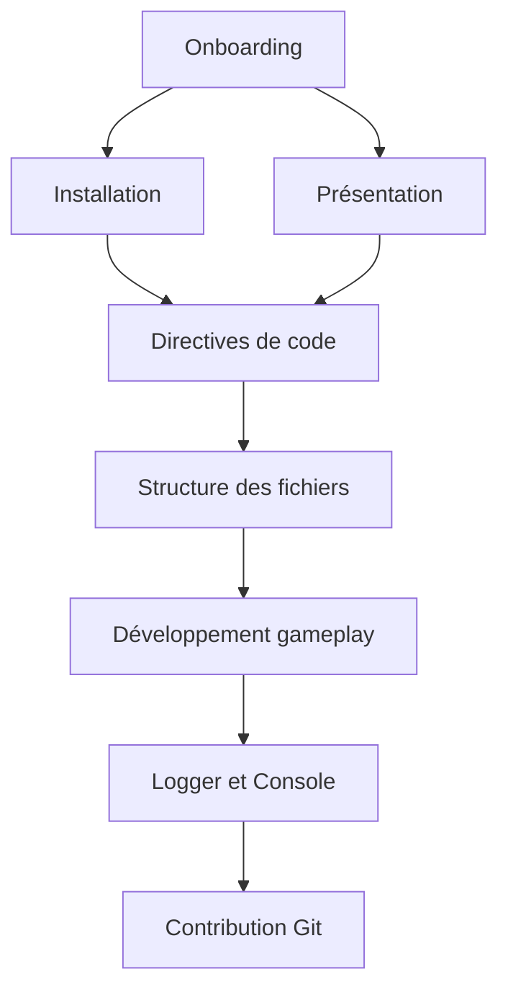

# Tableau de bord

Bienvenue dans la documentation de **CAT'ACLYSM**.
Cette page centralise les ressources essentielles pour démarrer vite, contribuer proprement et maintenir une base stable.

## Démarrage rapide

1. Lire la [Présentation](./introduction/overview.md)
2. Suivre le [Guide d'installation](./introduction/installation.md)
3. Vérifier les [Prérequis](./introduction/prerequisites.md)
4. Appliquer les [Directives de code](./development/guides/coding-guidelines.md)
5. Comprendre la [Structure des fichiers](./development/guides/file-structure.md)

## Vue d'ensemble rapide (graphe)

## Références essentielles

- [Workflow Git](./git-workflow.md)
- [Guidelines Git](./development/guides/git-guidelines.md)
- [Guide d'écriture](./writing-guidelines.md)
- [FAQ](./faq.md)
- [Liens utiles](./useful-links.md)

## Développement gameplay

- [Directives de code](./development/guides/coding-guidelines.md)
- [Structure des fichiers](./development/guides/file-structure.md)
- [Logger](./development/guides/logger.md)
- [Console debug](./development/guides/console.md)
- [Snippets](./development/guides/snippets.md)
- [Dialogic](./development/guides/dialogic-guide.md)

## Architecture et modèles

- [Comment lire/écrire un modèle](./development/models/how-to.md)
- [Enemy model](./development/models/enemy-model.md)
- [Tower model](./development/models/tower-model.md)
- [Projectile model](./development/models/projectile-model.md)
- [Level model](./development/models/level-model.md)
- [Singleton](./development/design-patterns/singleton.md)
- [Observer](./development/design-patterns/observer.md)
- [Factory](./development/design-patterns/factory.md)

## Setup et outils

- [Configuration Docusaurus](./setup/docusaurus-configuration.md)
- [Configuration IDE](./setup/ide-configuration.md)
- [Configuration Git](./setup/git-configuration.md)
- [Configuration Godot](./setup/godot-configuration.md)
- [Export du jeu](./setup/exporting.md)

## Besoin d'aide rapide

- Si un sujet manque: ajouter une page en suivant le [Guide d'écriture](./writing-guidelines.md).
- Si une convention est ambiguë: prioriser les [Directives de code](./development/guides/coding-guidelines.md).
- Si un comportement runtime est difficile à diagnostiquer: commencer par [Logger](./development/guides/logger.md) puis [Console debug](./development/guides/console.md).
