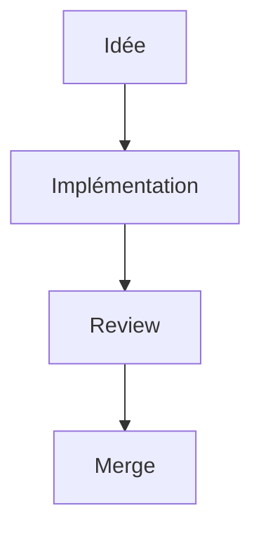

# Guide d'écriture de la documentation

## Prérequis

Voir [Configuration Docusaurus](./setup/docusaurus-configuration.md).

## Objectif de cette page

Ce guide explique comment rédiger des pages utiles, lisibles et faciles à maintenir dans le temps.
Une bonne documentation doit aider un dev à agir rapidement, pas seulement à "comprendre en théorie".

## Workflow

1. Mettre à jour votre branche: `git pull --rebase`
2. Modifier ou ajouter les pages nécessaires
3. Vérifier localement le rendu et les liens
4. Construire le site (`bun run build`)
5. Commit + push

```bash
git add .
git commit -m "..."
git push origin main
```

## Structure recommandée d'une page

Front matter minimal:

```md
---
title: Titre clair
sidebar_position: 10
description: Résumé en une phrase
---
```

Structure type:

1. Contexte / objectif
2. Étapes ou principes
3. Exemples concrets
4. Bonnes pratiques / pièges
5. Liens vers pages associées

## Style rédactionnel

- Écrire en français clair et direct.
- Préférer des phrases courtes.
- Donner des exemples exécutables/copier-coller quand possible.
- Expliquer le "pourquoi" quand une règle est importante.
- Éviter le jargon inutile.

## Ton et cohérence

- Style professionnel, concret, orienté action.
- Employer les mêmes termes d'une page à l'autre (`commande`, `autoload`, `build`, `scene`, etc.).
- Si une convention existe déjà, la citer au lieu d'inventer une variante.

## Code et exemples

- Toujours typer les snippets GDScript.
- Utiliser des exemples proches du code réel du repo.
- Montrer au moins un cas nominal et un cas d'erreur quand pertinent.

Exemple utile:

```gdscript
if not is_instance_valid(target):
	Log.trace(Log.Level.WARN, "Invalid target")
	return
```

## Liens internes

- Préférer les liens relatifs vers les pages du site.
- Vérifier que les ancres existent réellement.
- Éviter les liens vers des sections renommées non mises à jour.

## Diagrammes

Voir [draw.io](https://app.diagrams.net/).

Police recommandée dans les diagrammes: `IBM Plex Mono`.

## Graphes Mermaid (supportés)

La documentation supporte aussi les graphes Mermaid directement dans les pages Markdown.

Exemple:



Bonnes pratiques:

- Garder des graphes simples et lisibles
- Limiter le nombre de nœuds par graphe
- Préférer un graphe par concept

## Check-list avant merge

- Front matter complet
- Orthographe relue
- Exemples corrects et réalistes
- Liens internes valides
- Build Docusaurus vert
- Page liée depuis le [Dashboard](./dashboard.md) si elle est importante
