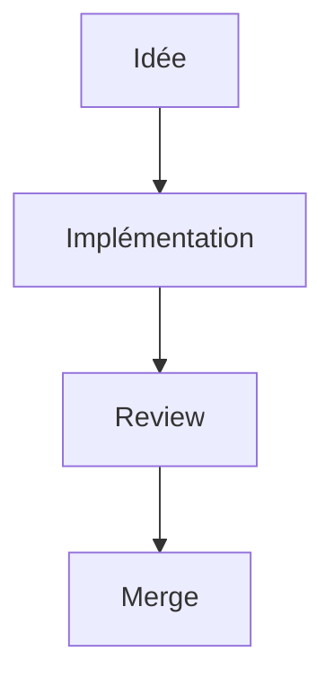

Prérequis et workflow (test, build, pull request): [Site de documentation (Starlight)](/documentation/contributing/starlight-configuration/).

## Front matter

```md
---
title: Titre clair
description: Résumé en une phrase qui ne répète pas le titre
sidebar:
  label: Libellé court
  order: 10
---
```

- Le titre devient le H1 de la page: ne pas le répéter dans le corps.
- `sidebar.label` raccourcit le libellé du menu, `sidebar.order` fixe la position dans le groupe.
- Chaque dossier de `src/content/docs/` est un groupe de la barre latérale déclaré dans `astro.config.ts`.

## Style

- Français, présent, phrases courtes. Décrire l'état actuel, pas l'historique.
- Mêmes termes d'une page à l'autre: tour, piège, vague, niveau, armurerie, défi, `autoload`, commande.
- Si une convention est déjà décrite ailleurs, mettre un lien au lieu de la répéter.
- Exemples proches du code réel du jeu, GDScript typé et indenté avec des tabulations.

## Liens internes

Liens absolus avec le préfixe de base, sans extension `.md` et avec un `/` final: `[Export](/documentation/setup/exporting/#exporter-pour-android)`. Seuls ces liens sont validés au build, qui échoue si un lien ou une ancre est cassé.

## Images

Placer les images dans `src/assets/`, les référencer avec un chemin relatif depuis la page et toujours renseigner un texte alternatif. Les diagrammes ne sont pas des images: ils s'écrivent en Mermaid.

## Encadrés

Starlight fournit `note`, `tip`, `caution` et `danger`:

```md
:::caution[Titre optionnel]
Contenu de l'encadré.
:::
```

## Diagrammes Mermaid

Tous les diagrammes sont des blocs de code `mermaid` dans les pages Markdown (`flowchart`, `classDiagram`, `sequenceDiagram`, `stateDiagram-v2`, voir la [documentation Mermaid](https://mermaid.js.org/intro/)). Ils suivent le thème clair ou sombre du site.



- Un diagramme simple par concept, avec peu de nœuds.
- Pas de couleurs: le thème s'en charge.
- Pour une classe, seulement les membres publics, les signaux et les relations majeures.

## Avant de fusionner

- Front matter complet, orthographe relue.
- `bun run build` vert.
- Page importante liée depuis le [tableau de bord](/documentation/dashboard/).
