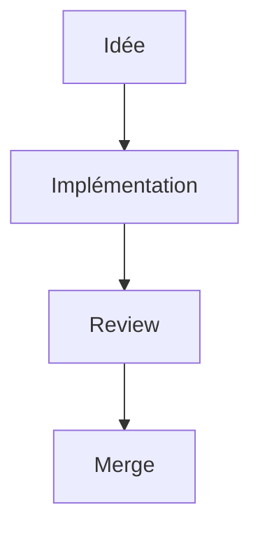

## Prérequis

Voir [Configuration Starlight](/documentation/setup/starlight-configuration/).

## Objectif de cette page

Ce guide explique comment rédiger des pages utiles, lisibles et faciles à maintenir dans le temps.
Une bonne documentation doit aider un dev à agir rapidement, pas seulement à "comprendre en théorie".

## Workflow

Le workflow complet (mise à jour, test, build, pull request) est décrit dans [Configuration Starlight](/documentation/setup/starlight-configuration/#workflow).

## Structure recommandée d'une page

Front matter minimal:

```md
---
title: Titre clair
description: Résumé en une phrase
sidebar:
  order: 10
---
```

Le titre du front matter devient le titre (H1) de la page: ne pas le répéter dans le corps du fichier.
L'ordre dans la barre latérale se règle avec `sidebar.order`, et le libellé avec `sidebar.label`.
Chaque dossier de `src/content/docs/` correspond à un groupe de la barre latérale déclaré dans `astro.config.ts`.

Structure type:

1. Contexte / objectif
2. Étapes ou principes
3. Exemples concrets
4. Bonnes pratiques / pièges
5. Liens vers pages associées

## Style rédactionnel

- Écrire en français clair et direct.
- Préférer des phrases courtes.
- Donner des exemples exécutables/copier-coller quand possible.
- Expliquer le "pourquoi" quand une règle est importante.
- Éviter le jargon inutile.

## Ton et cohérence

- Style professionnel, concret, orienté action.
- Employer les mêmes termes d'une page à l'autre (`commande`, `autoload`, `build`, `scene`, etc.).
- Si une convention existe déjà, la citer au lieu d'inventer une variante.

## Code et exemples

- Toujours typer les snippets GDScript.
- Indenter les snippets GDScript avec des tabulations, comme dans le code du jeu.
- Utiliser des exemples proches du code réel du repo.
- Montrer au moins un cas nominal et un cas d'erreur quand pertinent.

Exemple utile:

```gdscript
if not is_instance_valid(target):
	Log.trace(Log.Level.WARN, "Invalid target")
	return
```

## Liens internes

- Utiliser des liens absolus avec le préfixe de base, sans extension `.md` et avec un `/` final: `[Export](/documentation/setup/exporting/#exporter-pour-android)`. Seuls ces liens sont validés au build.
- Vérifier que les ancres existent réellement.
- Éviter les liens vers des sections renommées non mises à jour.
- Le build échoue si un lien interne ou une ancre est cassé.

## Images

- Placer les images dans `src/assets/` et les référencer avec un chemin relatif depuis la page.
- Placer les diagrammes draw.io (`.svg`) dans `public/models/` et les référencer avec le préfixe de base: `/documentation/models/nom.svg`. Astro ne sait pas lire leurs métadonnées.
- Toujours renseigner un texte alternatif.

## Encadrés

Starlight fournit les encadrés `note`, `tip`, `caution` et `danger`:

```md
:::caution[Titre optionnel]
Contenu de l'encadré.
:::
```

## Diagrammes

Voir [draw.io](https://app.diagrams.net/).

Police recommandée dans les diagrammes: `IBM Plex Mono`.

## Graphes Mermaid (supportés)

La documentation supporte aussi les graphes Mermaid directement dans les pages Markdown.

Exemple:



Bonnes pratiques:

- Garder des graphes simples et lisibles
- Limiter le nombre de nœuds par graphe
- Préférer un graphe par concept

## Check-list avant merge

- Front matter complet
- Orthographe relue
- Exemples corrects et réalistes
- Liens internes valides
- Build Starlight vert
- Page liée depuis le [Dashboard](/documentation/dashboard/) si elle est importante
