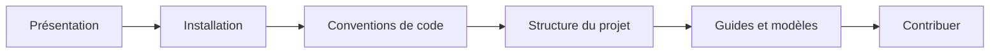

Documentation technique de **Cat'aclysm**, un tower defense développé avec Godot 4.4.

## Démarrer

1. [Présentation du jeu](/documentation/introduction/overview/)
2. [Installation](/documentation/introduction/installation/)
3. [Conventions de code](/documentation/development/guides/coding-guidelines/)
4. [Structure du projet](/documentation/development/guides/file-structure/)

## Sections

- **Mise en place**: [éditeur Godot](/documentation/setup/godot-configuration/), [éditeur externe](/documentation/setup/ide-configuration/), [snippets](/documentation/setup/snippets/), [test sur Android](/documentation/setup/android-testing/), [export](/documentation/setup/exporting/), [Firebase Test Lab](/documentation/setup/android-test-lab/), [intégration continue](/documentation/setup/ci/).
- **Guides**: [recettes pour ajouter du contenu](/documentation/development/guides/recipes/), [architecture](/documentation/development/guides/architecture/), [patterns Godot](/documentation/development/guides/godot-patterns/), [logs](/documentation/development/guides/logger/), [console](/documentation/development/guides/console/), [outils de debug](/documentation/development/guides/debugging/), [traductions](/documentation/development/guides/i18n/), [Dialogic](/documentation/development/guides/dialogic-guide/), [tutoriel](/documentation/development/guides/tutorial/), [construction](/documentation/development/guides/building-placement/), [créer un niveau](/documentation/development/guides/levels-and-arcs/), [audio](/documentation/development/guides/audio/), [interface](/documentation/development/guides/ui/), [caméra](/documentation/development/guides/camera/).
- **Modèles**: [comment documenter un modèle](/documentation/development/models/how-to/), puis un modèle par système (niveau, machine d'états, vague, ennemi, tour, projectile, piège, statistiques, défi, progression, armurerie).
- **Parcours joueur**: [hors niveau](/documentation/development/user-flows/off-game/) et [en niveau](/documentation/development/user-flows/in-game/).
- **Contribuer**: [branches Git](/documentation/contributing/git-workflow/), [conventions Git](/documentation/contributing/git-guidelines/), [rédaction](/documentation/contributing/writing-guidelines/), [site de documentation](/documentation/contributing/starlight-configuration/).
- **Ressources**: [FAQ](/documentation/faq/) et [liens utiles](/documentation/useful-links/).
