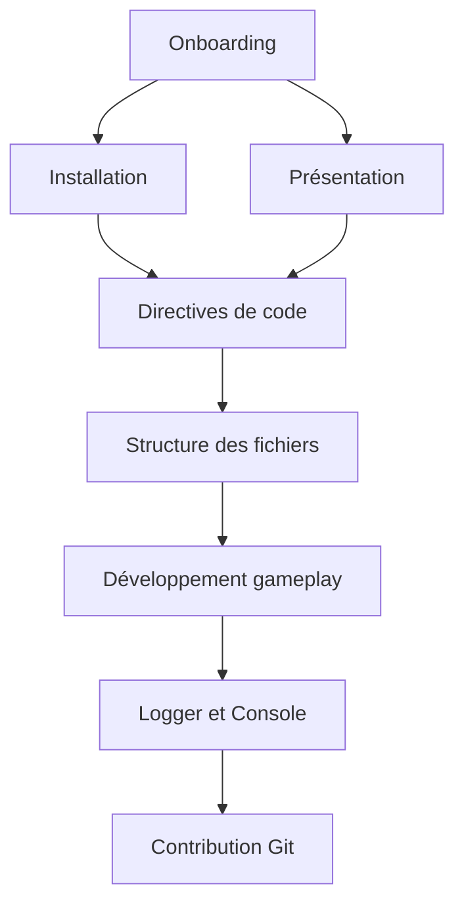

Bienvenue dans la documentation de **CAT'ACLYSM**.
Cette page centralise les ressources essentielles pour démarrer vite, contribuer proprement et maintenir une base stable.

## Démarrage rapide

1. Lire la [Présentation](/documentation/introduction/overview/)
2. Suivre le [Guide d'installation](/documentation/introduction/installation/)
3. Appliquer les [Directives de code](/documentation/development/guides/coding-guidelines/)
4. Comprendre la [Structure des fichiers](/documentation/development/guides/file-structure/)

## Vue d'ensemble rapide (graphe)

## Références essentielles

- [Workflow Git](/documentation/git-workflow/)
- [Guidelines Git](/documentation/development/guides/git-guidelines/)
- [Guide d'écriture](/documentation/writing-guidelines/)
- [FAQ](/documentation/faq/)
- [Liens utiles](/documentation/useful-links/)

## Développement gameplay

- [Directives de code](/documentation/development/guides/coding-guidelines/)
- [Structure des fichiers](/documentation/development/guides/file-structure/)
- [Logger](/documentation/development/guides/logger/)
- [Console debug](/documentation/development/guides/console/)
- [Snippets](/documentation/development/guides/snippets/)
- [Dialogic](/documentation/development/guides/dialogic-guide/)
- [Tutoriel](/documentation/development/guides/tutorial/)

## Architecture et modèles

- [Comment lire/écrire un modèle](/documentation/development/models/how-to/)
- [Enemy model](/documentation/development/models/enemy-model/)
- [Tower model](/documentation/development/models/tower-model/)
- [Projectile model](/documentation/development/models/projectile-model/)
- [Level model](/documentation/development/models/level-model/)
- [Stats model](/documentation/development/models/stats-model/)
- [Architecture et patterns](/documentation/development/guides/architecture/)

## Setup et outils

- [Configuration Starlight](/documentation/setup/starlight-configuration/)
- [Configuration IDE](/documentation/setup/ide-configuration/)
- [Configuration Godot](/documentation/setup/godot-configuration/)
- [Export du jeu](/documentation/setup/exporting/)

## Besoin d'aide rapide

- Si un sujet manque: ajouter une page en suivant le [Guide d'écriture](/documentation/writing-guidelines/).
- Si une convention est ambiguë: prioriser les [Directives de code](/documentation/development/guides/coding-guidelines/).
- Si un comportement runtime est difficile à diagnostiquer: commencer par [Logger](/documentation/development/guides/logger/) puis [Console debug](/documentation/development/guides/console/).
