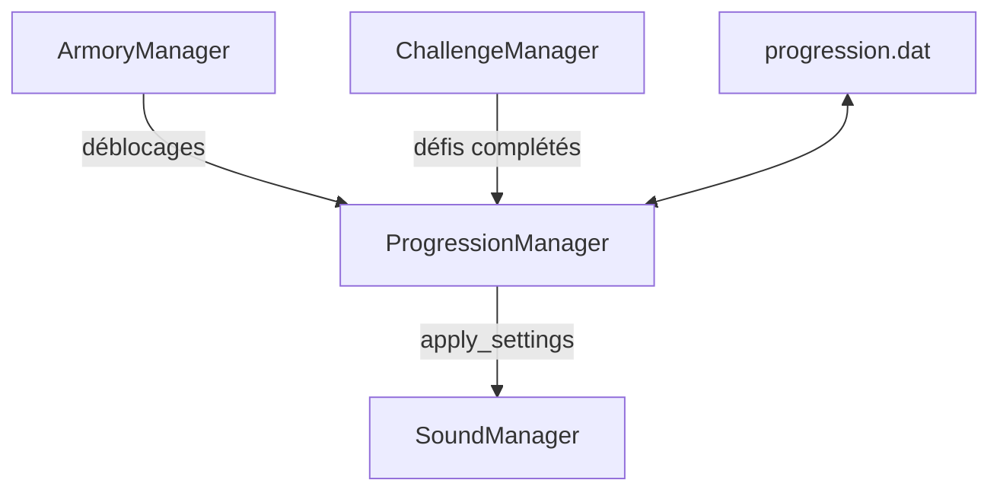

Le projet repose sur quatre mécanismes récurrents: les autoloads (singleton), la pause par source, les signaux (observer) et les factories. Les tests unitaires qui les couvrent sont décrits dans [Tests](/documentation/development/guides/testing/).

## Singleton

Les autoloads de `project.godot` sont accessibles partout par leur nom. L'ordre ci-dessous est l'ordre de chargement: `StatsDB` est chargé avant `ProgressionManager`, qui s'en sert dans son `_ready()` pour créer les valeurs par défaut des tours et des pièges.

| Autoload | Rôle |
|---|---|
| `Global` | Références vers la caméra, l'UI, le HUD, la console et le curseur, et pause par source ([Pause par source](#pause-par-source)) |
| `SoundManager` | Volumes et coupure par groupe, portés par les bus `Music`, `SFX` et `UI` ([Audio](/documentation/development/guides/audio/)) |
| `ScenesLoader` | Démarrage d'un niveau (`start_level(level_id)`), retour à l'accueil (`go_home()`) et scène du menu de fin de partie |
| `Dialogic` | Système de dialogues (addon) |
| `StatsDB` | Statistiques des tours, pièges, ennemis, projectiles, upgrades et modificateurs de case (voir [Stats](/documentation/development/models/stats-model/)) |
| `ProgressionManager` | Sauvegarde et progression du joueur ([Progression](/documentation/development/models/progression-model/)) |
| `ArmoryManager` | Armurerie et achats par étoiles ([Armurerie](/documentation/development/models/armory-model/)) |
| `ChallengeManager` | Suivi des défis du niveau en cours ([Défis](/documentation/development/models/challenge-model/)) |

`Log` n'est pas un autoload: c'est une classe avec des méthodes statiques (`Log.trace(Log.Level.INFO, "message")`), initialisée par `Global._ready()`. `SignalUtil`, `JsonUtil`, `Narrative` et `VfxUtil` sont aussi des classes statiques.

Le niveau en cours est accessible par la variable statique `ILevel.current_level`.

### ScenesLoader

`ScenesLoader` est le seul point d'entrée pour changer de niveau:

- `start_level(level_id: String) -> ILevel`: charge `scenes/gameplay/world/level/levels/<level_id>.tscn`, libère le niveau précédent, ajoute le nouveau à la racine, appelle `ILevel.start_level()` puis `Global.ui.start_level()`. Renvoie `null` si la scène n'existe pas. Toutes les pauses sont levées avant le changement.
- `go_home()`: libère le niveau en cours et recharge `res://scenes/main.tscn`. Toutes les pauses sont levées.

Le menu de sélection, le menu de pause, l'écran de fin et l'écran d'accueil passent par ces deux méthodes.

### Sources de données

Les gestionnaires remontent leurs résultats vers `ProgressionManager`, qui écrit la sauvegarde et applique les réglages:



| Source | Chargée par |
|---|---|
| `stats.json` | `StatsDB` ([Statistiques](/documentation/development/models/stats-model/)) |
| `armory.json` | `ArmoryManager` ([Armurerie](/documentation/development/models/armory-model/)) |
| `resources/challenges/cha.XXX.json` et clé `challenges` des JSON de niveaux | `ChallengeManager` |
| JSON de niveaux (clés `start_coins`, `max_health`, `waves`) | `ILevel` ([Vagues](/documentation/development/models/wave-model/)) |
| Sauvegarde | `ProgressionManager` |

Tous les JSON sont lus par `JsonUtil.load_dict(path)`, qui renvoie un dictionnaire vide et logue une erreur quand le fichier est absent ou invalide.

## Pause par source

Il n'existe pas de drapeau de pause global à écrire: chaque système qui veut arrêter le jeu demande une pause au nom d'une source (un `StringName`), et le jeu reprend quand toutes les sources ont libéré la leur.

| Membre de `Global` | Rôle |
|---|---|
| `request_pause(source: StringName)` | Demande une pause. Deux demandes de la même source comptent une fois |
| `release_pause(source: StringName)` | Libère la pause de la source |
| `clear_pauses()` | Oublie toutes les sources, appelée par `ScenesLoader` quand un niveau est remplacé ou quitté |
| `is_time_frozen() -> bool` | Vrai quand une source exige que `Engine.time_scale` passe à 0 |
| `paused: bool` | Lecture seule, vrai tant qu'au moins une source est active |
| signal `pause_changed(paused: bool)` | Émis à chaque demande ou libération, avec la valeur résultante de `paused` |

```gdscript
Global.request_pause(&"upgrade_menu")
# ...
Global.release_pause(&"upgrade_menu")
```

Deux constantes de `Global` décident de l'effet d'une source:

- `TREE_PAUSING_SOURCES` (`dialogue`, `new_enemy`, `pause_menu`, `tutorial`): la source met aussi l'arbre de scène en pause (`get_tree().paused`). `Global` tourne en `PROCESS_MODE_ALWAYS`.
- `TIME_RUNNING_SOURCES` (`dialogue`, `level_end`, `new_enemy`, `tutorial`): la source garde le `time_scale` du moteur actif, car elle joue ses propres animations. Dialogic arrête d'afficher le texte à un `time_scale` de 0, donc `dialogue` et `tutorial` en font partie.

Les autres sources gèlent le temps: `ILevel` met `Engine.time_scale` à 0 tant que l'une d'elles est active.

| Source | Posée par | Arbre en pause | Temps gelé |
|---|---|---|---|
| `pause_menu` | Bouton pause du HUD (`hud.gd`), levée par `pause.gd` | oui | oui |
| `new_enemy` | Révélation d'un nouvel ennemi (`hud.gd`) | oui | non |
| `level_end` | `ILevel._on_level_end()` | non | non |
| `tower_info` | `TowerInfo` | non | oui |
| `upgrade_menu` | `TowerUpgradeMenu` | non | oui |
| `dialogue` | `Narrative.play_once()` | oui | non |
| `tutorial` | `TutorialManager` | oui | non |

Les systèmes de gameplay (ennemis, tours, pièges, projectiles, caméra, curseur de construction) testent `Global.paused` dans leur `_process` ou `_physics_process`. Les effets différés testent aussi `Global.paused` à leur déclenchement, parce que la pause de fin de niveau (`level_end`) n'arrête pas l'arbre de scène: les pièges, les faisceaux de l'Inferno et les rebonds de la foudre n'infligent rien pendant une pause. `ILevel` applique le gel du temps et l'état `PAUSE` de sa machine à états ([Niveau et carte](/documentation/development/models/level-model/#pause)). Un système qui a ses propres `Timer` s'abonne à `pause_changed` pour les suspendre (c'est le cas de Big Daddy, voir [Ennemi](/documentation/development/models/enemy-model/#big-daddy)).

## Observer

Les composants communiquent par signaux Godot, connectés avec `SignalUtil.connects` (`scripts/utilities/signals/signal_util.gd`). Aucun code du projet n'appelle `.connect()` directement:

```gdscript
SignalUtil.connects([
	{SignalUtil.WHO: enemy, SignalUtil.WHAT: "died", SignalUtil.TO: _on_enemy_removed},
])
```

`SignalUtil.connects(signals: Array[Dictionary])` est statique. Chaque dictionnaire doit contenir les trois clés `WHO` (l'émetteur), `WHAT` (le nom du signal) et `TO` (le callback), sinon un `assert` échoue. Un émetteur `null` est loggué en `ERROR` et ignoré.

Exemples de signaux:

- `IEnemy`: `died`, `escaped`
- `ITower`: aucun signal propre, ses connexions (zone de portée, zone de survol, bouton) sont dans `ITower.signals`, passées à `SignalUtil.connects` dans `_ready()` ([Tour](/documentation/development/models/tower-model/#signaux))
- `ILevel`: `stats_updated`, `wave_started(wave_number: int)`
- `Global`: `pause_changed(paused: bool)`
- `ChallengeManager`: `challenge_status_updated(challenge_id, is_completed, is_failed)`, `challenges_loaded`
- `BuildPlacement`: `building_placed(building)`

## Factory

- `WaveStep.build(data)` retourne un `WaveStepSpawn` ou un `WaveStepWait` selon les clés du JSON du niveau.
- `StatsDB.get_enemy_scene(id)` charge à la demande la scène d'un ennemi à partir de sa clé de `stats.json` et la met en cache.
- `ILevel.spawn_enemy(path, enemy)` met un ennemi sur un chemin et le compte vivant ([Niveau et carte](/documentation/development/models/level-model/#apparition-des-ennemis)).

`WaveStep` (`exec()` et `is_over()`) et `IBuilding` (`get_building_kind()`) sont des classes `@abstract`: seules leurs sous-classes s'instancient. `StateMachine` est une seule classe `RefCounted` que `ILevel` remplit avec `add_state` et `allow`, sans builder ([Machine d'états](/documentation/development/models/state-machine/)).
