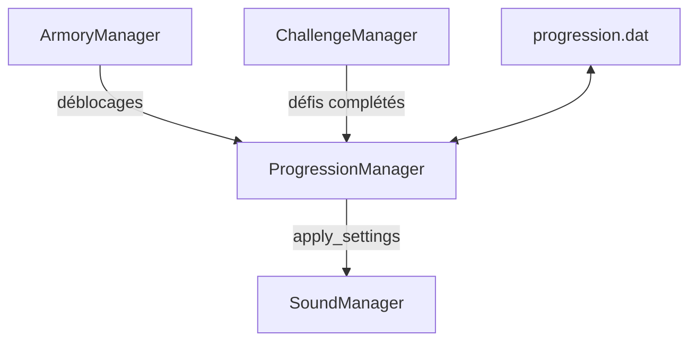

Le projet repose sur trois patterns récurrents: les autoloads (singleton), les signaux (observer) et les factories.

## Singleton

Les autoloads de `project.godot` sont accessibles partout par leur nom:

| Autoload | Rôle |
|---|---|
| `Global` | Références vers la caméra, l'UI, le HUD, la console et le curseur |
| `SoundManager` | Volumes par groupe ([Audio](/documentation/development/guides/audio/)) |
| `ScenesLoader` | Scènes préchargées (menu de fin de partie, ennemis, tours) et cache `enemies_scene` |
| `Dialogic` | Système de dialogues (addon) |
| `ProgressionManager` | Sauvegarde et progression du joueur |
| `StatsDB` | Statistiques des tours, pièges et ennemis (voir [Stats](/documentation/development/models/stats-model/)) |
| `ChallengeManager` | Suivi des challenges |
| `ArmoryManager` | Armurerie et achats par étoiles |
| `FirebaseTestLab` | Intégration Firebase Test Lab ([Firebase Test Lab](/documentation/setup/android-test-lab/)) |

Le niveau en cours est accessible par la variable statique `ILevel.current_level`.

### Sources de données

Les gestionnaires remontent leurs résultats vers `ProgressionManager`, qui écrit la sauvegarde et applique les réglages:



| Source | Chargée par |
|---|---|
| `stats.json` | `StatsDB` ([Statistiques](/documentation/development/models/stats-model/)) |
| `armory.json` | `ArmoryManager` ([Armurerie](/documentation/development/models/armory-model/)) |
| JSON de défis et de niveaux (clé `challenges`) | `ChallengeManager` |
| JSON de niveaux (clé `waves`) | `ILevel` ([Vagues](/documentation/development/models/wave-model/)) |
| Sauvegarde | `ProgressionManager` ([Progression](/documentation/development/models/progression-model/)) |

## Observer

Les composants communiquent par signaux Godot, connectés avec `SignalUtil.connects` (`scripts/utilities/signals/signal_util.gd`):

```gdscript
SignalUtil.connects([
	{SignalUtil.WHO: enemy, SignalUtil.WHAT: "die", SignalUtil.TO: _on_enemy_die},
])
```

`SignalUtil.connects(signals: Array[Dictionary])` est statique. Chaque dictionnaire doit contenir les trois clés `WHO` (l'émetteur), `WHAT` (le nom du signal) et `TO` (le callback), sinon un `assert` échoue.

Exemples de signaux:

- `IEnemy`: `die`, `camera_effect(effect: String)`
- `ILevel`: `stats_updated`, `wave_started(wave_number: int)`
- `ChallengeManager`: `challenge_status_updated(challenge_id, is_completed, is_failed)`

## Factory

- `WaveStep.build(data)` retourne un `WaveStepSpawn` ou un `WaveStepWait` selon les clés du JSON du niveau.
- `StateFactory.create(state_id, callback)` et `TransitionFactory.create(from, to, callback)` produisent les états et transitions d'une `StateMachine`.
- `StateMachineBuilder` assemble une `StateMachine` complète avec `build_state`, `build_initial_state` et `build_transition`.
