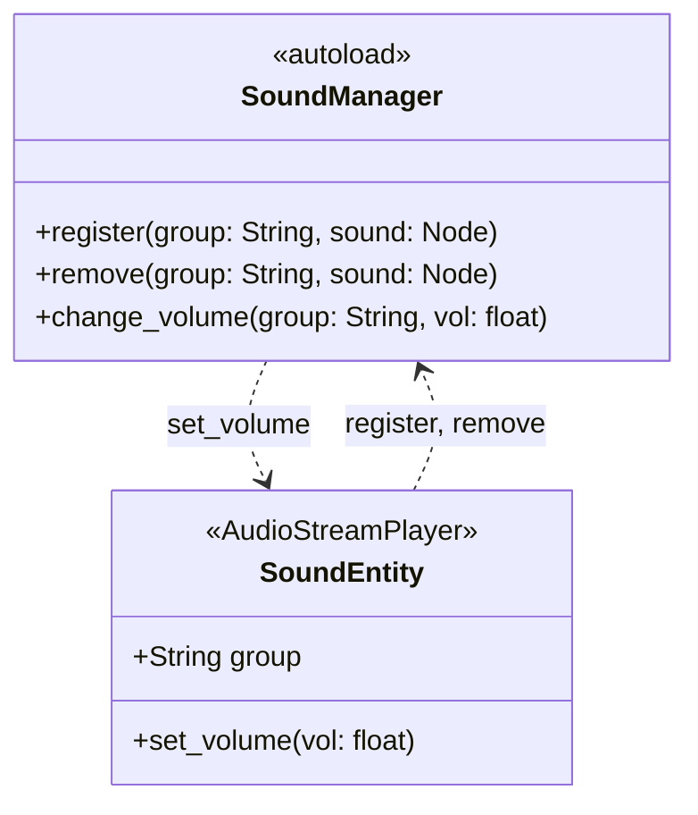

Le son passe par l'autoload `SoundManager` et le nœud `SoundEntity`. `SoundManager` range les lecteurs par groupe et applique un volume à tout un groupe.

## SoundEntity

`SoundEntity` (`scenes/utilities/sound_entity/sound_entity.tscn`) est un `AudioStreamPlayer`. Son export `group` vaut `sfx`, `music` ou `gui`. Il s'enregistre dans `_ready()` et se retire dans `_exit_tree()`. `set_volume(vol)` règle `volume_db`.

`SoundManager.register()` ne réapplique pas le volume courant du groupe: un `SoundEntity` ajouté à l'arbre après un `change_volume` garde son `volume_db`.

## Réglages du joueur

`SettingsData.music_enabled` et `sound_enabled` ([Progression et sauvegarde](/documentation/development/models/progression-model/)) sont appliqués par `ProgressionManager.apply_settings()`:

| Réglage | Groupe | Désactivé | Activé |
|---|---|---|---|
| `music_enabled` | `music` | `-80` dB | `0` dB |
| `sound_enabled` | `sfx` | `-80` dB | `0` dB |

Le groupe `gui` n'est pas touché. `apply_settings()` s'exécute au chargement de la sauvegarde, à sa réinitialisation et à chaque bascule du menu options.

## Dans le projet

- `ILevel` contient un nœud `BackgroundMusic` (un `SoundEntity` du groupe `music`) dont le flux est `assets/audio/music/background.mp3`. Il démarre dans `start_level()` et s'arrête à la fin du niveau.
- Aucun autre `SoundEntity` n'est utilisé. `assets/audio/music/Les_Ombres_de_la_Nuit.mp3` et `assets/audio/sounds/Huh Sound Effect.mp3` ne sont référencés par aucun script ni scène.
- Les canaux audio de Dialogic ont leurs propres réglages dans `project.godot` (canal `music` en boucle, bus par défaut): ils ne passent pas par `SoundManager`.

## Ajouter un son

1. Placer le fichier dans `assets/audio/music/` ou `assets/audio/sounds/` (nom en `snake_case`).
2. Ajouter un `SoundEntity` à la scène, choisir son `group` et son flux.
3. Appeler `play()` et `stop()` depuis le script de la scène.
