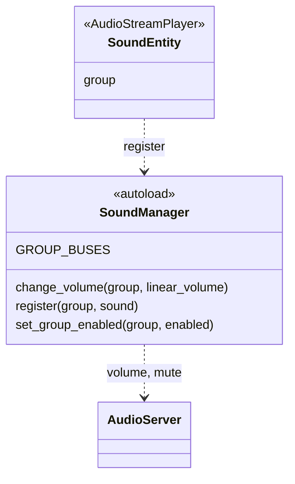

Le son passe par l'autoload `SoundManager`, le nœud `SoundEntity` et trois bus audio. Le volume et le mode muet vivent sur les bus: ils s'appliquent à tous les sons, y compris ceux créés après le réglage.



## Bus audio

`default_bus_layout.tres` (à la racine du projet, chargé par Godot comme disposition par défaut) déclare trois bus qui envoient tous vers `Master`:

| Bus | Groupe de `SoundEntity` | Réglage du joueur |
|---|---|---|
| `Music` | `music` | `music_enabled` |
| `SFX` | `sfx` | `sound_enabled` |
| `UI` | `gui` | `sound_enabled` |

`SoundManager.GROUP_BUSES` associe chaque groupe à son bus (`"gui"` vers `&"UI"`, `"music"` vers `&"Music"`, `"sfx"` vers `&"SFX"`).

| Classe | Membre | Rôle |
|---|---|---|
| `SoundManager` | `register(group, sound)` | affecte `sound.bus` au bus du groupe, avec un avertissement si le groupe est inconnu |
| `SoundManager` | `change_volume(group, linear_volume)` | règle le volume du bus du groupe, de `0.0` (silence) à `1.0` (pleine échelle), converti en dB par `linear_to_db` |
| `SoundManager` | `set_group_enabled(group, enabled)` | coupe ou rétablit le bus du groupe (`AudioServer.set_bus_mute`) |
| `SoundEntity` | `group` | export `sfx`, `music` ou `gui` |

Un groupe sans bus (nom inconnu ou bus absent de la disposition) écrit un avertissement dans le journal et n'a aucun effet.

## SoundEntity

`SoundEntity` (`scenes/utilities/sound_entity/sound_entity.tscn`) est un `AudioStreamPlayer`. Son export `group` vaut `sfx`, `music` ou `gui`. Il appelle `SoundManager.register()` dans `_ready()` pour être routé vers le bon bus. Le volume propre du nœud (`volume_db`) reste libre: il s'ajoute à celui du bus.

## Réglages du joueur

`SettingsData.music_enabled` et `sound_enabled` ([Progression et sauvegarde](/documentation/development/models/progression-model/)) sont appliqués par `ProgressionManager.apply_settings()`:

```gdscript
SoundManager.set_group_enabled("music", data.parameters.music_enabled)
SoundManager.set_group_enabled("sfx", data.parameters.sound_enabled)
SoundManager.set_group_enabled("gui", data.parameters.sound_enabled)
```

`apply_settings()` s'exécute au chargement de la sauvegarde, à sa réinitialisation et à chaque bascule des boutons musique et son du menu options. Les boutons musique et son du menu pause n'ont pas d'action.

## Fichiers audio

`assets/audio/` contient uniquement de la musique (`assets/audio/music/`):

| Fichier | Utilisation |
|---|---|
| `background.mp3` | Musique de fond des niveaux (`ILevel`) |
| `les_ombres_de_la_nuit.mp3` | Aucun script ni aucune scène ne le référence |

`ILevel` contient un nœud `BackgroundMusic` (un `SoundEntity` du groupe `music`) dont le flux est `BACKGROUND_MUSIC_STREAM` (`background.mp3`). Il démarre dans `start_level()` et s'arrête à la fin du niveau. Aucun autre `SoundEntity` n'est utilisé: le jeu n'a pas d'effet sonore.

Les canaux audio de Dialogic ont leurs propres réglages dans `project.godot` (canal `music` en boucle, `audio_bus` vide): ils ne passent pas par `SoundManager` et ne suivent donc pas les réglages du joueur.

## Ajouter un son

1. Placer le fichier dans `assets/audio/music/` ou `assets/audio/sounds/` (nom en `snake_case`).
2. Ajouter un `SoundEntity` à la scène, choisir son `group` et son flux.
3. Appeler `play()` et `stop()` depuis le script de la scène.

Le volume et le mode muet du groupe s'appliquent sans autre code.
