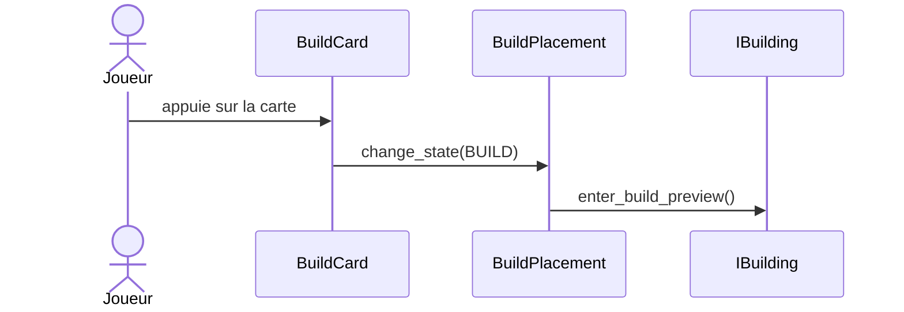
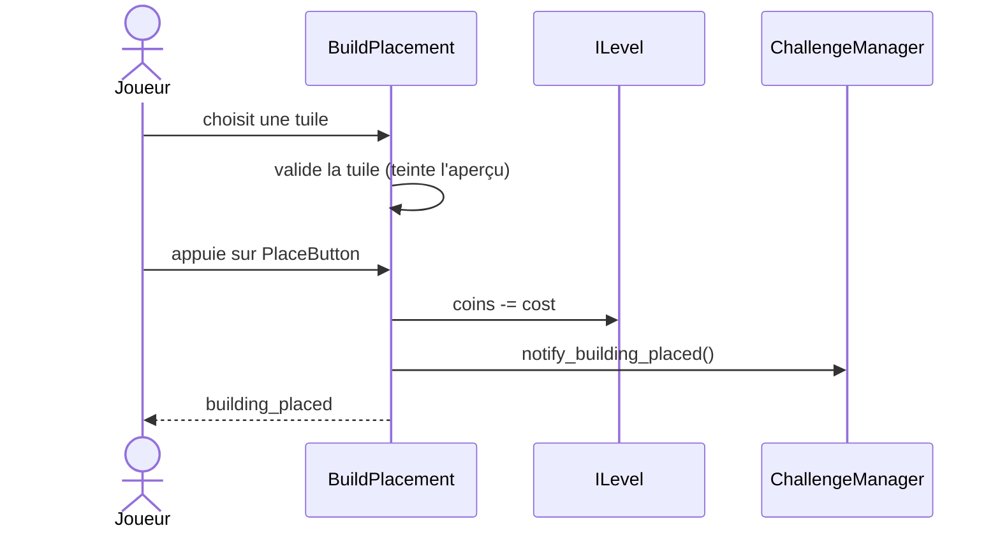

import {Icon} from '@astrojs/starlight/components';

Le joueur construit des bâtiments (`IBuilding`: tours et pièges) depuis le menu de construction. `BuildPlacement` affiche un aperçu, valide la tuile et pose le bâtiment. Les modèles [Tour](/documentation/development/models/tower-model/) et [Piège](/documentation/development/models/trap-model/) décrivent les bâtiments eux-mêmes.

Puis le joueur choisit une tuile et valide:

## BuildPlacement

`BuildPlacement` (`game/buildings/placement/`) s'enregistre dans `Global.cursor` à son `_ready()`. Il ignore les entrées pendant une pause (`Global.paused`). Son énumération `CursorState` a deux valeurs:

| État | Signal émis à l'entrée | Usage |
|---|---|---|
| `IDLE` | aucun | Repos, curseur masqué, boutons des tours actifs |
| `BUILD` | `trigger_state_build` | Aperçu d'un bâtiment, boutons des tours désactivés |

- `change_state(new_state, args)`: passer en `BUILD` exige `args = [bâtiment]` et un état courant `IDLE` (sinon un `WARN` est loggé). Un nouvel appel en `BUILD` remplace l'aperçu.
- `add_invalid_cell(tm_pos)` et `remove_invalid_cell(tm_pos)`: marquent une tuile occupée ou libre.
- `building_placed(building: IBuilding)`: signal émis après chaque pose.
- `tm_ref: TileMapLayer`: le calque racine de la carte, qui sert aux conversions cellule/position.
- Au démarrage de l'aperçu, le curseur se place sur la tuile valide la plus proche du centre de l'écran.
- Sur ordinateur, un clic gauche déplace le curseur et un clic droit annule. Sur mobile, un toucher déplace le curseur. Un glisser ne le déplace pas.

`BuildPlacement` est le nœud `Controller` de `i_map.tscn`, donc chaque carte en contient un. `IMap` lui donne sa `TileMapLayer` racine (`tm_ref`) à son `_ready()`.

## IBuilding

| Membre | Rôle |
|---|---|
| `cost: int` | Coût d'achat, rempli depuis `StatsDB` (`base.cost`) pour les tours et les pièges |
| `enum BuildingKind { TOWER, TRAP }` | Type de bâtiment |
| `@abstract func get_building_kind() -> BuildingKind` | Abstraite, implémentée par `ITower` et `ITrap` (`IBuilding` est une classe `@abstract`) |
| `enter_build_preview()` | Appelé quand l'aperçu démarre |
| `cancel_build_preview()` | Appelé quand l'aperçu est annulé |
| `get_placement_vertical_offset()` | Décalage vertical entre l'ancre de la tuile et le nœud pendant l'aperçu (0 par défaut) |

Une tour ou un piège à l'état `ACTIVE` s'enregistre aussi auprès du curseur dans son `_ready()` (`add_invalid_cell`). Il libère sa tuile quand la tour est vendue ou que le piège quitte la scène.

## Règles de validation

L'aperçu est teinté (`COLOR_OK` ou `COLOR_KO`) et le bouton de validation se désactive tant que la tuile est refusée. La validation est refaite à chaque changement de pièces (`stats_updated`).

| Règle | Tour | Piège |
|---|---|---|
| Pièces du niveau >= `cost` | <Icon name="approve-check" class="inline-icon" /> oui | <Icon name="approve-check" class="inline-icon" /> oui |
| Tuile libre (pas dans les cellules invalides) | <Icon name="approve-check" class="inline-icon" /> oui | <Icon name="approve-check" class="inline-icon" /> oui |
| Cellule peinte dans `IMap.placement_tilemap` | <Icon name="approve-check" class="inline-icon" /> oui | <Icon name="close" class="inline-icon" /> non |
| Cellule hors de `IMap.get_blocked_cells()` (décorations) | <Icon name="approve-check" class="inline-icon" /> oui | non vérifié |
| À moins de 12,5 px d'un chemin (`IMap.is_cell_on_path`) | refusé | requis |

## Tuiles de placement

Les cartes sont faites de `TileMapLayer` (`TileMapPlains`, `TileMapProps`, `TileMapPlacement`, `TileMapDebug`). Chaque carte (`IMap`) porte un calque invisible, `placement_tilemap`, peint par le level designer: seules les cellules peintes acceptent une tour. `IMap.is_tile_buildable(coords)` ajoute l'exclusion des cellules bloquées par une décoration et des tuiles trop proches d'un chemin. `BuildPlacement` applique les mêmes règles.

La commande `debug_tower_placement` affiche cette surcouche ([Outils de debug](/documentation/development/guides/debugging/)).

### Bloqueurs de placement

`MapPlacementBlocker` (un `Sprite2D` placé sur une décoration de la carte) bloque les cellules qu'elle recouvre. `IMap.get_blocked_cells()` collecte les cellules de tous les `MapPlacementBlocker` de la carte une seule fois (`MapPlacementBlocker.get_blocked_cells(tilemap)`, les décorations ne bougent pas) et `is_tile_buildable()` ainsi que la validation de `BuildPlacement` les refusent. Exports d'un bloqueur:

| Export | Rôle |
|---|---|
| `use_sprite_bounds` | Bloque toute cellule dont le centre est dans le rectangle du sprite (taille de la texture autour de l'origine du nœud, l'échelle est ignorée) |
| `bounds_inset_px` | Réduit ce rectangle de chaque côté (0 à 64 px, 12 par défaut) pour autoriser le placement plus près des bords |
| `blocked_tile_offsets` | Cellules supplémentaires, en décalage depuis la cellule d'ancrage du sprite |

### Tuiles spéciales

`SpecialTile` (`special_tile.gd`) est la classe abstraite (`@abstract`) des tuiles qui modifient les tours posées dessus. `BonusTile` et `MalusTile` en héritent et implémentent `_apply_configuration()`, `_get_particles()` et `_setup_layers()` (teinte du sol et des particules). La teinte d'une case est lue dans le modificateur que `IMap` a généré pour sa cellule.

`IMap` génère des tuiles bonus et malus au chargement de la carte, dans `special_tiles` (position vers dictionnaire de modificateurs: la stat et son multiplicateur, plus `color`, `label` traduit `TILE.<BONUS|MALUS>.<STAT>` et `is_malus`). Les cases sont posées sur un calque `TileMapLayer` créé à l'exécution (`Special Bonus`):

- Le nombre visé de tuiles bonus est `special_tile_percentage` (2 % par défaut) des tuiles constructibles, avec un minimum de 1 quand le pourcentage n'est pas nul.
- Les tuiles bonus sont à 2 tuiles au plus d'un chemin et à au moins 2 tuiles les unes des autres. Les tuiles à moins de 2 tuiles de l'indice de placement du tutoriel sont exclues.
- Si les tuiles éligibles ou l'espacement ne suffisent pas pour atteindre ce nombre, la génération s'arrête avec un log `WARN` et la carte n'a aucune tuile spéciale.
- Les modificateurs viennent de la section `tile_modifiers` de `stats.json` (`StatsDB.get_tile_modifiers("bonus")` et `("malus")`) et sont attribués dans l'ordre déclaré, en boucle. Aujourd'hui, les bonus alternent entre `fire_rate x1.3`, `damage x1.3` et `reward_multiplier x1.5`.
- Les tuiles malus sont les cases voisines d'une tuile bonus parmi les cases éligibles. Elles alternent entre `fire_rate x0.7`, `damage x0.7` et `shoot_range x0.7`.

Les tuiles apparaissent avec une animation (`play_special_tiles_intro_sequence()`). Un bâtiment qui supporte un modificateur (`ITower.apply_special_modifier(modifiers)`) le reçoit à l'aperçu puis à la pose, et la tour recalcule ses stats depuis ses upgrades ([Tour](/documentation/development/models/tower-model/#calcul-des-stats)).

## Menu de construction

Le bouton du HUD instancie `BuildSelection` (`ui/menus/build_selection/`) sous `Global.ui`. Il contient une `BuildCard` par bâtiment et deux onglets, `Tab.TOWERS` et `Tab.TRAPS`. Les cartes sont créées au `_ready()` par `_build_cards()`, à partir de la liste `BuildSelection.CARD_IDS` qui fixe leur ordre (la tour `bat_09` précède `bat_08`, ce que l'ordre de `StatsDB` ne donnerait pas). La scène de chaque bâtiment vient du champ `scene` de `StatsDB` (tour ou piège); un id sans scène est ignoré avec un avertissement. Chaque carte est posée dans un `AspectRatioContainer` nommé `<Id>AspectRatioContainer` (par exemple `Bat01AspectRatioContainer`).

`BuildCard` (`build_card.tscn`) est l'unique scène de carte. Elle a un export `entity: PackedScene` (la scène de la tour ou du piège), posé avant son ajout à l'arbre. À son `_ready()`, elle l'instancie, applique les stats de `StatsDB` et, pour une tour, les bonus de l'armurerie. Elle lit ensuite le coût sur l'instance. Le titre vient de `StatsDB.name_key`, l'icône (texture et teinte) du sprite de l'instance par `SpritePreview.from_node`, et le cadre est `card_frame.png` recoloré par la palette `GREEN` ([Interface](/documentation/development/guides/ui/)).

- Un bâtiment non débloqué ([Armurerie](/documentation/development/models/armory-model/)) affiche `BUILD.CARD.LOCKED` à la place du prix et la carte est inactive.
- Une carte trop chère est assombrie et son prix passe en rouge.
- `BuildSelection` rafraîchit les cartes à chaque `stats_updated`.

Pour ajouter un bâtiment, voir [Recettes](/documentation/development/guides/recipes/).

## Améliorer et vendre

Un appui sur une tour active (hors pause) ouvre `RadialTowerUpgradeMenu` avec quatre boutons: vendre, améliorer, infos et fermer.

- **Vendre**: `ITower.sell_tower()` rend `sell_price` en pièces et libère la tuile. `sell_price` vaut la moitié du coût, plus la moitié du prix de chaque upgrade achetée.
- **Améliorer**: ouvre `TowerUpgradeMenu`, qui met le jeu en pause avec la source `upgrade_menu` (le temps est gelé, [Pause par source](/documentation/development/guides/architecture/#pause-par-source)). Il liste une ou deux options d'upgrade (deux onglets), les changements de stats en `StatBar` et le prix. `tower.start_upgrade(upgrade_id)` débite les pièces et passe la tour en `UPGRADING`; `apply_upgrade()` applique ensuite les changements.
- **Infos**: ouvre `TowerInfo` avec les stats de la tour, avec la source de pause `tower_info`.

Quand `available_upgrade_ids` est vide, le bouton d'amélioration est grisé et affiche `TOWER.UPGRADE.MAX`. Les upgrades viennent de `stats.json` ([Statistiques](/documentation/development/models/stats-model/)).

## Défis

La pose appelle `ChallengeManager.notify_building_placed(building)`, qui redirige vers `notify_tower_placed` ou `notify_trap_placed` selon `get_building_kind()` ([Défis](/documentation/development/models/challenge-model/)).
