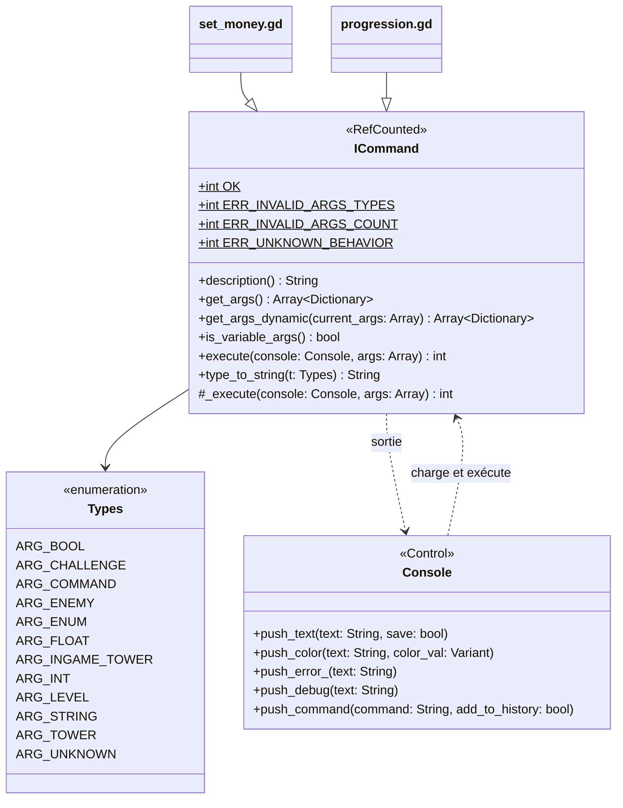

Une commande de la [console de debug](/documentation/development/guides/console/) est un script qui étend `ICommand`.

## Emplacement des scripts

- Interface de base: `res://scenes/utilities/console/icommand.gd`
- Implémentations: `res://scripts/commands/`

Le nom du fichier est le token de commande tapé en jeu : `set_money.gd` expose la commande `set_money`. La console charge le script et crée une nouvelle instance à chaque exécution.

## Diagramme de classes



## Contrat minimal

Chaque commande:

1. `extends ICommand`
2. Surcharge `description() -> String`
3. Surcharge `get_args() -> Array[Dictionary]` si elle prend des arguments
4. Surcharge `_execute(console: Console, args: Array) -> int`

`execute()` n'est pas à surcharger : il valide les arguments puis appelle `_execute()`.

## Exemple

Extrait réel de `scripts/commands/set_money.gd`:

```gdscript
## © [2024] A7 Studio. All rights reserved. Trademark.
extends ICommand


# Public functions
func description() -> String:
	return "Sets the current amount of coins available to the player."


func get_args() -> Array[Dictionary]:
	return [{"name": "amount", "type": Types.ARG_INT}]


# Private functions
func _execute(console: Console, args: Array) -> int:
	if not ILevel.current_level:
		console.push_error_("You must be in a level to use this command.")
		return ERR_UNKNOWN_BEHAVIOR

	var amount: int = int(args[0])
	if amount < 0:
		console.push_error_("Money amount cannot be negative.")
		return ERR_UNKNOWN_BEHAVIOR

	ILevel.current_level.coins = amount
	console.push_text("Set coins to: %d" % amount)

	return OK
```

Les pièces appartiennent au niveau en cours: une commande qui y touche vérifie `ILevel.current_level` avant.

## Schéma d'arguments

`get_args()` renvoie une liste de dictionnaires:

```gdscript
[
	{
		"name": "arg_name",
		"type": ICommand.Types.ARG_STRING,
		"optional": false
	}
]
```

Clés d'un argument:

- `name`: nom affiché dans la signature
- `type`: valeur de `ICommand.Types`
- `optional`: `false` par défaut
- `enum_values`: pour `ARG_ENUM`, valeurs acceptées

### Types d'arguments

| Type | Validation à l'exécution | Suggestions de la console |
| --- | --- | --- |
| `ARG_INT` | entier valide | aucune |
| `ARG_FLOAT` | nombre valide | aucune |
| `ARG_BOOL` | `true` ou `false` | aucune |
| `ARG_STRING` | toute chaîne | aucune |
| `ARG_ENUM` | une valeur de `enum_values` (toute chaîne si la liste est vide) | les valeurs de `enum_values` |
| `ARG_COMMAND` | toute chaîne | les commandes disponibles |
| `ARG_LEVEL` | toute chaîne | les niveaux de `resources/levels/` |
| `ARG_CHALLENGE` | toute chaîne | les défis de `resources/challenges/` |
| `ARG_ENEMY` | toute chaîne | les ennemis de `StatsDB` |
| `ARG_TOWER` | toute chaîne | les tours de `StatsDB` |
| `ARG_INGAME_TOWER` | toute chaîne | les tours posées sur la carte du niveau en cours |
| `ARG_UNKNOWN` | toujours invalide | aucune |

`ARG_UNKNOWN` est la valeur par défaut d'un argument sans `type` : ne pas l'utiliser dans une commande.

## Validation

`execute()` valide les arguments à partir de `get_args_dynamic(args)`:

- si la définition n'est pas vide, le nombre d'arguments doit être compris entre le nombre d'arguments obligatoires et le nombre d'arguments définis, sinon `ERR_INVALID_ARGS_COUNT`;
- chaque argument est validé selon son type, sinon `ERR_INVALID_ARGS_TYPES`;
- si la définition est vide, aucune validation n'a lieu.

`is_variable_args()` renvoie `false` par défaut. Sa documentation annonce que la validation du nombre d'arguments est ignorée quand elle renvoie `true`, mais `execute()` ne la lit pas.

## Arguments dynamiques (sous-commandes)

Quand les arguments dépendent des précédents (`progression unlock tower ...`), surcharger `get_args_dynamic(current_args: Array) -> Array[Dictionary]`. Par défaut, elle renvoie `get_args()`.
Extrait de `scripts/commands/progression.gd`:

```gdscript
func get_args_dynamic(current_args: Array) -> Array[Dictionary]:
	var action_arg := {"name": "action", "type": Types.ARG_ENUM, "enum_values": ["armory", "challenge", "reset", "show", "unlock"]}

	if current_args.is_empty():
		return [action_arg]

	var args: Array[Dictionary] = [action_arg]
	var subcommand: String = current_args[0]

	match subcommand:
		# ... branches "armory" et "unlock"
		"challenge":
			args.append({"name": "level_id", "type": Types.ARG_LEVEL})
			args.append({"name": "challenge_id", "type": Types.ARG_CHALLENGE})

	return args
```

## Codes de retour

- `OK` (`0`) en succès.
- `ERR_INVALID_ARGS_TYPES` (`-1`) et `ERR_INVALID_ARGS_COUNT` (`-2`): renvoyés par `execute()` quand la validation échoue.
- `ERR_UNKNOWN_BEHAVIOR` (`-3`): échec métier signalé par la commande.

Quand le code n'est pas `OK`, la console affiche seulement le code numérique en rouge. Une commande qui échoue écrit donc aussi un message avec `console.push_error_(...)`.

## Sortie console

- `console.push_text(text)`: texte simple.
- `console.push_color(text, color)`: texte coloré.
- `console.push_error_(text)`: message d'erreur en rouge (le nom finit par `_`).
- `console.push_debug(text)`: message de debug en vert.

## Liens liés

- [Console de debug](/documentation/development/guides/console/)
- [Conventions de code](/documentation/development/guides/coding-guidelines/)
- [Snippets](/documentation/setup/snippets/)
