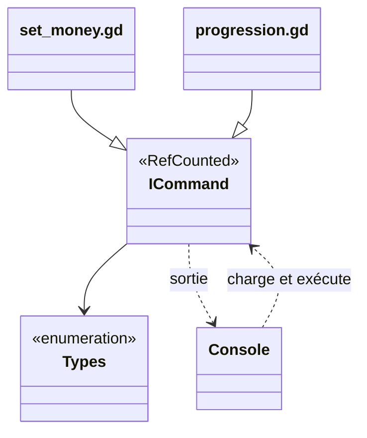

Une commande de la [console de debug](/documentation/development/guides/console/) est un script qui étend `ICommand`.

## Emplacement des scripts

- Interface de base: `res://debug/console/icommand.gd`
- Implémentations: `res://debug/console/commands/`

Le nom du fichier est le token de commande tapé en jeu : `set_money.gd` expose la commande `set_money`, `debug_tower_placement.gd` la commande `debug_tower_placement` (nom en `snake_case`, sans tiret). La console charge tous les scripts du dossier au premier usage (`Console.get_commands()`), crée une seule instance par commande et la réutilise: une commande ne garde donc pas d'état entre deux exécutions sans le vouloir.

## Diagramme de classes



| Membre de `ICommand` | Rôle |
|---|---|
| `description()` | texte d'aide de la commande |
| `get_args()` | définition des arguments |
| `get_args_dynamic(current_args)` | définition qui dépend des arguments déjà saisis |
| `get_signature(current_args, highlight_index)` | signature affichée par `help` et sous la saisie, par exemple `<tower_name: ingame_tower> [path: int]` |
| `execute(console, args)` | valide les arguments puis appelle `_execute()` |
| `_execute(console, args)` | comportement de la commande, à surcharger |
| `type_to_string(t)` | nom d'un type d'argument |
| `OK`, `ERR_*` | [codes de retour](#codes-de-retour) |

## Contrat minimal

Chaque commande:

1. `extends ICommand`
2. Surcharge `description() -> String`
3. Surcharge `get_args() -> Array[Dictionary]` si elle prend des arguments
4. Surcharge `_execute(console: Console, args: Array) -> int`

`execute()` n'est pas à surcharger : il valide les arguments puis appelle `_execute()`.

## Exemple

Extrait réel de `debug/console/commands/set_money.gd`:

```gdscript
## © [2026] A7 Studio. All rights reserved. Trademark.
##
## Sets the player's in-game money amount.
## Can only be used when a level is active. Updates the [member ILevel.coins] value.
extends ICommand


# Public functions
func description() -> String:
	return "Sets the current amount of coins available to the player."


func get_args() -> Array[Dictionary]:
	return [{"name": "amount", "type": Types.ARG_INT}]


# Private functions
func _execute(console: Console, args: Array) -> int:
	if not ILevel.current_level:
		console.push_error_("You must be in a level to use this command.")
		return ERR_UNKNOWN_BEHAVIOR

	var amount: int = int(args[0])
	if amount < 0:
		console.push_error_("Money amount cannot be negative.")
		return ERR_UNKNOWN_BEHAVIOR

	ILevel.current_level.coins = amount
	console.push_text("Set coins to: %d" % amount)

	return OK
```

Les pièces appartiennent au niveau en cours: une commande qui y touche vérifie `ILevel.current_level` avant.

## Schéma d'arguments

`get_args()` renvoie une liste de dictionnaires:

```gdscript
[
	{
		"name": "arg_name",
		"type": ICommand.Types.ARG_STRING,
		"optional": false
	}
]
```

Clés d'un argument:

- `name`: nom affiché dans la signature
- `type`: valeur de `ICommand.Types`
- `optional`: `false` par défaut
- `enum_values`: pour `ARG_ENUM`, valeurs acceptées

### Types d'arguments

| Type | Validation à l'exécution | Suggestions de la console |
| --- | --- | --- |
| `ARG_INT` | entier valide | aucune |
| `ARG_FLOAT` | nombre valide | aucune |
| `ARG_BOOL` | `true` ou `false` | aucune |
| `ARG_STRING` | toute chaîne | aucune |
| `ARG_ENUM` | une valeur de `enum_values` (toute chaîne si la liste est vide) | les valeurs de `enum_values` |
| `ARG_COMMAND` | toute chaîne | les commandes disponibles |
| `ARG_LEVEL` | toute chaîne | les niveaux de `data/levels/` |
| `ARG_CHALLENGE` | toute chaîne | les défis de `data/challenges/` |
| `ARG_ENEMY` | toute chaîne | les ennemis de `StatsDB` |
| `ARG_TOWER` | toute chaîne | les tours de `StatsDB` |
| `ARG_INGAME_TOWER` | toute chaîne | les tours posées sur la carte du niveau en cours |
| `ARG_UNKNOWN` | toujours invalide | aucune |

`ARG_UNKNOWN` est la valeur par défaut d'un argument sans `type` : ne pas l'utiliser dans une commande.

## Validation

`execute()` valide les arguments à partir de `get_args_dynamic(args)`:

- si la définition n'est pas vide, le nombre d'arguments doit être compris entre le nombre d'arguments obligatoires et le nombre d'arguments définis, sinon `ERR_INVALID_ARGS_COUNT`;
- chaque argument est validé selon son type, sinon `ERR_INVALID_ARGS_TYPES`;
- si la définition est vide, aucune validation n'a lieu.

Les arguments sont des chaînes: `ARG_INT` et `ARG_FLOAT` valident le format, la commande convertit ensuite (`int(args[0])`) et contrôle les bornes elle-même (par exemple `set_money` refuse un montant négatif).

## Arguments dynamiques (sous-commandes)

Quand les arguments dépendent des précédents (`progression unlock tower ...`), surcharger `get_args_dynamic(current_args: Array) -> Array[Dictionary]`. Par défaut, elle renvoie `get_args()`.
Extrait de `debug/console/commands/progression.gd`:

```gdscript
func get_args_dynamic(current_args: Array) -> Array[Dictionary]:
	var action_arg := {"name": "action", "type": Types.ARG_ENUM, "enum_values": ["armory", "challenge", "reset", "show", "unlock"]}

	if current_args.is_empty():
		return [action_arg]

	var args: Array[Dictionary] = [action_arg]
	var subcommand: String = current_args[0]

	match subcommand:
		# ... branches "armory" et "unlock"
		"challenge":
			args.append({"name": "level_id", "type": Types.ARG_LEVEL})
			args.append({"name": "challenge_id", "type": Types.ARG_CHALLENGE})

	return args
```

## Codes de retour

- `OK` (`0`) en succès.
- `ERR_INVALID_ARGS_TYPES` (`-1`) et `ERR_INVALID_ARGS_COUNT` (`-2`): renvoyés par `execute()` quand la validation échoue.
- `ERR_UNKNOWN_BEHAVIOR` (`-3`): échec métier signalé par la commande.
- `progression` renvoie `ERR_INVALID_PARAMETER`, la constante globale de Godot, pour une sous-commande ou un identifiant invalide.

Quand le code n'est pas `OK`, la console affiche seulement le code numérique en rouge. Une commande qui échoue écrit donc aussi un message avec `console.push_error_(...)`.

## Sortie console

- `console.push_text(text)`: texte simple.
- `console.push_color(text, color)`: texte coloré.
- `console.push_error_(text)`: message d'erreur en rouge (le nom finit par `_`).
- `console.push_debug(text)`: message de debug en vert.

Ces méthodes n'affichent que dans la console: pour écrire aussi dans le fichier de logs, passer par [`Log.trace`](/documentation/development/guides/logger/).

## Liens liés

- [Console de debug](/documentation/development/guides/console/)
- [Conventions de code](/documentation/development/guides/coding-guidelines/)
- [Snippets](/documentation/setup/snippets/)
