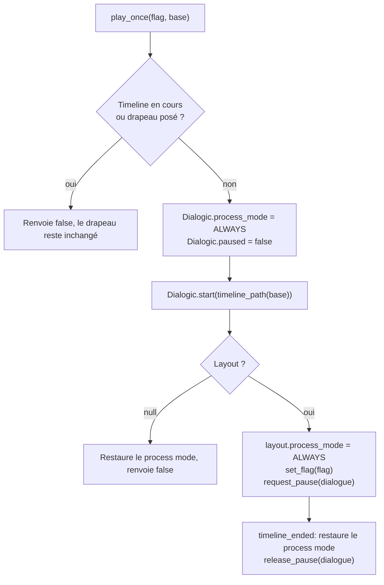

Dialogic porte tous les dialogues du jeu: le tutoriel, l'armurerie et les dialogues uniques de Whiskas. La [documentation officielle](https://docs.dialogic.pro/) couvre l'éditeur et la syntaxe des timelines.

Le plugin (2.0-Alpha-20, Godot 4.5+) est fourni dans `addons/dialogic/` et activé: rien à installer. `Dialogic` est un autoload (`addons/dialogic/Core/DialogicGameHandler.gd`), déclaré après `ScenesLoader` et avant `StatsDB` dans `project.godot`.

## Fichiers du projet

Les ressources narratives sont dans `res://assets/narrative/`:

- `<nom>.en.dtl` et `<nom>.fr.dtl`: une timeline par langue (`armory_intro`, `armory_first_unlock`, `first_new_enemy`, `first_boss`, `first_victory`, `first_defeat`, `tutorial_level_01`)
- `character1.dch`: personnage du guide, nommé Whiskas
- `whiskas.png`, `whiskas_amazed.png`, `whiskas_worry.png`: portraits du personnage
- `style.tres`: style et layout (style par défaut de Dialogic)

Whiskas, le guide du tutoriel, de l'armurerie et des dialogues uniques, a trois portraits (l'humeur est donnée entre parenthèses dans la timeline, comme `character1 (Neutral)`):

| Portrait | Humeur | Fichier |
|---|---|---|
|  | `Neutral` (par défaut) | `whiskas.png` |
|  | `Amazed` | `whiskas_amazed.png` |
|  | `Worry` | `whiskas_worry.png` |

Le tutoriel et l'armurerie n'utilisent que `Neutral`. Les dialogues uniques alternent `Amazed`, `Worry` et `Neutral`.

Chaque `.dtl` est enregistré dans `project.godot`, sous `[dialogic]`, dans `directories/dtl_directory`, avec le nom de fichier sans extension `.dtl` comme clé. Le personnage l'est dans `directories/dch_directory`:

```ini
directories/dch_directory={
"character1": "res://assets/narrative/character1.dch"
}
directories/dtl_directory={
"armory_intro.en": "res://assets/narrative/armory_intro.en.dtl",
"armory_intro.fr": "res://assets/narrative/armory_intro.fr.dtl",
...
}
```

Ajouter une timeline demande donc ses deux fichiers (`.en.dtl` et `.fr.dtl`) et leurs deux entrées dans `dtl_directory`. Godot génère les fichiers `.uid` à côté.

## Écrire une timeline

Exemple tiré de `armory_intro.fr.dtl`:

```text
join character1 (Neutral) center
character1 (Neutral): Bienvenue dans l'Armurerie !
leave character1 [animation="Fade Out" wait="true"]
[end_timeline]
```

Un deux-points dans une réplique s'écrit `\:`.

## Signaux depuis une timeline

Une timeline peut notifier le code avec un événement signal, nommé `namespace:event`:

```text
[signal arg="tutorial:open_build_menu"]
```

Le code écoute `Dialogic.signal_event` et `Dialogic.timeline_ended`. Le `TutorialManager` écoute aussi `Dialogic.event_handled`. Seul le tutoriel utilise des signaux ([Tutoriel](/documentation/development/guides/tutorial/)).

## Langue des timelines

La traduction intégrée de Dialogic est désactivée dans `project.godot` (`translation/enabled=false`): aucun CSV ni fichier `.translation` Dialogic n'existe. Le texte d'une langue vit uniquement dans sa timeline, les autres textes du jeu dans [translations.csv](/documentation/development/guides/i18n/).

## Narrative

`Narrative` (`core/narrative/narrative.gd`, un `RefCounted` avec des fonctions statiques) choisit le fichier selon la langue et joue les dialogues uniques.

### Choisir la timeline

`Narrative.timeline_path(base: String) -> String` renvoie `res://assets/narrative/<base>.<locale>.dtl`, où `<locale>` sont les deux premières lettres de `TranslationServer.get_locale()`. Quand ce fichier n'existe pas, le chemin anglais (`DEFAULT_LOCALE = "en"`) est renvoyé.

```gdscript
Dialogic.start(Narrative.timeline_path("armory_intro"))
```

### Jouer un dialogue une seule fois

`Narrative.play_once(flag: StringName, base: String) -> bool` joue la timeline `base` une fois par sauvegarde:



- Une timeline déjà en cours (le tutoriel, un autre dialogue) fait renvoyer `false` sans poser le drapeau: le dialogue est proposé à nouveau à la prochaine occasion. Sans cette garde, `Dialogic.start` remplacerait la timeline en cours dont le propriétaire ne verrait jamais la fin.
- `Dialogic.process_mode` et le layout passent en `PROCESS_MODE_ALWAYS`: Dialogic n'avance sous un arbre en pause que dans ce cas. Le mode d'origine de l'autoload est restauré à la fin de la timeline.
- `Dialogic.paused` est remis à `false` avant le démarrage, au cas où un tutoriel interrompu l'aurait laissé à `true`.
- Le drapeau est écrit avec `ProgressionManager.set_flag(flag)` ([Progression et sauvegarde](/documentation/development/models/progression-model/)).
- La source de pause `&"dialogue"` (`Narrative.PAUSE_SOURCE`) gèle le jeu pendant le dialogue et est relâchée à `Dialogic.timeline_ended`. Elle fait partie de `Global.TREE_PAUSING_SOURCES` et `Global.TIME_RUNNING_SOURCES`: l'arbre est en pause mais `Engine.time_scale` reste à 1, car Dialogic arrête de révéler le texte à une échelle de temps de 0.

### Dialogues du jeu

| Timeline | Déclencheur | Drapeau |
|---|---|---|
| `armory_intro` | Première ouverture de l'armurerie (`Armory._ready`) | `armory_intro_seen` |
| `armory_first_unlock` | Achat d'un nœud de la catégorie `periphery_building` de l'armurerie (déblocage d'une tour ou d'un piège), le dialogue ne se joue que la première fois | `armory_first_unlock_seen` |
| `first_new_enemy` | Fin de la file des révélations d'un ennemi qui n'est ni `default_zombie` ni `big_daddy` (`HUD._play_enemy_dialogue`) | `first_new_enemy_seen` |
| `first_boss` | Même point, pour `big_daddy` | `first_boss_seen` |
| `first_victory` | Écran de fin après une victoire (`EndGame.init(true)`) | `first_victory_seen` |
| `first_defeat` | Écran de fin après une défaite (`EndGame.init(false)`) | `first_defeat_seen` |
| `tutorial_level_01` | Démarrage de `lev.01` tant que le tutoriel n'est pas terminé (`TutorialManager`) | réglage `tutorial_completed` |

Le bouton d'aide de l'armurerie relance `armory_intro` avec `Dialogic.start(Narrative.timeline_path("armory_intro"))`: sans drapeau, sans source de pause.

Le tutoriel n'utilise pas `play_once`: il démarre sa timeline lui-même et gère ses pauses ([Tutoriel](/documentation/development/guides/tutorial/)).

## Intégration GDScript

### Pause d'un dialogue

`Dialogic.paused` suspend le déroulement de la timeline. Le tutoriel le passe à `true` pendant qu'il attend une action du joueur (par exemple l'ouverture du menu de construction), puis à `false` pour reprendre le dialogue.

### Layout

Le `TutorialManager` règle le layout Dialogic au démarrage du tutoriel: `process_mode` à `PROCESS_MODE_ALWAYS`, puis si c'est un `CanvasLayer`, `layer = 100`, sinon `z_index = 9000`. Il est ainsi affiché au-dessus de l'interface du niveau.

Écoute des signaux, comme dans `TutorialManager`:

```gdscript
SignalUtil.connects([
	{SignalUtil.WHO: Dialogic, SignalUtil.WHAT: "signal_event", SignalUtil.TO: _on_dialogic_signal_event},
	{SignalUtil.WHO: Dialogic, SignalUtil.WHAT: "timeline_ended", SignalUtil.TO: _on_dialogic_timeline_ended},
	{SignalUtil.WHO: Dialogic, SignalUtil.WHAT: "event_handled", SignalUtil.TO: _on_dialogic_event_handled},
])
```

## Conventions

- Aucun texte de dialogue dans le GDScript: tout passe par des fichiers `.dtl`, un par langue.
- Toute timeline existe en `.en.dtl` et `.fr.dtl`, enregistrés dans `project.godot`.
- Choisir le fichier avec `Narrative.timeline_path()`, jamais avec un chemin écrit en dur.
- Un dialogue qui ne doit se jouer qu'une fois passe par `Narrative.play_once()` avec un drapeau `<nom>_seen`.
- Signaux de timeline nommés `namespace:event` (par exemple `tutorial:open_build_menu`).
