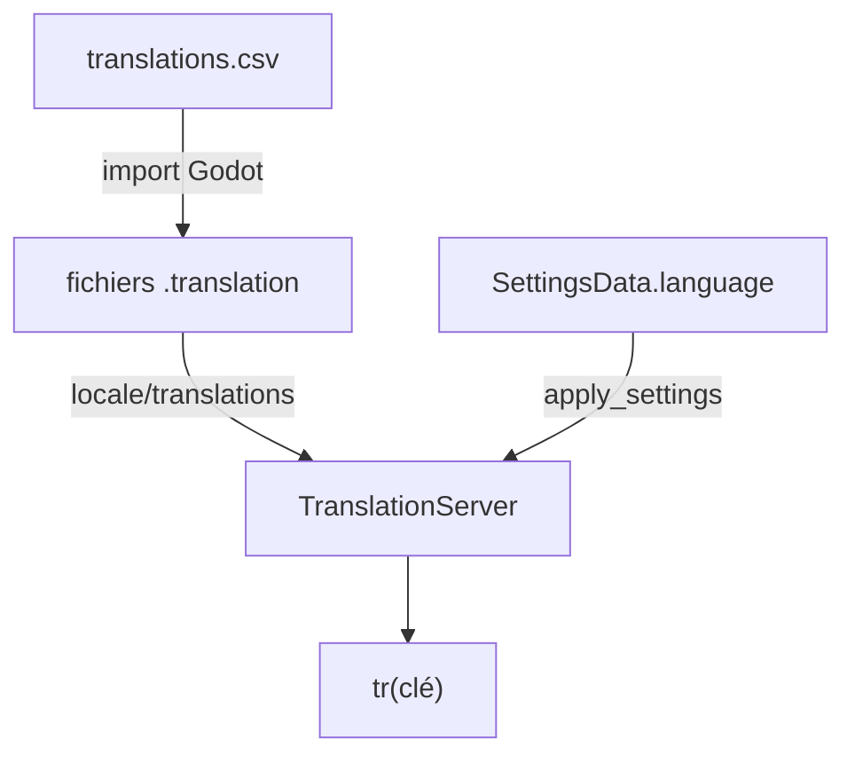

Le jeu existe en français et en anglais. Les textes de l'interface viennent d'un fichier CSV, les dialogues de fichiers Dialogic séparés par langue.



## Le fichier CSV

`assets/translations/translations.csv` a trois colonnes: `keys`, `en` et `fr`. Godot l'importe (importeur `csv_translation`, voir `translations.csv.import`) en un fichier `.translation` par langue. Ces fichiers sont ignorés par Git (`*.translation`) et enregistrés dans `project.godot`, sous `locale/translations`, avec `dialogic_translations.en.translation` et `dialogic_translations.fr.translation` (voir [Dialogues](#dialogues)).

```csv
keys,en,fr
HOME.PLAY.BUTTON,Play,Jouer
TOWER.UPGRADE.TITLE,Upgrade to level %d,Améliorer au niveau %d
```

Une valeur qui contient une virgule est entourée de guillemets.

### Format des clés

Les clés sont en majuscules, séparées par des points: `DOMAINE.SUJET.TYPE`.

| Domaine | Exemples |
|---|---|
| Écrans et HUD | `HOME.PLAY.BUTTON`, `INGAMEHUD.NEW_ENEMY.TITLE`, `ENDGAMEMENU.LEVEL.TITLE.WIN` |
| Défis | `CHALLENGE.CHA.001.NAME`, `CHALLENGE.CHA.001.DESC`, `CHALLENGE.DIFFICULTY.EASY` |
| Armurerie | `ARMORY.NODE.UNLOCK_BAT_02.NAME`, `ARMORY.NODE.UNLOCK_BAT_02.DESC` |
| Encyclopédie | `ENCYCLOPEDIA.STATS.HEALTH`, `ENEMY.RAT.NAME`, `TOWER.BAT_01.NAME` |

## Utiliser une clé

Toute chaîne visible par le joueur passe par `tr()`. Les identifiants techniques, les logs et les noms de commande ne sont pas traduits.

Un `Label` ou un `Button` dans une scène reçoit directement la clé comme texte (`text = "HOME.PLAY.BUTTON"` dans `home.tscn`), Godot la traduit. Dans le code:

```gdscript
title_label.text = tr("ENDGAMEMENU.LEVEL.TITLE.WIN")
```

Une valeur peut contenir un placeholder, rempli après la traduction:

```gdscript
return tr("TOWER.UPGRADE.TITLE") % next_level
```

### Clés construites

Certaines clés sont assemblées à partir d'un identifiant. Il faut alors une entrée CSV par valeur possible:

| Code | Clé produite |
|---|---|
| `tr("ENEMY.%s.NAME" % enemy_id.to_upper())` | `ENEMY.RAT.NAME` |
| `tr("CHALLENGE.DIFFICULTY.%s" % _difficulty.to_upper())` | `CHALLENGE.DIFFICULTY.EASY` |
| `"ARMORY.NODE.%s.NAME" % node_id.to_upper()` | `ARMORY.NODE.UNLOCK_BAT_02.NAME` |

Les champs `name` et `description` des JSON de défis (`resources/challenges/`) contiennent directement une clé.

### Clé absente

Quand une clé n'existe pas dans le CSV, `tr()` renvoie la clé elle-même. `armory.gd` et `new_enemy_challenger.gd` comparent le résultat à la clé pour prévoir un repli (l'identifiant du nœud, par exemple).

Le code contient aussi des appels sans entrée CSV: `tr("Wave %s")` dans `i_level.gd`, `tr("SPAWN")` et `tr("BASE")` dans `path_indicator.gd`. Ces textes s'affichent tels quels dans les deux langues.

## Langue du joueur

- `SettingsData.language` vaut `fr` par défaut et est sauvegardé ([Progression et sauvegarde](/documentation/development/models/progression-model/)).
- `ProgressionManager.apply_settings()` appelle `TranslationServer.set_locale(language)`. Elle s'exécute au chargement de la sauvegarde et à chaque changement dans les options.
- Le bouton drapeau du menu options (`options.gd`) bascule entre `fr` et `en`, sauvegarde puis rappelle `apply_settings()`. Il ne gère que ces deux langues.

Dans `project.godot`, `locale/test` vaut `fr` (langue forcée quand le projet est lancé depuis l'éditeur) et la pseudolocalisation est activée, sans accents, préfixe ni suffixe.

## Dialogues

Les timelines Dialogic ont un fichier par langue (`tutorial_level_01.fr.dtl`, `tutorial_level_01.en.dtl`). Le code choisit le fichier selon la locale, voir [Dialogic](/documentation/development/guides/dialogic-guide/#intégration-gdscript).

La traduction intégrée de Dialogic est aussi activée dans `project.godot` (section `[dialogic]`: `translation/enabled=true`, `original_locale="fr"`, locales `en` et `fr`). Les deux fichiers `dialogic_translations.<langue>.translation` de la racine, enregistrés dans `locale/translations`, sont ignorés par Git. Aucun CSV Dialogic n'est versionné: l'origine de ces fichiers n'est pas documentée dans le dépôt.

## Ajouter une chaîne

1. Choisir une clé `DOMAINE.SUJET.TYPE` et ajouter une ligne dans `translations.csv`, avec les colonnes `en` et `fr`.
2. Laisser Godot réimporter le CSV, il régénère les `.translation`.
3. Utiliser la clé dans la scène ou avec `tr()`.
