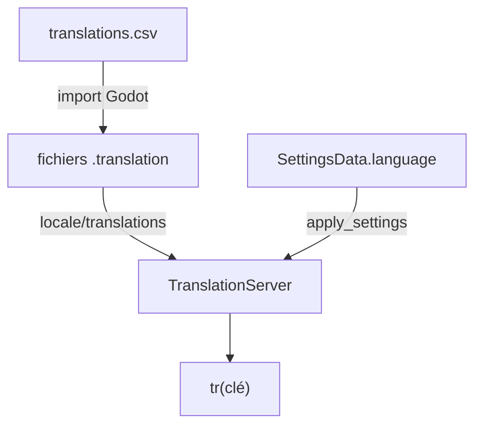

Le jeu existe en français et en anglais (locales `en` et `fr`). Les textes de l'interface viennent d'un fichier CSV, les dialogues de fichiers Dialogic séparés par langue.



## Le fichier CSV

`assets/translations/translations.csv` a trois colonnes: `keys`, `en` et `fr`. Godot l'importe (importeur `csv_translation`, voir `translations.csv.import`) en un fichier `.translation` par langue: `translations.en.translation` et `translations.fr.translation`. Ces fichiers sont régénérés à chaque import du CSV, ignorés par Git (`*.translation`) et enregistrés dans `project.godot`, sous `locale/translations`.

```csv
keys,en,fr
HOME.PLAY.BUTTON,PLAY,JOUER
TOWER.UPGRADE.TITLE,Upgrade to level %d,Améliorer au niveau %d
```

Une valeur qui contient une virgule est entourée de guillemets.

### Format des clés

Les clés sont en majuscules, séparées par des points: `DOMAINE.SUJET.TYPE`.

| Famille | Exemples | Utilisation |
|---|---|---|
| Entités | `TOWER.BAT_01.NAME`, `TRAP.BAT_03.NAME`, `ENEMY.RAT.NAME` | Noms construits par `StatsDB.name_key(category, id)` |
| Niveaux | `LEVEL.LEV_01.NAME`, `LEVEL.LEV_01.DESC`, `LEVEL.WAVE` | `level_name` et `level_description` des scènes de niveau |
| Arcs | `ARC.01.TITLE`, `ARC.02.TITLE` | Titre affiché par la sélection de niveau |
| Défis | `CHALLENGE.CHA.001.NAME`, `CHALLENGE.CHA.001.DESC`, `CHALLENGE.DIFFICULTY.EASY` | Champs `name` et `description` des JSON de défis |
| Statistiques | `STAT.FIRE_RATE`, `STAT.SHOOT_RANGE`, `ENCYCLOPEDIA.STATS.HEALTH` | Barres de statistiques et encyclopédie |
| Cases et carte | `TILE.BONUS.DAMAGE`, `TILE.MALUS.FIRE_RATE`, `MAP.PATH.SPAWN`, `MAP.PATH.BASE` | Libellés des cases spéciales et des indicateurs de chemin |
| Écrans | `HOME.PLAY.BUTTON`, `LEVEL_SELECTION.LEVELS`, `PAUSE.TITLE`, `INGAMEHUD.NEW_ENEMY.TITLE`, `ENDGAMEMENU.LEVEL.TITLE.WIN`, `ENDGAMEMENU.LEVEL.TITLE.LOSE` | Accueil, sélection de niveau, pause, HUD, écran de fin |
| Amélioration | `TOWER.UPGRADE.TITLE`, `TOWER.UPGRADE.PRICE`, `TOWER.UPGRADE.MAX`, `TOWER.LEVEL.DISPLAY` | Menus de tour |
| Armurerie | `ARMORY.TITLE`, `ARMORY.NODE.UNLOCK_BAT_02.NAME`, `ARMORY.NODE.UNLOCK_BAT_02.DESC` | Armurerie |

`stats.json` ne contient aucun nom d'entité: seule la clé construite par `StatsDB.name_key()` les désigne ([Statistiques](/documentation/development/models/stats-model/)).

## Utiliser une clé

Toute chaîne visible par le joueur passe par `tr()`. Les identifiants techniques, les logs et les noms de commande ne sont pas traduits.

Un `Label` ou un `Button` dans une scène reçoit directement la clé comme texte (`text = "HOME.PLAY.BUTTON"` dans `home.tscn`), Godot la traduit. Quand le code remplit le texte lui-même (nom et description d'un niveau, défis, libellés d'un cadre), le champ `text` de la scène reste vide: aucun texte provisoire n'est écrit dans les scènes. Dans le code:

```gdscript
title_label.text = tr("ENDGAMEMENU.LEVEL.TITLE.WIN")
```

Une valeur peut contenir un placeholder, rempli après la traduction:

```gdscript
return tr("TOWER.UPGRADE.TITLE") % next_level
```

### Clés construites

Certaines clés sont assemblées à partir d'un identifiant. Il faut alors une entrée CSV par valeur possible:

| Code | Clé produite |
|---|---|
| `tr(StatsDB.name_key("ENEMY", enemy_id))` | `ENEMY.RAT.NAME` |
| `tr("STAT.%s" % stat_name.to_upper())` (`StatBar.setup`) | `STAT.FIRE_RATE` |
| `tr("TILE.%s.%s" % [kind.to_upper(), stat.to_upper()])` (`IMap`) | `TILE.BONUS.DAMAGE` |
| `tr("CHALLENGE.DIFFICULTY.%s" % _difficulty.to_upper())` | `CHALLENGE.DIFFICULTY.EASY` |
| `"ARMORY.NODE.%s.NAME" % node_id.to_upper()` | `ARMORY.NODE.UNLOCK_BAT_02.NAME` |

`StatsDB.name_key(category: String, id: String) -> String` renvoie `<CATEGORY>.<ID en majuscules>.NAME`; `category` vaut `"TOWER"`, `"TRAP"` ou `"ENEMY"`. Le nom d'une tour, d'un piège ou d'un ennemi s'obtient donc toujours avec `tr(StatsDB.name_key("TOWER", tower_id))`.

Les champs `name` et `description` des JSON de défis (`data/challenges/`) contiennent directement une clé.

### Clé absente

Quand une clé n'existe pas dans le CSV, `tr()` renvoie la clé elle-même. `armory.gd` compare le résultat à la clé pour prévoir un repli (l'identifiant du nœud pour un nom, un texte vide pour une description).

Chaque appel `tr("CLÉ")` écrit en dur dans les scripts a une entrée dans le CSV.

## Langue du joueur

- `SettingsData.language` vaut `fr` par défaut et est sauvegardé ([Progression et sauvegarde](/documentation/development/models/progression-model/)).
- `ProgressionManager.apply_settings()` appelle `TranslationServer.set_locale(language)`. Elle s'exécute au chargement de la sauvegarde et à chaque changement dans les options.
- Le bouton drapeau du menu options (`options.gd`) bascule entre `fr` et `en`, sauvegarde puis rappelle `apply_settings()`. Il ne gère que ces deux langues.

La pseudolocalisation n'est pas activée dans `project.godot` (`pseudolocalization/replace_with_accents=false`, préfixe et suffixe vides) et `locale/test` n'est pas défini: la langue vient uniquement de `SettingsData.language`.

## Dialogues

Les timelines Dialogic ont un fichier par langue (`tutorial_level_01.fr.dtl`, `tutorial_level_01.en.dtl`). Le code choisit le fichier avec `Narrative.timeline_path()`, voir [Dialogic](/documentation/development/guides/dialogic-guide/#narrative).

La traduction intégrée de Dialogic est désactivée (`translation/enabled=false` dans la section `[dialogic]` de `project.godot`): aucun fichier de traduction Dialogic n'est généré.

## Ajouter une chaîne

1. Choisir une clé `DOMAINE.SUJET.TYPE` et ajouter une ligne dans `translations.csv`, avec les colonnes `en` et `fr`.
2. Laisser Godot réimporter le CSV, il régénère les `.translation`.
3. Utiliser la clé dans la scène ou avec `tr()`.
