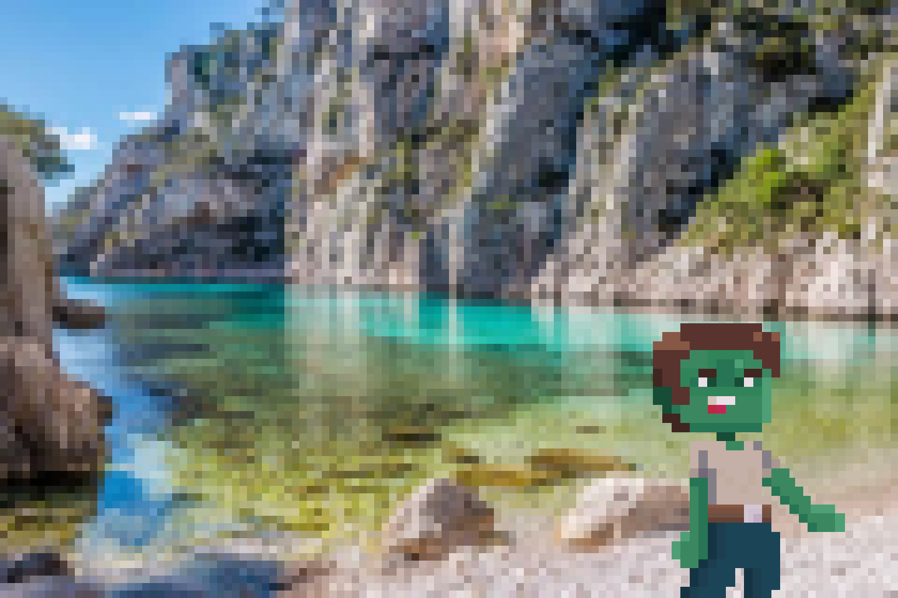
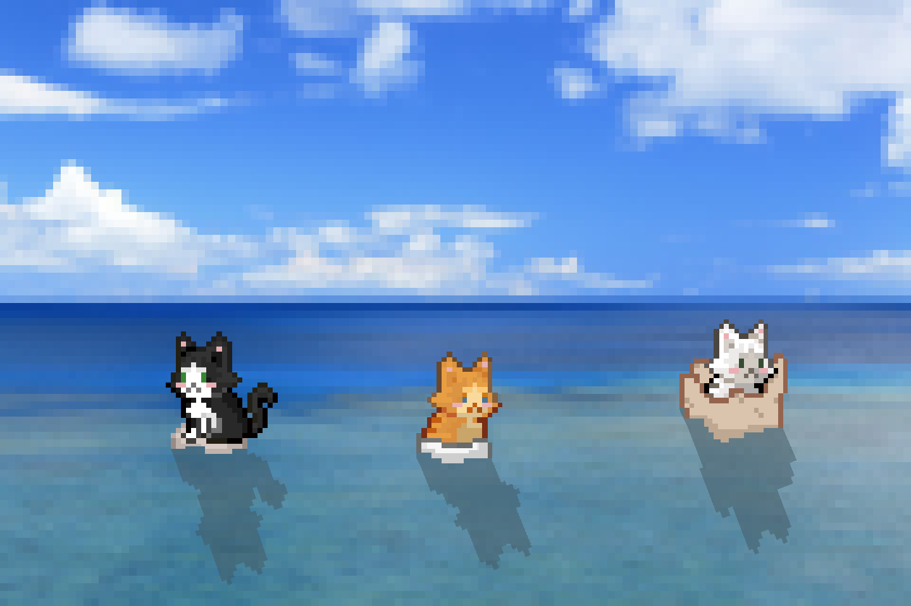

Un niveau est un trio: une scène de niveau (`ILevel`), une scène de carte (`IMap`) et un JSON de vagues et de défis. Les arcs regroupent les niveaux dans le menu de sélection. Les propriétés de `ILevel` et `IMap` sont dans [Niveau et carte](/documentation/development/models/level-model/), le format des vagues dans [Vagues](/documentation/development/models/wave-model/).

## Les fichiers

| Fichier | Rôle |
|---|---|
| `game/level/levels/lev.XX.tscn` | Scène héritée de `i_level.tscn`, avec `level_id`, `level_name` et `level_description` (clés de traduction), `arc_id` et `map_scene` |
| `game/map/maps/arc_XX/map_XX.tscn` | Carte héritée de `i_map.tscn` |
| `data/levels/lev.XX.json` | Vie et pièces de départ (`max_health`, `start_coins`), vagues (`waves`) et défis (`challenges`) |
| `ui/menus/level_selection/level_selection_menu.tscn` | Un `LevelFrame` par niveau, et les arcs (voir [Arcs](#arcs)) |

Le nom du fichier de la scène et celui du JSON sont le `level_id`: `ILevel` charge `data/levels/<level_id>.json` et `ScenesLoader.start_level(level_id)` charge `levels/<level_id>.tscn`.

## Niveaux existants

Les noms sont les traductions de `LEVEL.LEV_0X.NAME`, les descriptions de `LEVEL.LEV_0X.DESC`.

| Niveau | Nom (scène) | Arc | Carte | Défis (JSON) | Vagues |
|---|---|---|---|---|---|
| `lev.01` | 1. Premier niveau | `arc.01` | `arc_01/map_01` | `cha.000`, `cha.001`, `cha.002` | 4 |
| `lev.02` | 2. Coink coink | `arc.01` | `arc_01/map_02` | `cha.000`, `cha.003`, `cha.004` | 3 |
| `lev.03` | 3. Niveau trois | `arc.01` | `arc_01/map_03` | `cha.000`, `cha.005` | 3 |
| `lev.04` | 4. Neuf vies et mille chemins | `arc.01` | `arc_01/map_04` | aucun | 10 |
| `lev.05` | 5. Le boss | `arc.01` | `map_coink` | `cha.000`, `cha.103`, `cha.104` | 2 |
| `lev.06` | 6. Nouvel arc | `arc.02` | `map_coink` | `cha.000`, `cha.105`, `cha.106` | 2 |
| `lev.07` | 7. Un chat à la mer | `arc.02` | `map_coink` | `cha.000`, `cha.201`, `cha.202` | 2 |
| `lev.08` | 8. Tempête de ronrons | `arc.02` | `map_coink` | `cha.000`, `cha.203`, `cha.205` | 2 |

Les huit niveaux démarrent avec 250 pièces et 20 points de vie. Les règles des défis sont dans [Défis](/documentation/development/models/challenge-model/#défis-du-jeu).

## Arcs

Il n'y a pas de dossier `data/arcs/`: les arcs ne sont pas des données JSON. Un arc est la combinaison de trois éléments:

- `arc_id` dans la scène du niveau, qui choisit l'image de fond `assets/ui/level_selection/arcs/<arc_id>.png`.
- L'export `arc_title` du `LevelFrame` dans `level_selection_menu.tscn`: une clé de traduction `ARC.0X.TITLE`, affichée comme titre de l'arc.
- Les `LevelFrame` consécutifs qui partagent le même `arc_title`.

| Image de fond | Arc | Titre (clé) | Niveaux |
|---|---|---|---|
|  | `arc.01` | Chat'lanques de Nyarseille (`ARC.01.TITLE`) | `lev.01` à `lev.05` |
|  | `arc.02` | La mer Nyaditerranée (`ARC.02.TITLE`) | `lev.06` à `lev.08` |

Le déblocage vient de la sauvegarde ([Progression et sauvegarde](/documentation/development/models/progression-model/)): `lev.01` est débloqué au départ, et `complete_level` débloque le niveau portant le numéro suivant (`lev.02` après `lev.01`, `ProgressionManager.get_next_level_id`).

## Menu de sélection

`LevelSelectionMenu` parcourt les `LevelFrame` placés dans sa scène. Chaque frame a deux exports, `level_id` et `arc_title`, et lit la scène du niveau sans l'instancier pour afficher son nom, sa description et son arc.

- Statut d'un niveau: verrouillé s'il n'est pas débloqué, terminé si au moins un défi est complété, courant sinon.
- Les défis affichés (trois emplacements) viennent de `challenges` dans le JSON du niveau (nom et description traduits depuis le JSON du défi, l'identifiant si le fichier du défi manque).
- Le bouton jouer émet `start_level(level_id)`, et le menu appelle `ScenesLoader.start_level(level_id)` ([Architecture](/documentation/development/guides/architecture/#scenesloader)).

## Déroulement d'un niveau

`ILevel.start_level()` enchaîne: initialisation de la carte, lecture du JSON (`start_coins`, `max_health`, vagues), démarrage des défis, construction de la machine à états ([Machine d'états](/documentation/development/models/state-machine/)), animation des tuiles spéciales, puis `start_wave_flow()`. Sur `lev.01`, tant que le tutoriel n'est pas terminé, le démarrage des vagues attend la fin du [tutoriel](/documentation/development/guides/tutorial/).

Signaux utiles: `stats_updated` (pièces ou vie modifiées) et `wave_started(wave_number)` (numéro à partir de 1).

## Créer un niveau

### 1. La carte

1. Godot > Scenes > New inherited scene > `res://game/map/i_map.tscn`.
2. L'enregistrer dans `game/map/maps/arc_XX/map_XX.tscn`.
3. Dessiner le terrain dans `TileMapPlains`, les accessoires dans `TileMapProps` et les cellules où une tour est permise dans `TileMapPlacement`. Ce sont tous des `TileMapLayer` ([Construction](/documentation/development/guides/building-placement/#tuiles-de-placement)).
4. Poser des `MapPlacementBlocker` sur les décorations qui ne doivent pas accueillir de tour ([Bloqueurs de placement](/documentation/development/guides/building-placement/#bloqueurs-de-placement)).
5. Ajouter un `Path2D` par chemin sous le nœud `Paths`. L'ordre des enfants donne l'index de chemin utilisé par `spawner` dans les vagues.

Propriétés exportées de `IMap` utiles:

| Propriété | Rôle |
|---|---|
| `tilemap`, `placement_tilemap`, `props_tilemap` | Les `TileMapLayer` de la carte (terrain racine, cellules constructibles, accessoires) |
| `initial_path_index` | Chemin actif au départ quand des événements de vague sont configurés |
| `initial_camera_position` | Position initiale de la caméra (centrée sur la carte si nulle) |
| `show_start_indicators`, `show_end_indicators` | Marqueurs `SPAWN` et `BASE` aux extrémités des chemins |
| `special_tile_percentage` | Part de tuiles bonus et malus |
| `debug_show_spawnable_special_tiles` | Affiche les tuiles éligibles |

Une carte contient aussi un nœud `Controller` (le `BuildPlacement`) et une `Camera2D`, hérités de `i_map.tscn`.

### Chemins qui s'ouvrent en cours de niveau

Le nœud `MapEvents` (`maps/map_events.gd`) active ou désactive des chemins au début d'une vague, d'après l'export `wave_path_events`:

```gdscript
wave_path_events = {
	2: {"activate": [1], "deactivate": []},
	4: {"activate": [2], "deactivate": []},
	6: {"activate": [3], "deactivate": [0]},
	8: {"activate": [0, 4], "deactivate": [3]},
}
```

La clé est le numéro de vague (à partir de 1). Seule `map_04.tscn` l'utilise (cinq chemins, `lev.04`). Les enfants de `Paths` sont `Path_Main`, `Path_South`, `Path_North`, `Path_Far_South` et `Path_Reverse`.

### 2. Le niveau

1. New inherited scene > `res://game/level/i_level.tscn`.
2. L'enregistrer dans `game/level/levels/<level_id>.tscn`.
3. Renseigner `level_id`, `level_name` et `level_description` (clés `LEVEL.LEV_XX.NAME` et `LEVEL.LEV_XX.DESC`, à ajouter au CSV de traductions), `arc_id` et `map_scene`.

### 3. Le JSON

Créer `data/levels/<level_id>.json`:

```json
{
	"start_coins": 250,
	"max_health": 20,
	"challenges": ["cha.000", "cha.001"],
	"waves": [
		[
			{"enemy_id": "default_zombie", "count": 1, "spawner": 0},
			{"wait_s": 5.25}
		]
	]
}
```

- `start_coins` et `max_health` sont obligatoires: ce sont les pièces de départ et la vie de la base. `waves` l'est aussi (un `assert` échoue sinon).
- `challenges` (optionnel, `lev.04` n'en a pas) référence des fichiers de `data/challenges/`.
- `enemy_id` est une clé d'ennemi de `stats.json` (`default_zombie`, `damage_zombie`, `rat`, `small_zombie`, `splitter_zombie`, `minesweeper`, `big_daddy`). Les clés `enemy_id`, `count`, `spawner` et `wait_s` sont décrites dans [Vagues](/documentation/development/models/wave-model/#étapes).

### 4. Le menu

Dans `level_selection_menu.tscn`, ajouter une instance de `level_frame.tscn` sous `BodyContainer`, avec `level_id` et `arc_title` (clé `ARC.0X.TITLE`). Les frames sont affichées dans l'ordre de la scène. Pour un nouvel arc, ajouter `assets/ui/level_selection/arcs/arc.XX.png` et les clés `ARC.XX.TITLE` du CSV.

### 5. Tester

La console charge directement un niveau: `load_level lev.XX` ([Console](/documentation/development/guides/console/)).
