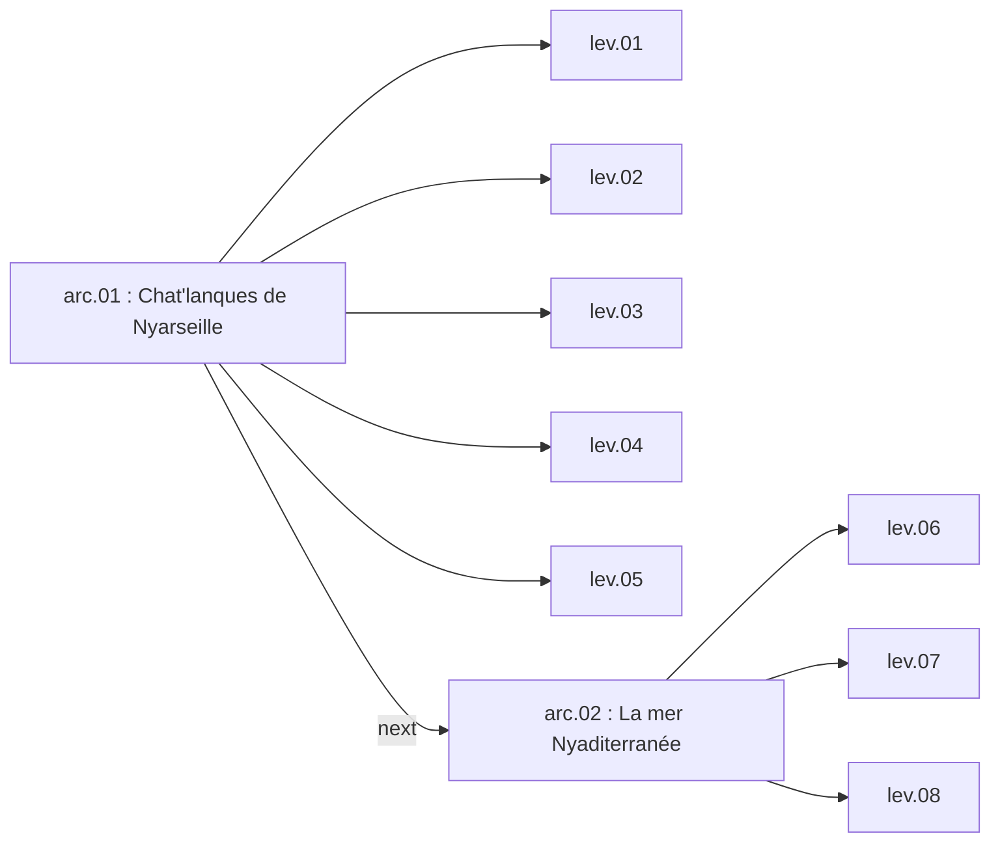

Un niveau est un trio: une scène de niveau (`ILevel`), une scène de carte (`IMap`) et un JSON de vagues et de défis. Les arcs regroupent les niveaux dans le menu de sélection. Les propriétés de `ILevel` et `IMap` sont dans [Niveau et carte](/documentation/development/models/level-model/), le format des vagues dans [Vagues](/documentation/development/models/wave-model/).

## Les fichiers

| Fichier | Rôle |
|---|---|
| `scenes/gameplay/world/level/levels/lev.XX.tscn` | Scène héritée de `i_level.tscn`, avec `level_id`, `level_name`, `level_description`, `arc_id` et `map_scene` |
| `scenes/gameplay/world/map/maps/arc.XX/map.XX.tscn` | Carte héritée de `i_map.tscn` |
| `resources/levels/lev.XX.json` | Vagues (`waves`) et défis (`challenges`) |
| `scenes/ui/menus/level_selection/level_selection_menu.tscn` | Un `LevelFrame` par niveau |

Le nom du fichier de la scène et celui du JSON sont le `level_id`: `ILevel` charge `resources/levels/<level_id>.json` et `LevelFrame` charge `levels/<level_id>.tscn`.

## Niveaux existants

| Niveau | Nom (scène) | Arc | Carte | Défis (JSON) | Vagues |
|---|---|---|---|---|---|
| `lev.01` | 1. Premier niveau | `arc.01` | `arc.01/map.01` | `cha.000`, `cha.001`, `cha.002` | 4 |
| `lev.02` | 2. Coink coink | `arc.01` | `arc.01/map.02` | `cha.000`, `cha.003`, `cha.004` | 3 |
| `lev.03` | 3. Niveau trois | `arc.01` | `arc.01/map.03` | `cha.000`, `cha.005`, `cha.006` | 3 |
| `lev.04` | 4. Dynamic Paths Test | `arc.01` | `arc.01/map.04` | aucun | 10 |
| `lev.05` | 5. Le boss | `arc.01` | `map_coink` | `cha.000`, `cha.103`, `cha.104` | 2 |
| `lev.06` | 6. Nouvel arc | `arc.02` | `map_coink` | `cha.000`, `cha.105`, `cha.106` | 2 |
| `lev.07` | 7. Titre | `arc.02` | `map_coink` | `cha.000`, `cha.201`, `cha.202` | 2 |
| `lev.08` | 8. Fin arc deux | `arc.02` | `map_coink` | `cha.000`, `cha.203`, `cha.205` | 2 |

`cha.006` n'a pas de fichier dans `resources/challenges/`: le `ChallengeManager` l'ignore et le menu affiche son identifiant. Les statuts des défis sont dans [Défis](/documentation/development/models/challenge-model/).

## Arcs



Ce graphe est celui de `resources/arcs/arc.01.json` et `arc.02.json` (champs `id`, `next`, `name`, `levels`). Aucun code du jeu ne lit ces fichiers. Ce qui compte à l'exécution:

- `arc_id` dans la scène du niveau, qui choisit l'image de fond `assets/ui/level_selection/bg_arcs/<arc_id>.png`.
- `arc_title` du `LevelFrame`, le titre affiché pour l'arc.

Le champ `status` des JSON de niveaux et d'arcs n'est pas lu non plus. Le déblocage vient de la sauvegarde ([Progression et sauvegarde](/documentation/development/models/progression-model/)): `lev.01` est débloqué au départ, et `complete_level` débloque le niveau portant le numéro suivant (`lev.02` après `lev.01`).

## Menu de sélection

`LevelSelectionMenu` parcourt les `LevelFrame` placés dans sa scène. Chaque frame a deux exports, `level_id` et `arc_title`, et lit la scène du niveau sans l'instancier pour afficher son nom, sa description et son arc.

- Statut d'un niveau: verrouillé s'il n'est pas débloqué, terminé si au moins un défi est complété, courant sinon.
- Les défis affichés (trois emplacements) viennent de `challenges` dans le JSON du niveau.
- Le bouton jouer instancie la scène, la rattache à la racine, appelle `start_level()` puis `Global.ui.start_level()`.

## Déroulement d'un niveau

`ILevel.start_level()` enchaîne: initialisation de la carte, chargement des vagues, démarrage des défis, construction de la machine à états ([Machine d'états](/documentation/development/models/state-machine/)), animation des tuiles spéciales, puis `start_wave_flow()`. Sur `lev.01`, tant que le tutoriel n'est pas terminé, le démarrage des vagues attend la fin du [tutoriel](/documentation/development/guides/tutorial/).

Signaux utiles: `stats_updated` (pièces ou vie modifiées) et `wave_started(wave_number)` (numéro à partir de 1).

## Créer un niveau

### 1. La carte

1. Godot > Scenes > New inherited scene > `res://scenes/gameplay/world/map/i_map.tscn`.
2. L'enregistrer dans `scenes/gameplay/world/map/maps/arc.XX/map.XX.tscn`.
3. Dessiner le terrain dans `TileMapPlains`, les accessoires dans `TileMapProps` et les tuiles où une tour est permise dans `TileMapPlacement` ([Construction](/documentation/development/guides/building-placement/#tuiles-de-placement)).
4. Ajouter un `Path2D` par chemin sous le nœud `Paths`. L'ordre des enfants donne l'index de chemin utilisé par `spawner` dans les vagues.

Propriétés exportées de `IMap` utiles:

| Propriété | Rôle |
|---|---|
| `initial_path_index` | Chemin actif au départ quand des événements de vague sont configurés |
| `initial_camera_position` | Position initiale de la caméra (centrée sur la carte si nulle) |
| `show_start_indicators`, `show_end_indicators` | Marqueurs `SPAWN` et `BASE` aux extrémités des chemins |
| `special_tile_percentage` | Part de tuiles bonus et malus |
| `debug_show_spawnable_special_tiles` | Affiche les tuiles éligibles |

Une carte contient aussi un nœud `Controller` (le `BuildPlacement`) et une `Camera2D`, hérités de `i_map.tscn`.

### Chemins qui s'ouvrent en cours de niveau

Le nœud `MapEvents` (`maps/map_events.gd`) active ou désactive des chemins au début d'une vague, d'après l'export `wave_path_events`:

```gdscript
wave_path_events = {
	2: {"activate": [1], "deactivate": []},
	6: {"activate": [3], "deactivate": [0]},
}
```

La clé est le numéro de vague (à partir de 1). Seule `map.04.tscn` l'utilise (cinq chemins, `lev.04`). Les enfants de `Paths` sont `Path_Main`, `Path_South`, `Path_North`, `Path_Far_South` et `Path_Reverse`.

### 2. Le niveau

1. New inherited scene > `res://scenes/gameplay/world/level/i_level.tscn`.
2. L'enregistrer dans `scenes/gameplay/world/level/levels/<level_id>.tscn`.
3. Renseigner `level_id`, `level_name`, `level_description`, `arc_id` et `map_scene`.

### 3. Le JSON

Créer `resources/levels/<level_id>.json`:

```json
{
	"challenges": ["cha.000", "cha.001"],
	"waves": [
		[
			{"enemy_id": "ene.01", "count": 1, "spawner": 0},
			{"wait_s": 5.25}
		]
	]
}
```

`challenges` référence des fichiers de `resources/challenges/`. Les clés `enemy_id`, `count`, `spawner` et `wait_s` sont décrites dans [Vagues](/documentation/development/models/wave-model/#étapes).

### 4. Le menu

Dans `level_selection_menu.tscn`, ajouter une instance de `level_frame.tscn` sous `BodyContainer`, avec `level_id` et `arc_title`. Les frames sont affichées dans l'ordre de la scène. Pour un nouvel arc, ajouter `assets/ui/level_selection/bg_arcs/arc.XX.png`.

### 5. Tester

La console charge directement un niveau: `load_level lev.XX` ([Console](/documentation/development/guides/console/)).
