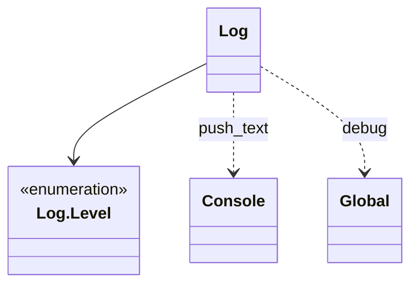

Le système de logs est la classe statique `Log` (`res://core/log/log.gd`, `class_name Log`). Ce n'est pas un autoload. Elle remplace `print()` pour tout message technique.

```gdscript
Log.trace(Log.Level.INFO, "Wave started")
Log.trace(Log.Level.WARN, "Missing file: %s" % file_path)
Log.trace(Log.Level.ERROR, ["Cannot load wave id", wave_id])
```

`Log.trace` accepte un message simple ou une liste de fragments, joints par un espace. `Log.init()` est appelé une seule fois, par l'autoload `Global` dans son `_ready()`.



| Membre statique de `Log` | Rôle |
|---|---|
| `init()` | crée le fichier de logs et écrit `Logger initialized!`, appelé une fois par `Global` |
| `trace(level: Log.Level, args: Variant)` | formate et publie un message |
| `close()` | referme le fichier de logs, appelé par `Global` à la fermeture de la fenêtre |
| `PREFIXS` | préfixe affiché pour chaque niveau (`[DEBUG]`, `[ INFO]`, `[ WARN]`, `[ERROR]`, `[FATAL]`) |

## Niveaux

`Log.Level` contient `DEBUG`, `INFO`, `WARN`, `ERROR` et `FATAL`, par gravité croissante. `WARN` signale un comportement dégradé, `ERROR` un échec qui n'arrête pas le jeu, `FATAL` un problème bloquant. `DEBUG` n'est affiché que si `Global.debug` vaut `true`, c'est-à-dire dans l'éditeur et les exports debug (`OS.has_feature("debug")`).

## Format de sortie

```log
[LEVEL] h:m:s.ms - message
```

L'heure n'est pas complétée par des zéros. Le champ `ms` vaut `Time.get_ticks_msec() % 1000`: les millisecondes écoulées depuis le démarrage du moteur, pas celles de l'horloge.

```log
[ INFO] 13:19:39.485 - Logger initialized!
```

Les niveaux `ERROR` et `FATAL` ajoutent le fichier (nom seul), la ligne et la fonction de l'appelant, car la lecture de la pile (`get_stack()`) est lente:

```log
[ERROR] 13:19:41.102 - sell.gd::18@_execute - Tower not found
```

## Sorties

Chaque message part vers:

1. la sortie standard de Godot (`print`);
2. la [console de debug](/documentation/development/guides/console/), si elle existe;
3. un fichier `res://log/YYYY_MM_DD-hh_mm.log`, créé au démarrage (par exemple `2026_04_12-18_43.log`). Si le fichier de la même minute existe déjà, les messages s'y ajoutent.

Le fichier reste ouvert pour toute la session et n'est vidé sur le disque qu'à partir du niveau `WARN`.

Le dossier `log/` à la racine du projet est ignoré par Git. `res://` n'est pas modifiable dans un export (Android compris): les fichiers de logs n'existent donc que quand le jeu tourne depuis l'éditeur. Sur un téléphone, lire la sortie Godot ([Test sur Android](/documentation/setup/android-testing/)).

## Écrire de bons logs

- Ajouter le contexte utile (id, état, valeur): `"Wave data is null for id: %s" % wave_id` plutôt que `"ok"`.
- Éviter de logger à chaque frame dans `_process`.

Le snippet de l'IDE génère l'appel ([Snippets](/documentation/setup/snippets/)).
