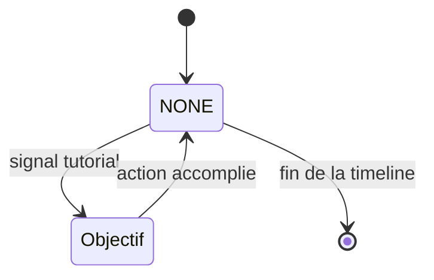
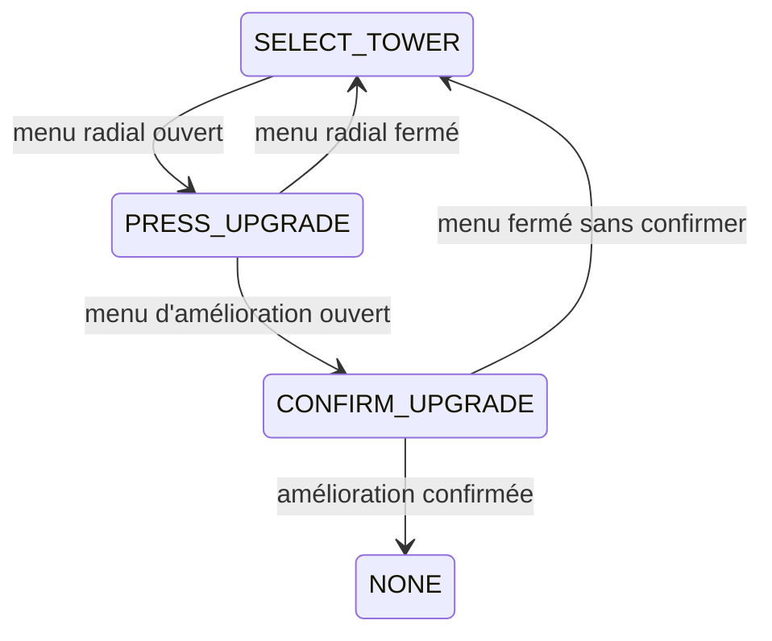

Le jeu contient un tutoriel guidé sur `lev.01` et un dialogue d'introduction à l'armurerie. Les deux utilisent [Dialogic](/documentation/development/guides/dialogic-guide/). Le guide qui parle au joueur est Whiskas (`character1`):

## Tutoriel du premier niveau

### Composants

- `TutorialManager` (`scenes/ui/tutorial/tutorial_manager.gd`): enfant de la scène `ui.tscn`, il orchestre les dialogues et les objectifs.
- `TutorialOverlay` (`scenes/ui/tutorial/tutorial_overlay.gd`): flèche animée qui pointe un contrôle de l'interface ou un élément du monde.
- `TutorialPlacementHint` (`scenes/gameplay/world/level/tutorial_placement_hint.gd`): indicateur de la tuile à utiliser pendant l'étape de placement.
- Timelines: `res://assets/narrative/tutorial_level_01.en.dtl` et `tutorial_level_01.fr.dtl`.

### Déclenchement

`ui.gd` appelle `TutorialManager.on_level_started(level)` au démarrage d'un niveau, et `on_level_ended()` à sa fin.
Le tutoriel ne démarre que si `level_id == "lev.01"` et que `ProgressionManager.is_tutorial_completed()` est `false`.

Dans `ILevel`, le démarrage des vagues de `lev.01` est différé tant que le tutoriel n'est pas terminé : le `TutorialManager` appelle `start_wave_flow()` une fois l'objectif de placement validé.

### Objectifs

`TutorialManager` suit un objectif à la fois (enum `Objective`, `NONE` entre deux objectifs). Une timeline active un objectif par un signal Dialogic `tutorial:<objectif>`, puis le dialogue attend l'action du joueur.

L'amélioration d'une tour enchaîne trois objectifs, avec un retour en arrière possible:

| Objectif | Action attendue |
|---|---|
| `OPEN_BUILD_MENU` | Ouvrir le menu de construction |
| `SELECT_BUILD_CARD` | Choisir une carte de tour |
| `PLACE_CONFIRM` | Placer et confirmer la tour. Le `TutorialPlacementHint` indique la tuile et `ILevel.start_wave_flow()` démarre les vagues |
| `SELECT_TOWER` | Sélectionner la tour posée. Activé par `TutorialManager` après `KILLS_TO_ACTIVATE_UPGRADE` (5) ennemis tués depuis la pose, pas par un signal |
| `PRESS_UPGRADE` | Appuyer sur le bouton d'amélioration |
| `CONFIRM_UPGRADE` | Confirmer l'amélioration (flèche seule, sans dialogue) |
| `PAUSE_AND_RESUME` | Mettre en pause puis reprendre |

À la fin de la timeline, le tutoriel s'arrête et `ProgressionManager.mark_tutorial_completed()` est appelé.

## Introduction de l'armurerie

Au premier affichage du menu armurerie, `armory.gd` vérifie `ProgressionManager.is_armory_intro_seen()`. Si l'intro n'a pas été vue, il appelle `mark_armory_intro_seen()` puis lance `armory_intro.<langue>.dtl` (choix du fichier: [Dialogic](/documentation/development/guides/dialogic-guide/#intégration-gdscript)). Le bouton d'aide de l'armurerie relance le dialogue.

Les drapeaux `tutorial_completed` et `armory_intro_seen` sont décrits dans [Progression et sauvegarde](/documentation/development/models/progression-model/).
