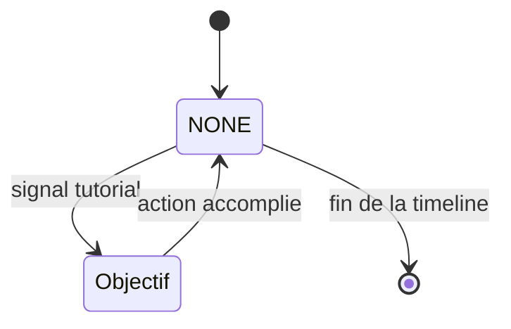
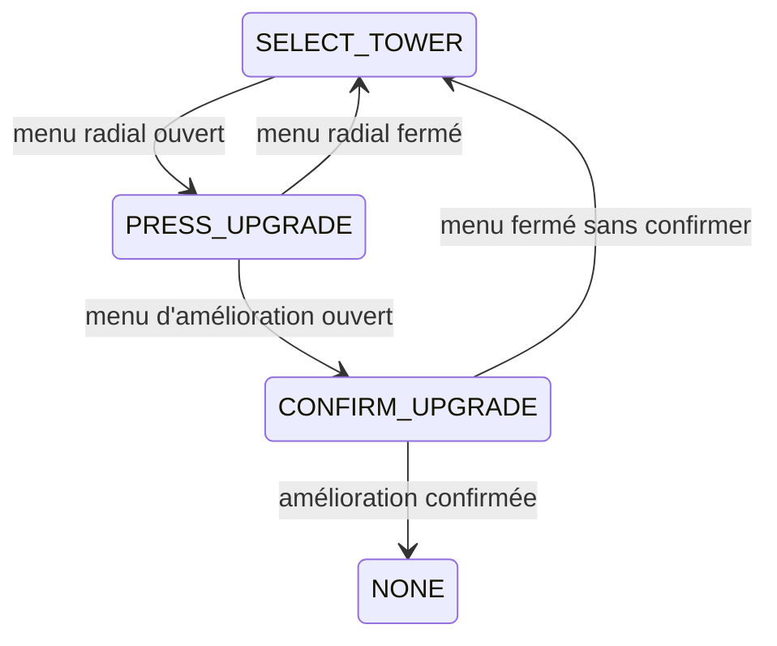

Le jeu contient un tutoriel guidé sur `lev.01` et un dialogue d'introduction à l'armurerie. Les deux utilisent [Dialogic](/documentation/development/guides/dialogic-guide/). Le guide qui parle au joueur est Whiskas (`character1`):

## Tutoriel du premier niveau

### Composants

- `TutorialManager` (`scenes/ui/tutorial/tutorial_manager.gd`): enfant de la scène `ui.tscn`, il orchestre les dialogues et les objectifs.
- `TutorialOverlay` (`scenes/ui/tutorial/tutorial_overlay.gd`): flèche animée qui pointe un contrôle de l'interface ou un élément du monde.
- `TutorialPlacementHint` (`scenes/gameplay/world/level/tutorial_placement_hint.gd`): indicateur de la tuile à utiliser pendant l'étape de placement.
- Timelines: `res://assets/narrative/tutorial_level_01.en.dtl` et `tutorial_level_01.fr.dtl`, choisies par `Narrative.timeline_path(TIMELINE_BASE)` (`TIMELINE_BASE = "tutorial_level_01"`, repli sur l'anglais).

### Déclenchement

`ui.gd` appelle `TutorialManager.on_level_started(level)` au démarrage d'un niveau (`UI.start_level()`), et `on_level_ended()` à sa fin.
Le tutoriel ne démarre que si `level_id == "lev.01"` (`LEVEL_ID_TUTORIAL`) et que `ProgressionManager.is_tutorial_completed()` est `false`. Au démarrage, `_start_tutorial()` attend la fin d'une éventuelle timeline en cours, puis passe `Dialogic.process_mode` en `PROCESS_MODE_ALWAYS`, verrouille la caméra sur la tuile du `TutorialPlacementHint` et lance la timeline.

Dans `ILevel`, le démarrage des vagues de `lev.01` est différé tant que le tutoriel n'est pas terminé (`_should_defer_wave_start_for_tutorial()`): le `TutorialManager` appelle `start_wave_flow()` une fois l'objectif de placement validé.

Tant que le tutoriel n'est pas terminé, le bouton « Jouer » de l'accueil lance `lev.01` directement et l'armurerie et l'encyclopédie sont verrouillées ([Parcours hors niveau](/documentation/development/user-flows/off-game/)).

### Objectifs

`TutorialManager` suit un objectif à la fois (enum `Objective`, `NONE` entre deux objectifs). Une timeline active un objectif par un événement signal Dialogic `tutorial:<objectif>`, puis le dialogue attend l'action du joueur: `Dialogic.paused` passe à `true` et le layout est masqué tant que l'objectif n'est pas accompli.

Les événements gérés par `_handle_tutorial_event()`:

| Événement | Effet |
|---|---|
| `tutorial:open_build_menu` | Active `OPEN_BUILD_MENU` |
| `tutorial:select_build_card` | Active `SELECT_BUILD_CARD` |
| `tutorial:place_confirm` | Active `PLACE_CONFIRM` |
| `tutorial:select_tower` | Suspend la timeline (`Dialogic.paused = true`) et masque le layout, en attendant le clic sur la tour |
| `tutorial:press_upgrade` | Réactive la saisie du menu radial, suspend la timeline et masque le layout |
| `tutorial:pause_and_resume` | Active `PAUSE_AND_RESUME` |

L'amélioration d'une tour enchaîne trois objectifs, avec un retour en arrière possible:

| Objectif | Action attendue |
|---|---|
| `OPEN_BUILD_MENU` | Ouvrir le menu de construction |
| `SELECT_BUILD_CARD` | Choisir une carte de tour |
| `PLACE_CONFIRM` | Placer et confirmer la tour. Le `TutorialPlacementHint` indique la tuile et `ILevel.start_wave_flow()` démarre les vagues |
| `SELECT_TOWER` | Sélectionner la tour posée. Activé par `TutorialManager` après `KILLS_TO_ACTIVATE_UPGRADE` (5) ennemis tués depuis la pose, pas par un signal |
| `PRESS_UPGRADE` | Appuyer sur le bouton d'amélioration |
| `CONFIRM_UPGRADE` | Confirmer l'amélioration (flèche seule, sans dialogue) |
| `PAUSE_AND_RESUME` | Mettre en pause puis reprendre |

### Pauses

Le tutoriel combine deux mécanismes:

- `Dialogic.paused` suspend la timeline pendant qu'un objectif attend le joueur. Le jeu continue de tourner.
- La source de pause `&"tutorial"` (`TutorialManager.PAUSE_SOURCE`, voir [pause par source](/documentation/development/models/level-model/)) gèle le gameplay pendant que des répliques se jouent sans action du joueur. Elle appartient à `Global.TREE_PAUSING_SOURCES` et `Global.TIME_RUNNING_SOURCES`: l'arbre est en pause mais Dialogic continue de révéler le texte.

La source `&"tutorial"` est demandée une seule fois, quand l'amélioration est confirmée: les répliques qui suivent se jouent sur un jeu gelé. Elle est relâchée à l'activation de chaque objectif suivant (`_activate_objective`, car tout objectif attend une action du joueur) et à l'arrêt du tutoriel.

Les objectifs `SELECT_TOWER` et `PRESS_UPGRADE` remettent `Dialogic.paused` à `false` et affichent le layout (le jeu continue pour que les menus animent); `CONFIRM_UPGRADE` affiche seulement une flèche.

### Fin et arrêt

La timeline se termine par `[end_timeline]`. À `Dialogic.timeline_ended`, `_stop_tutorial(true)` appelle `ProgressionManager.mark_tutorial_completed()` (réglage `tutorial_completed`).

`_stop_tutorial(false)` arrête le tutoriel sans le marquer comme terminé. Il est appelé quand:

- le niveau se termine: `ILevel._on_level_end()` et `UI.end_level()` appellent `on_level_ended()`, avant l'ajout de l'écran de fin, pour que les dialogues uniques de l'écran de fin ne soient pas bloqués;
- un autre niveau démarre ou que le niveau n'est plus valide.

Dans tous les cas, l'arrêt masque l'overlay et l'indicateur de placement, remet `Dialogic.paused` à `false`, rend la caméra au joueur, relâche la source `&"tutorial"` et restaure le `process_mode` de Dialogic. Si la timeline tourne encore, elle est terminée avec `Dialogic.end_timeline(true)`. Un tutoriel quitté avant sa fin se relance donc au prochain démarrage de `lev.01`.

Les dialogues uniques (`Narrative.play_once`) sont ignorés, sans poser leur drapeau, tant que la timeline du tutoriel tourne.

## Introduction de l'armurerie

À l'ouverture du menu armurerie, `armory.gd` appelle `Narrative.play_once(&"armory_intro_seen", "armory_intro")` dans `_ready()`: la timeline `armory_intro.<langue>.dtl` se joue une fois par sauvegarde (choix du fichier et pause: [Dialogic](/documentation/development/guides/dialogic-guide/#narrative)). Le bouton d'aide de l'armurerie relance le dialogue avec `Dialogic.start(Narrative.timeline_path("armory_intro"))`.

Le réglage `tutorial_completed` et le drapeau `armory_intro_seen` (dans `flags`) sont décrits dans [Progression et sauvegarde](/documentation/development/models/progression-model/).
