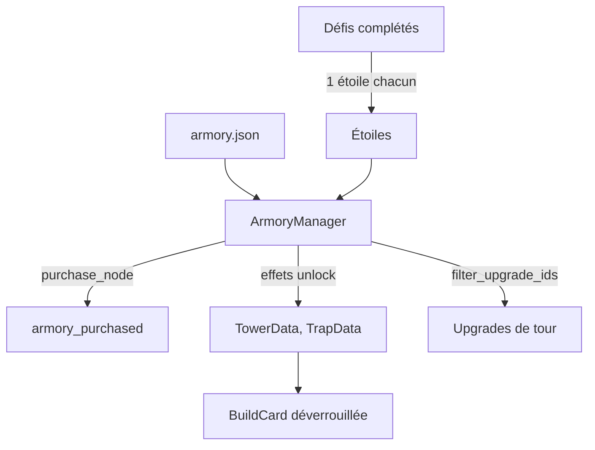

L'armurerie est la méta-progression basée sur les étoiles gagnées via les défis. Elle combine:

- un graphe de nœuds à acheter (`nodes`)
- des contraintes de prérequis (`prerequisites`)
- des effets appliqués au jeu (`effects`)
- des verrous d'upgrade (`upgrade_gates`)

La source de vérité est `res://data/armory/armory.json`.



Les étoiles gagnées sont le nombre total de défis complétés, tous niveaux confondus.

## Structure JSON

### Node

```json
{
  "id": "unlock_bat_02",
  "cost_stars": 1,
  "prerequisites": [],
  "category": "periphery_building",
  "effects": [{ "type": "unlock_tower", "tower_id": "bat_02" }]
}
```

### Upgrade gate

```json
{
  "upgrade_id": "bat_02_a_04",
  "requires_node": "unlock_bat_02_branch_a"
}
```

## Catégories

- `periphery_building`: déblocage d'une tour ou d'un piège
- `periphery_upgrade`: upgrade de périphérie
- `core_buff`: bonus appliqués à toutes les tours

## Effets supportés

- `unlock_tower`
- `unlock_trap`
- `append_tower_upgrade` (champs `tower_id` et `upgrade_id`): ajoute une upgrade aux upgrades disponibles de la tour
- `tower_buff`: multiplicateurs `fire_rate_mult`, `shoot_range_mult` et `bullet_damage_mult`, pris en compte uniquement pour la catégorie `core_buff`

Les effets `unlock_*` mettent à jour la progression via `ProgressionManager`.
Aucun nœud de `armory.json` n'utilise `tower_buff` ni `append_tower_upgrade`.

## API ArmoryManager

- `can_purchase(node_id)`, `purchase_node(node_id)`
- `are_prerequisites_met(node_id)`, `get_unmet_prerequisite_node_ids(node_id)`
- `is_node_purchased(node_id)`
- `get_available_stars()`, `get_spent_stars()`, `get_total_earned_stars()`
- `filter_upgrade_ids(ids)`: retire les upgrades dont la gate n'est pas achetée
- `reset_armory_spending()`
- signal `armory_updated`

Au chargement, `armory.json` est validé: effets inconnus, ids invalides et cycles de prérequis sont signalés dans les logs.

## Tour de départ

La tour `bat_01` est débloquée d'office (`ARMORY_STARTER_TOWER_IDS` dans `ProgressionManager`). `ARMORY_STARTER_TRAP_IDS` est vide: tous les pièges et les autres tours passent par l'armurerie. Les déblocages par défaut sont recalculés d'après les ids de `StatsDB` ([Progression](/documentation/development/models/progression-model/#flux-métier)).

Le premier achat déclenche le dialogue `armory_first_unlock` (drapeau `armory_first_unlock_seen`) et la première ouverture de l'armurerie le dialogue `armory_intro` ([Progression](/documentation/development/models/progression-model/#settingsdata)).

## Persistance

L'état joueur est stocké dans `ProgressionData`:

- `armory_purchased: Array[String]` (ids de nœuds achetés)
- `armory_legacy_mode: bool`

## Contraintes métier

- Un nœud ne peut être acheté que si tous ses prérequis sont validés.
- Le joueur doit avoir assez d'étoiles (`cost_stars`).
- Les upgrades verrouillées doivent vérifier la gate avant d'être proposées.

Les ids de nœuds sont stockés dans la sauvegarde: ne pas en renommer sans migration.
