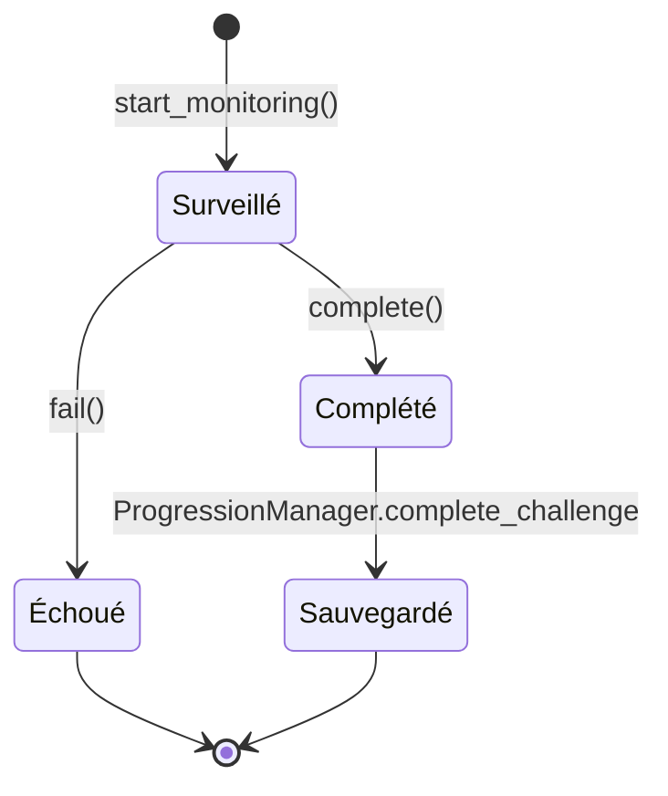

`Challenge` représente un défi: un objectif optionnel attaché à un niveau. Cycle de vie: initialisation (`_init(p_id, p_title, p_desc, p_diff)`), début de monitoring (`start_monitoring`), puis échec ou complétion (`fail` / `complete`).



`complete()` est appelé par `ChallengeManager.check_victory_conditions()` à la victoire quand `check_completion()` vaut `true`, ou directement par la logique du défi (cha.004, cha.105). `fail()` vient des hooks `on_*` de la logique du défi.

## Contrat public

### Propriétés clés

- `id: String`
- `title: String`
- `description: String`
- `difficulty: String`
- `is_completed: bool`
- `is_failed: bool`

### Signaux

- `completed(challenge_id: String)`
- `failed(challenge_id: String)`

### Méthodes publiques

- `start_monitoring()`: réinitialise l'état du défi au démarrage du niveau. Une logique qui garde un état le remet à zéro en appelant `super.start_monitoring()`.
- `check_completion() -> bool`: renvoie `true` si le défi n'est pas en échec. Une logique la surcharge pour ajouter sa condition.
- `complete()`: marque comme complété et enregistre l'état via `ProgressionManager.complete_challenge(...)`.
- `fail()`: marque comme échoué.

### Hooks à surcharger

Les hooks virtuels de `Challenge` ne font rien par défaut. Une logique surcharge ceux dont elle a besoin:

| Hook | Appelé quand |
|---|---|
| `on_damage_taken(amount: int)` | La base perd de la vie (`amount` points réellement perdus, `ILevel.health` est déjà à jour) |
| `on_tower_placed(tower: ITower)` | Une tour est posée |
| `on_trap_placed(trap: ITrap)` | Un piège est posé |
| `on_enemy_hit(enemy: IEnemy, source: Variant)` | Un ennemi est touché, `source` est le projectile, la tour ou le piège |
| `on_enemy_died(enemy: IEnemy, damage_type: IEnemy.DamageType, source: Variant)` | Un ennemi meurt, `source` est la tour (ou le piège) qui a porté le coup fatal, `null` pour le poison |
| `on_enemy_escaped(enemy: IEnemy)` | Un ennemi arrive au bout du chemin vivant (ce n'est pas une mort) |

## Notifications du ChallengeManager

Le `ChallengeManager` (autoload) relaie les événements de jeu aux défis actifs, qui les reçoivent dans leurs hooks:

- `notify_damage(amount, source)`
- `notify_tower_placed(tower)`
- `notify_trap_placed(trap)`
- `notify_building_placed(building)`: redirige vers l'une des deux méthodes précédentes selon `get_building_kind()`
- `notify_enemy_hit(enemy, source)`
- `notify_enemy_died(enemy, damage_type, source)`
- `notify_enemy_escaped(enemy)`

Autres membres du `ChallengeManager`:

- `challenge_status_updated(challenge_id, is_completed, is_failed)`: signal émis uniquement quand le statut d'un défi change.
- `challenges_loaded`: signal émis une fois les défis du niveau chargés.
- `get_active_challenges() -> Array[Challenge]`: défis actifs du niveau en cours.
- `emit_runtime_status()`: émet `challenge_status_updated` pour chaque défi actif.

## Flux d'exécution

- Au démarrage du niveau, `ChallengeManager.start_level_challenges(level_id)` lit la clé `challenges` du JSON du niveau, instancie la logique de chaque défi et appelle `start_monitoring()`.
- Les logiques notifient leur état via `fail()` et `complete()` en réponse aux hooks.
- En victoire, `ChallengeManager.check_victory_conditions()` lance la vérification de complétion de chaque défi.
- En cas de succès, le défi est persisté dans `LevelData.challenges_completed`.

## Données JSON associées

Chaque défi est décrit par un JSON dans `res://resources/challenges`:

```json
{
  "id": "cha.000",
  "name": "CHALLENGE.CHA.000.NAME",
  "description": "CHALLENGE.CHA.000.DESC",
  "difficulty": "Easy",
  "script": "res://scripts/challenges/logics/cha.000.gd"
}
```

Le champ `script` pointe vers la logique du défi. Les 17 défis ont leur propre `cha.XXX.gd` dans `scripts/challenges/logics/`: il n'existe pas de logique `impossible.gd`. Un identifiant de niveau sans fichier JSON de défi est ignoré avec un log `WARN`.

## Défis du jeu

| Défi | Difficulté | Règle |
|---|---|---|
| `cha.000` | Easy | Finir le niveau |
| `cha.001` | Easy | Ne subir aucun dégât (`on_damage_taken` avec `amount > 0` échoue) |
| `cha.002` | Easy | Ne poser aucun piège |
| `cha.003` | Easy | N'utiliser qu'un seul type de tour (comparé par `scene_file_path`) |
| `cha.004` | Easy | Tuer 10 rats (`enemy_id == "rat"`) avec des dégâts `FIRE`, complété dès le dixième |
| `cha.005` | Easy | Chaque tour posée doit tuer au moins un ennemi (le tueur est la tour source). Une tour vendue n'est plus exigée |
| `cha.101` | Medium | Chaque tour posée doit être d'un type unique (un second exemplaire du même type échoue) |
| `cha.102` | Medium | Aucune tour dans la portée d'une autre: échoue si la distance entre deux tours est inférieure ou égale à la plus grande de leurs `shoot_range` réelles (cases et upgrades comprises) |
| `cha.103` | Medium | Aucun ennemi ne dépasse la moitié du chemin (`get_progress_ratio() > 0.5`, contrôlé toutes les 5 frames) |
| `cha.104` | Medium | Laisser passer exactement 3 rats (`on_enemy_escaped`): un quatrième échoue. Un `WARN` est loggué au démarrage quand 3 x `escape_damage` du rat atteint `max_health` (défi alors inatteignable): avec 5 de dégâts et 20 PV, il reste atteignable |
| `cha.105` | Medium | Le boss (`BIG_DADDY`) doit être touché par un piège passif et par un piège limité (`get_trap_type()`), complété au second type |
| `cha.106` | Medium | Survivre: la base doit encore tenir à la fin (`health > 0`) |
| `cha.201` | Hard | Laisser passer exactement un ennemi de chaque type du niveau. Les types sont lus dans les étapes de spawn des vagues parsées (`ILevel.waves`), un second ennemi du même type échoue |
| `cha.202` | Hard | Finir avec exactement 1 PV |
| `cha.203` | Hard | Finir chaque vague avec 4 bâtiments (tours et pièges) debout au plus: contrôlé au début de chaque vague suivante (`wave_started`) et à la victoire. Un bâtiment vendu ou consommé ne compte plus |
| `cha.204` | Hard | N'utiliser que des pièges: poser une tour échoue |
| `cha.205` | Hard | Finir en moins de 3 minutes de temps de jeu (`ILevel.elapsed_time` < 180 s) |

Les défis attribués à chaque niveau sont listés dans [Créer un niveau](/documentation/development/guides/levels-and-arcs/#niveaux-existants). Ajouter un défi: [Recettes](/documentation/development/guides/recipes/#ajouter-un-défi).

## Dépendances

- `ChallengeManager`
- `ILevel.current_level`
- `ProgressionManager`
- Scripts de `res://scripts/challenges/logics/*.gd`

## Points de vigilance

- `complete()` et `fail()` sont sans effet si le défi est déjà complété ou échoué: un défi ne peut pas être les deux.
- Le script de logique doit rester idempotent sur les notifications de gameplay et remettre son état à zéro dans `start_monitoring()` (un niveau peut être relancé).
- Un ennemi qui arrive au bout du chemin n'appelle pas `on_enemy_died`: un défi sur les ennemis qui passent lit `on_enemy_escaped`.
