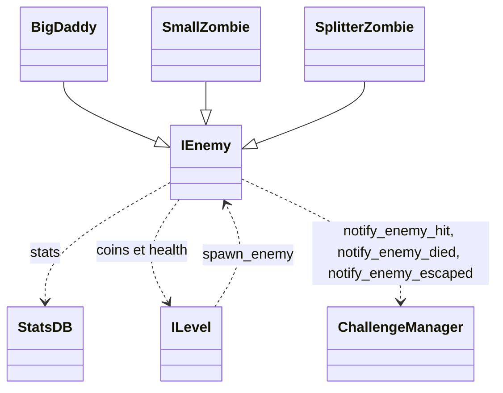

`IEnemy` est la classe de base des ennemis. Elle gère le déplacement sur un `Path2D`, la vie et les dégâts, les effets d'état (poison, stun, electrify, ralentissements) et les signaux de mort et d'arrivée. Un ennemi apparaît via une étape `SPAWN` ([Vagues](/documentation/development/models/wave-model/)), qui retrouve sa scène par `StatsDB.get_enemy_scene(enemy_id)`.

## Diagramme de classes

## Contrat public

### Signaux

- `died`: émis à la mort, après la récompense et la notification aux défis
- `escaped`: émis quand l'ennemi arrive au bout du chemin vivant

`IEnemy` n'émet que ces deux signaux. Un `BIG_DADDY` appelle directement `Global.camera.handle_effect("shake")` à son `_ready()`.

### Propriétés clés

| Propriété | Type |
|---|---|
| `enemy_id` | `String`, la clé de l'ennemi dans `stats.json` |
| `type` | `EnemyType`: `BIG_DADDY`, `DEFAULT`, `RAT` |
| `health`, `max_health` | `float` |
| `base_speed`, `speed` | `float`: `speed` est `base_speed` multiplié par tous les modificateurs |
| `reward`, `escape_damage` | `int`, lus dans les stats |
| `trap_disable_duration` | `float`, durée pendant laquelle l'ennemi désamorce un piège (0 par défaut) |
| `state` | `EnemyState` (voir [États](#états)) |
| `is_stunned` | `bool` |

Les types de dégâts (`DamageType`) sont `DEFAULT`, `POISON`, `FIRE` et `STUN`. La constante `DAMAGE_COLORS: Dictionary[DamageType, Color]` donne la couleur du flash et du popup de chaque type (blanc, violet `#744187`, orange, jaune). `take_damage()` passe cette couleur et la tour à l'origine du coup à `PopupSpawner.display_damage(amount, color, tower)`.

### Méthodes publiques

- `take_damage(damage: float, damage_type: DamageType, source: Variant = null)`
- `follow_path(delta: float)`
- `add_poison_effect(damage: float, total_execution: int, interval: float)`
- `apply_electrify_effect(duration: float, slow_amount: float, tick_damage: float, tick_interval: float, source: Variant = null)`
- `is_electrified() -> bool`
- `stun(duration: float)`
- `set_speed_modifier(key: StringName, multiplier: float)` et `remove_speed_modifier(key: StringName)`
- `push_visual(key: StringName)` et `pop_visual(key: StringName)`

## États

- `FOLLOW_PATH`: ennemi en mouvement
- `DEAD`: ennemi mort (récompense et retrait du jeu)
- `PATH_FINISHED`: ennemi arrivé à la fin du chemin

`_physics_process` ne fait rien pendant une pause (`Global.paused`).

## Modificateurs de vitesse

La vitesse n'est pas écrite directement: chaque effet pose un multiplicateur sous sa propre clé avec `set_speed_modifier(key, multiplier)`, et `speed = base_speed * produit de tous les multiplicateurs`. Deux effets de clés différentes se cumulent, et retirer un effet (`remove_speed_modifier(key)`) restaure la vitesse que les autres laissent. Clés utilisées:

| Clé | Posée par |
|---|---|
| `electrify` | `apply_electrify_effect()` (la plus forte lenteur est gardée quand l'effet est rafraîchi) |
| `bat_03` | Piège à lames: immobilise (`0.0`) l'ennemi qui a survécu au coup |
| `bat_04` | Piège ralentissant: `1.0 - slow_amount`. Deux pièges ralentissants ne se cumulent pas sur un même ennemi |

Les teintes visuelles (ralenti, poison, stun, faisceau de l'Inferno) s'empilent sur la teinte de base du sprite. `push_visual(key)` et `pop_visual(key)` comptent les références d'un effet visuel: la clé `inferno` (`VISUAL_KEY_INFERNO`) teinte l'ennemi tant qu'au moins un faisceau le touche.

## Source des stats

Les stats runtime viennent de `data/stats.json` via `StatsDB` ([Statistiques](/documentation/development/models/stats-model/)). Champs: `max_health`, `speed`, `reward`, `escape_damage`, `scene` et `extra` (optionnel, comportement spécifique).

Au `_ready()`, `IEnemy` lit l'entrée dont la clé est son export `enemy_id` (une erreur est loguée si la clé manque) et applique `max_health`, `speed` (vers `base_speed`), `reward` et `escape_damage`. Les clés de `extra` sont ensuite écrites par `StatsDB.apply_fields(self, extra)` dans la propriété du même nom, convertie au type de cette propriété (`trap_disable_duration` pour tous les ennemis, `spawn_count` pour `SplitterZombie`, `shoot_range` et les délais pour `BigDaddy`). Une clé sans propriété correspondante est ignorée avec un log `WARN`: une nouvelle clé d'`extra` demande une propriété du même nom dans le script de l'ennemi ([Statistiques](/documentation/development/models/stats-model/#application-des-stats)). L'`enemy_id` est le même partout: étape de vague, export de la scène et clé de `stats.json` (`default_zombie`).

## Catalogue

Scènes de `game/enemies/`, toutes héritées de `i_enemy.tscn`. Le champ `scene` de `stats.json` désigne le fichier, dont le nom est la clé de l'ennemi (`default_zombie.tscn`, `damage_zombie.tscn`, `rat.tscn`...):

| Sprite | Clé `stats.json` | Vie | Vitesse | `reward` | Particularité |
|---|---|---|---|---|---|
|  | `default_zombie` | 50 | 35 | 20 | Ennemi de base |
|  | `damage_zombie` | 120 | 20 | 40 | Feuille d'animation `zombie_lom_damage_sheet.png` |
|  | `rat` | 25 | 70 | 5 | `type = RAT` |
|  | `splitter_zombie` | 150 | 35 | 5 | `SplitterZombie`: teinté en rouge, à sa mort fait apparaître `extra.spawn_count` (4) petits zombies près de sa position sur le chemin |
|  | `small_zombie` | 25 | 70 | 10 | `SmallZombie`: teinté en rose, échelle 0,6, apparaît avec une animation |
|  | `minesweeper` | 70 | 45 | 12 | Scène héritée de `damage_zombie.tscn`, teintée en vert, sans script. `extra.trap_disable_duration` (5) désamorce les pièges qu'il croise |
|  | `big_daddy` | 700 | 20 | 400 | `BigDaddy`, `type = BIG_DADDY`, voir [Big Daddy](#big-daddy) |

Tous ont `escape_damage = 5`. Chaque sprite est la première image de la feuille d'animation de la scène, avec la teinte de la scène. `default_zombie`, `splitter_zombie` et `small_zombie` partagent la feuille `zombie_lom_base_sheet.png`, `damage_zombie` et `minesweeper` la feuille `zombie_lom_damage_sheet.png` (dans `assets/sprites/enemies/`).

Le type `BIG_DADDY` secoue la caméra à l'apparition ([Caméra](/documentation/development/guides/camera/)).

## Barre de vie

`EnemyHealthBar` (`health_bar.gd`) affiche la vie de l'ennemi, de vert à rouge selon le pourcentage restant. Elle est invisible tant que l'ennemi n'est pas touché. `update_health(current_health, max_health)` crée un seul `Tween` qui fait monter l'opacité à 1 en `FADE_IN_DURATION` (0,1 s), attend jusqu'à `FADE_DELAY` (4 s) puis ramène l'opacité à `FADE_ALPHA` (0,5) en `FADE_DURATION` (1 s). Un nouveau coup tue le tween en cours et relance toute la séquence: il n'y a ni `Timer` ni second tween.

## Mort et arrivée

- **Mort**: l'ennemi rapporte `reward` pièces, multipliées par le `reward_multiplier` de la tour qui a porté le coup fatal (une case bonus d'or le monte à 1,5). `ChallengeManager.notify_enemy_died` est appelé, puis `died` est émis, puis l'ennemi est retiré du jeu. Un coup fatal sans tour d'origine (poison, piège) rapporte `reward` tel quel.
- **Arrivée**: l'ennemi appelle `ChallengeManager.notify_enemy_escaped`, émet `escaped` et retire `escape_damage` points de vie à la base. Une arrivée n'est pas une mort: elle ne rapporte rien et n'appelle pas `notify_enemy_died`. Pour `BIG_DADDY`, la vie de la base tombe à 0 et le niveau est perdu aussitôt.

## Big Daddy

`BigDaddy` (`game/enemies/big_daddy.gd`) attaque les tours à portée. Ses stats viennent de `extra` dans `stats.json`, écrites par `StatsDB.apply_fields` dans les propriétés du même nom: `shoot_range`, `tower_disable_duration`, `pre_attack_delay`, `attack_duration`, `post_attack_delay` et `attack_cooldown`. Les signaux `body_entered` et `body_exited` de sa zone de portée (`RangeArea`) sont connectés dans `_ready()`.

- Le cycle d'attaque est `PRE_ATTACK`, `ATTACKING`, `POST_ATTACK` puis `COOLDOWN`. Il s'arrête de marcher pendant les trois premières phases.
- Une attaque touche une seule fois: le premier projectile de la fenêtre `ATTACKING` est le coup réel, il désactive la tour touchée pendant `tower_disable_duration` secondes (`ITower.disable_tower_for`). Les projectiles suivants de la fenêtre (un toutes les 0,02 s, `STREAM_INTERVAL`) forment un flux purement visuel, sans collision ni effet ([Projectile](/documentation/development/models/projectile-model/#enemyprojectile)).
- Ses `Timer` (phases, flux) sont suspendus par `Global.pause_changed` et reprennent là où ils se sont arrêtés: une pause ne remet pas le cycle à zéro.
- Les tours qui ne sont plus `ACTIVE` ne sont pas ciblées.

## Apparition

`ILevel.spawn_enemy(path: Path2D, enemy: IEnemy)` est appelée par `WaveStepSpawn.exec()` (via `ILevel.current_level`) et par `SplitterZombie` pour ses petits zombies:

1. Crée un `PathFollow2D` (sans boucle ni rotation) sous le `Path2D`, avec un décalage latéral aléatoire d'au plus 0,2 tuile (`SPAWN_OFFSET_MAX_TILES`).
2. Nomme l'ennemi `ENEMY_<n>` et lui donne son `path` et son `path_follow`.
3. Connecte ses signaux `died` et `escaped` à `ILevel._on_enemy_removed` et compte l'ennemi vivant.
4. Ajoute l'ennemi au `PathFollow2D`.

Un ennemi ajouté à la main doit passer par cette méthode pour être compté dans la vague ([Niveau et carte](/documentation/development/models/level-model/#apparition-des-ennemis)). Pour créer un ennemi, voir [Recettes](/documentation/development/guides/recipes/#ajouter-un-ennemi).

## Dépendances

`StatsDB`, `ChallengeManager`, `Global`, `ILevel`.
