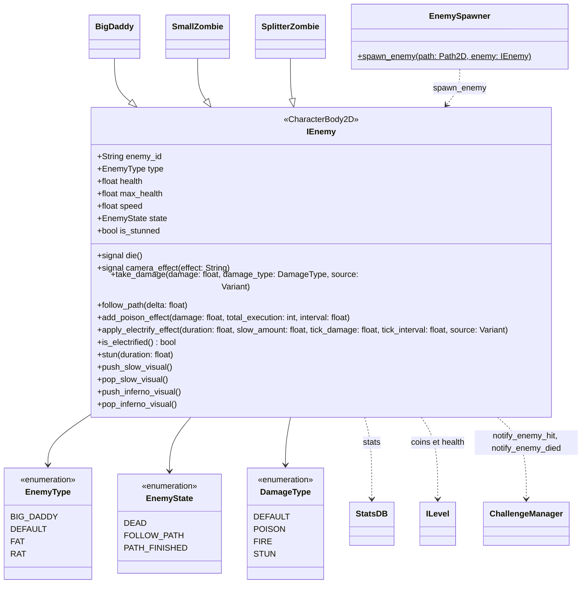

`IEnemy` est la classe de base des ennemis. Elle gère le déplacement sur un `Path2D`, la vie et les dégâts, les effets d'état (poison, stun, electrify, slow) et les signaux de mort. Un ennemi apparaît via une étape `SPAWN` ([Vagues](/documentation/development/models/wave-model/)), qui retrouve sa scène par `enemy_id` (`ene.01` charge `enemies/ene.01.tscn`).

## Diagramme de classes

## Contrat public

### Signaux

- `die`
- `camera_effect(effect: String)`

### Propriétés clés

`enemy_id`, `type`, `health`, `max_health`, `speed`, `state` et `is_stunned` (types dans le diagramme).

### Méthodes publiques

- `take_damage(damage: float, damage_type: DamageType, source: Variant = null)`
- `follow_path(delta: float)`
- `add_poison_effect(damage: float, total_execution: int, interval: float)`
- `apply_electrify_effect(duration: float, slow_amount: float, tick_damage: float, tick_interval: float, source: Variant = null)`
- `is_electrified() -> bool`
- `stun(duration: float)`

## États

- `FOLLOW_PATH`: ennemi en mouvement
- `DEAD`: ennemi mort (récompenses et cleanup)
- `PATH_FINISHED`: ennemi arrive à la fin du chemin

## Source des stats

Les stats runtime viennent de `assets/resources/configs/stats.json` via `StatsDB` ([Statistiques](/documentation/development/models/stats-model/)). Champs fréquents: `max_health`, `speed`, `reward`, `scene` et `extra` (optionnel, comportement spécifique).

## Dépendances

`StatsDB`, `ChallengeManager`, `Global`, `ILevel`.
