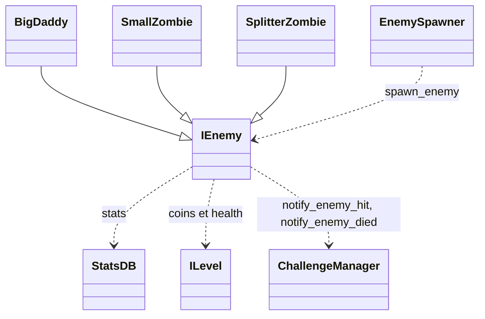

`IEnemy` est la classe de base des ennemis. Elle gère le déplacement sur un `Path2D`, la vie et les dégâts, les effets d'état (poison, stun, electrify, slow) et les signaux de mort. Un ennemi apparaît via une étape `SPAWN` ([Vagues](/documentation/development/models/wave-model/)), qui retrouve sa scène par `enemy_id` (`ene.01` charge `enemies/ene.01.tscn`).

## Diagramme de classes

## Contrat public

### Signaux

- `die`
- `camera_effect(effect: String)`

### Propriétés clés

| Propriété | Type |
|---|---|
| `enemy_id` | `String` |
| `type` | `EnemyType`: `BIG_DADDY`, `DEFAULT`, `FAT`, `RAT` |
| `health`, `max_health`, `speed` | `float` |
| `state` | `EnemyState` (voir [États](#états)) |
| `is_stunned` | `bool` |

Les types de dégâts (`DamageType`) sont `DEFAULT`, `POISON`, `FIRE` et `STUN`.

### Méthodes publiques

- `take_damage(damage: float, damage_type: DamageType, source: Variant = null)`
- `follow_path(delta: float)`
- `add_poison_effect(damage: float, total_execution: int, interval: float)`
- `apply_electrify_effect(duration: float, slow_amount: float, tick_damage: float, tick_interval: float, source: Variant = null)`
- `is_electrified() -> bool`
- `stun(duration: float)`
- `push_slow_visual()` et `pop_slow_visual()`
- `push_inferno_visual()` et `pop_inferno_visual()`

## États

- `FOLLOW_PATH`: ennemi en mouvement
- `DEAD`: ennemi mort (récompenses et cleanup)
- `PATH_FINISHED`: ennemi arrive à la fin du chemin

## Source des stats

Les stats runtime viennent de `assets/resources/configs/stats.json` via `StatsDB` ([Statistiques](/documentation/development/models/stats-model/)). Champs: `max_health`, `speed`, `reward`, `scene` et `extra` (optionnel, comportement spécifique).

Au `_ready()`, `IEnemy` lit l'entrée dont la clé est son export `enemy_id` et applique `max_health` et `speed` (une erreur est loguée si la clé manque). `reward` n'est lu que par l'[encyclopédie](/documentation/development/guides/ui/#encyclopédie).

Deux identifiants coexistent: l'`enemy_id` d'une étape de vague est le nom du fichier de scène (`ene.01`), l'export `enemy_id` de la scène est la clé de `stats.json` (`default_zombie`).

## Catalogue

Scènes de `scenes/gameplay/entities/enemy/enemies/`, toutes héritées de `i_enemy.tscn`:

| Sprite | Clé `stats.json` et scène | Vie | Vitesse | `reward` | Particularité |
|---|---|---|---|---|---|
|  | `default_zombie` `ene.01` | 50 | 35 | 20 | Ennemi de base |
|  | `damage_zombie` `ene.02` | 120 | 20 | 40 | |
|  | `rat` `ene.03` | 25 | 70 | 5 | `type = RAT` |
|  | `splitter_zombie` `splitter_zombie` | 150 | 35 | 5 | `SplitterZombie`: teinté en rouge, à sa mort fait apparaître `extra.spawn_count` (4) petits zombies près de sa position sur le chemin |
|  | `small_zombie` `small_zombie` | 25 | 70 | 10 | `SmallZombie`: teinté en rose, échelle 0,6, apparaît avec une animation |
|  | `minesweeper` `minesweeper` | 70 | 45 | 12 | Scène héritée de `ene.02`, teintée en vert, sans script |
|  | `big_daddy` `big_daddy` | 700 | 20 | 400 | `BigDaddy`, `type = BIG_DADDY`: tire sur les tours à portée et les désactive ([Projectile](/documentation/development/models/projectile-model/)). `extra`: `shoot_range`, `fire_rate`, `tower_disable_duration`, `pre_attack_delay`, `attack_duration`, `post_attack_delay`, `attack_cooldown` |

Chaque sprite est la première image de la feuille d'animation de la scène, avec la teinte de la scène. `ene.01`, `splitter_zombie` et `small_zombie` partagent la feuille `Zombie_lOM_Base-Sheet.png`, `ene.02` et `minesweeper` la feuille `Zombie_lOM_Damage-Sheet.png`.

Les types `FAT` et `BIG_DADDY` secouent la caméra à l'apparition et vident la vie de la base à l'arrivée. Aucune scène du projet n'utilise `FAT`.

## Mort et arrivée

- À sa mort, un ennemi rapporte 10 pièces, multipliées par le `reward_multiplier` de la tour qui a tiré le projectile fatal. Ce montant est écrit en dur dans `_dead_state()`: le champ `reward` de `stats.json` ne le change pas.
- À la fin du chemin, la base perd 5 points de vie. Pour `BIG_DADDY` et `FAT`, la vie tombe à 0.

## EnemySpawner

`EnemySpawner.spawn_enemy(path, enemy)` est une méthode statique appelée par `WaveStepSpawn.exec()`:

1. Crée un `PathFollow2D` (sans boucle ni rotation) sous le `Path2D`, avec un décalage latéral aléatoire d'au plus 0,2 tuile.
2. Nomme l'ennemi `ENEMY_<n>` et lui donne son `path` et son `path_follow`.
3. Connecte son signal `die` à `ILevel._on_enemy_die` et compte l'ennemi vivant (`_on_enemy_spawn()`).
4. Ajoute l'ennemi au `PathFollow2D`.

Un ennemi ajouté à la main doit passer par cette méthode pour être compté dans la vague. Pour créer un ennemi, voir [Recettes](/documentation/development/guides/recipes/#ajouter-un-ennemi).

## Dépendances

`StatsDB`, `ChallengeManager`, `Global`, `ILevel`.
