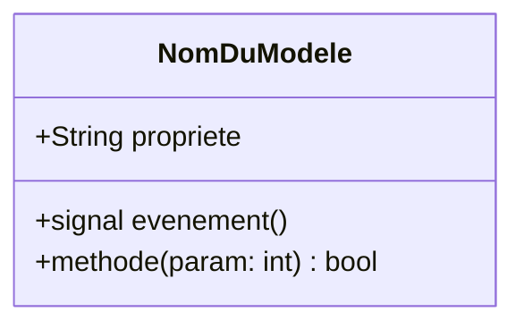

Une page de modèle décrit la responsabilité d'un composant (ennemi, tour, niveau...), ce qu'il expose (propriétés, signaux, méthodes), ses dépendances et les points sensibles à ne pas casser.

## Template

````markdown
---
title: Modèle [nom]
description: Description du modèle [nom]
sidebar:
  order: 100
---

## Description

## Responsabilités

## Contrat public

### Propriétés clés

### Signaux

### Méthodes publiques

## Utilisation

## Flux d'exécution

## Dépendances

## Cas limites / erreurs

## Bonnes pratiques

## Structure


````

Le titre du front matter devient le titre (H1) de la page: ne pas le répéter dans le corps.

## Diagramme

Le diagramme est un bloc de code `mermaid` dans la section `## Structure`. Il résume l'essentiel: attributs publics, signaux, méthodes publiques et relations majeures, sans couleurs. Voir [Rédiger la documentation](/documentation/contributing/writing-guidelines/#diagrammes-mermaid) et la [syntaxe `classDiagram`](https://mermaid.js.org/syntax/classDiagram.html).

Dans un `classDiagram`:

- variable publique: `+Type nom`
- membre statique: `+Type nom$` ou `+nom()$`
- signal: `+signal nom(param: type)`
- fonction: `+nom(param: type) type_de_retour`
- type de nœud ou enum: annotation `<<Node2D>>`, `<<enumeration>>`
- héritage: `Enfant --|> Parent`, composition: `A *-- B`, dépendance: `A ..> B`
