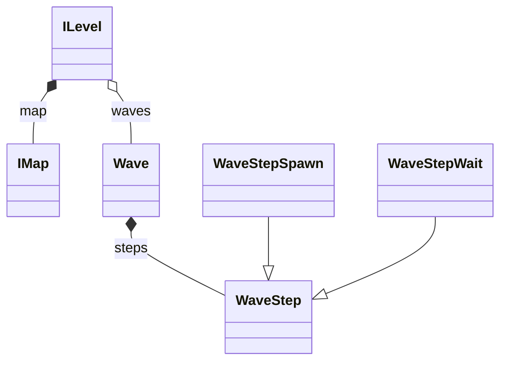

## Description

Le nœud **ILevel** est la base de tous les niveaux.
La référence du niveau en cours est accessible par la variable statique `ILevel.current_level`.

Propriétés exportées:

- `level_id`: identifiant du niveau (`lev.XX`), aussi nom du fichier JSON des vagues
- `level_name`: clé de traduction du nom (`LEVEL.LEV_0X.NAME`)
- `level_description`: clé de traduction de la description (`LEVEL.LEV_0X.DESC`)
- `arc_id`: arc auquel appartient le niveau (`arc.XX`)
- `map_scene`: scène de la map (`IMap`)

Les niveaux sont composés de **vagues**, elles-mêmes composées d'**étapes** ([Vagues](/documentation/development/models/wave-model/)). Les fichiers d'un niveau, les arcs et la création d'un niveau sont dans [Créer un niveau](/documentation/development/guides/levels-and-arcs/). Les états du niveau sont dans [Machine d'états](/documentation/development/models/state-machine/#états-dun-niveau).

## Diagramme de classes



| Classe | Membres |
|---|---|
| `ILevel` (`Node2D`) | `current_level` (statique), `map`, `state_machine` ([Machine d'états](/documentation/development/models/state-machine/)), `waves`, `current_step`, `current_wave`, `elapsed_time`, `coins`, `health`, `max_health`, signaux `stats_updated` et `wave_started(wave_number)`, méthodes `start_level()`, `start_wave_flow()`, `get_enemies_alive()` |
| `IMap` (`Node2D`) | `tilemap`, `placement_tilemap`, `props_tilemap` (des `TileMapLayer`), `paths`, `special_tiles`, `special_tile_percentage`, `play_special_tiles_intro_sequence()`, `get_tower_by_name(name)`, `is_tile_buildable(coords)`, `get_blocked_cells()` |
| `Wave` (`RefCounted`) | `steps`, `peak()`, `pop()` |
| `WaveStep` (`RefCounted`) | `build(data)` statique, `data()`, `exec()`, `is_over()` |

Gestion des chemins d'`IMap`:

| Méthode | Rôle |
|---|---|
| `activate_path(index)` et `deactivate_path(index)` | Active ou désactive un chemin, renvoie un `bool` |
| `is_path_active(index)` | Indique si le chemin est actif |
| `get_active_paths()` et `get_active_path_indices()` | Listent les chemins actifs (nœuds ou index) |
| `get_random_active_path()` | Renvoie un chemin actif au hasard, `null` s'il n'y en a aucun |
| `set_active_paths_only(indices)` | N'active que les chemins donnés |
| `get_path_distance(cell)` | Distance en pixels du centre d'une cellule au chemin le plus proche (tous les chemins, actifs ou non), mise en cache par cellule |
| `is_cell_on_path(cell)` | Vrai quand la boîte de placement (12,5 px de demi-côté, `PLACEMENT_HALF_SIZE`) touche un chemin |

La carte est faite de `TileMapLayer`: `tilemap` est le calque racine du terrain, ses enfants sont des calques supplémentaires (`IMap.get_combined_used_rect(root)` renvoie l'étendue de l'ensemble) et `placement_tilemap` marque les cellules constructibles. Voir [Construction](/documentation/development/guides/building-placement/#tuiles-de-placement).

## Démarrage et données du JSON

`ILevel.start_level()` lit `res://resources/levels/<level_id>.json` avec `JsonUtil.load_dict()`. Les clés `waves`, `start_coins` et `max_health` sont obligatoires (un `assert` échoue sinon): `coins` reçoit `start_coins`, `max_health` et `health` reçoivent `max_health`, et chaque entrée de `waves` devient une `Wave`. La clé `challenges` est lue par `ChallengeManager.start_level_challenges(level_id)`.

## Stats joueur

Les stats joueur runtime sont portées directement par `ILevel` et viennent du JSON du niveau (les valeurs de départ du script ne sont que des marqueurs):

- `health: int`: points de vie de la base, bornés entre 0 et `max_health` (20 dans les huit niveaux)
- `coins: int`: ressources de construction et d'upgrade (250 dans les huit niveaux)

Le signal `stats_updated` est émis après chaque changement de `coins` ou de `health`, ce qui rafraîchit l'UI.

- Quand `health` diminue, `ChallengeManager.notify_damage(amount)` est appelé avec les points réellement perdus, après la mise à jour de `health` (un défi lit donc la vie restante).
- Quand `health <= 0`, la machine à états passe à l'état `DEFEAT`.

Ces stats sont des stats de session (niveau en cours), distinctes de la sauvegarde (`ProgressionData`).

## Temps de jeu

`elapsed_time` compte les secondes de temps de jeu depuis le début du flux de vagues. Il n'avance pas pendant une pause (`Global.paused`) ni après la fin du niveau. `WaveStepWait` et le défi `cha.205` le lisent.

`get_enemies_alive()` renvoie le nombre d'ennemis vivants sur la carte: `EnemySpawner` appelle `_on_enemy_spawn()` à chaque apparition, et le niveau décompte un ennemi via `_on_enemy_removed()` quand son signal `died` ou `escaped` est émis.

## Pause

`ILevel` se connecte à `Global.pause_changed` dans `start_level()` ([Pause par source](/documentation/development/guides/architecture/#pause-par-source)). `_on_pause_changed(is_paused)` est appelé tout de suite, sans attendre un tick de l'horloge:

- Quand une source active gèle le temps (`Global.is_time_frozen()`), le niveau mémorise `Engine.time_scale` et le met à 0. Quand plus aucune source ne le gèle, il restaure la valeur mémorisée (aussi dans `_exit_tree()`). Le bouton d'avance rapide du HUD est ignoré pendant que le temps est gelé.
- Pendant `CONFIGURING` ou `WAVE_<i>`, une pause fait passer la machine à états à `PAUSE` (l'état précédent est mémorisé). Quand la dernière source libère sa pause, elle revient à cet état. Une pause est donc possible pendant l'introduction des tuiles spéciales.
- Après la fin du niveau, `_on_pause_changed` ne fait plus rien.

Sources de pause: `pause_menu`, `new_enemy`, `tower_info`, `upgrade_menu`, `dialogue`, `tutorial` et `level_end`. `Global.TREE_PAUSING_SOURCES` (`dialogue`, `new_enemy`, `pause_menu`, `tutorial`) met aussi l'arbre de scène en pause, `Global.TIME_RUNNING_SOURCES` (`dialogue`, `level_end`, `new_enemy`, `tutorial`) laisse le `time_scale` actif. Le tableau complet est dans [Architecture](/documentation/development/guides/architecture/#pause-par-source).

## Fin de niveau

`_on_level_end(victory)`, appelé par les états `VICTORY` et `DEFEAT`, arrête l'horloge et la musique, demande la pause `level_end` (le temps continue de tourner, mais le gameplay et la caméra s'arrêtent), arrête le tutoriel s'il tourne encore, ajoute le menu de fin de partie à `Global.ui` et passe à l'état `END`. Un boss (`BIG_DADDY`) qui arrive au bout du chemin met `health` à 0 et provoque donc une défaite immédiate.

## Horloge (Clock)

`Clock` (`scenes/gameplay/world/clock/clock.gd`) est un nœud enfant d'`ILevel` qui appelle des callbacks à intervalle régulier. Un tick dure `tick_rate` secondes (0,1 par défaut, donc 10 ticks = 1 seconde).

| Méthode | Rôle |
|---|---|
| `subscribe(callback, tick_count = 1) -> int` | Appelle `callback` tous les `tick_count` ticks, renvoie l'identifiant de l'abonnement |
| `unsubscribe(id) -> bool` | Retire l'abonnement |
| `start()` et `stop()` | Démarrent et arrêtent le `Timer` interne |

`ILevel.start_wave_flow()` abonne `_process_tick` tous les 5 ticks (toutes les 0,5 s) puis démarre l'horloge. À chaque cycle, `_process_tick` exécute le callback de l'état courant de la machine à états. `ILevel` arrête l'horloge à la fin du niveau.

```gdscript
clock.subscribe(_process_tick, 5)
clock.start()
```
