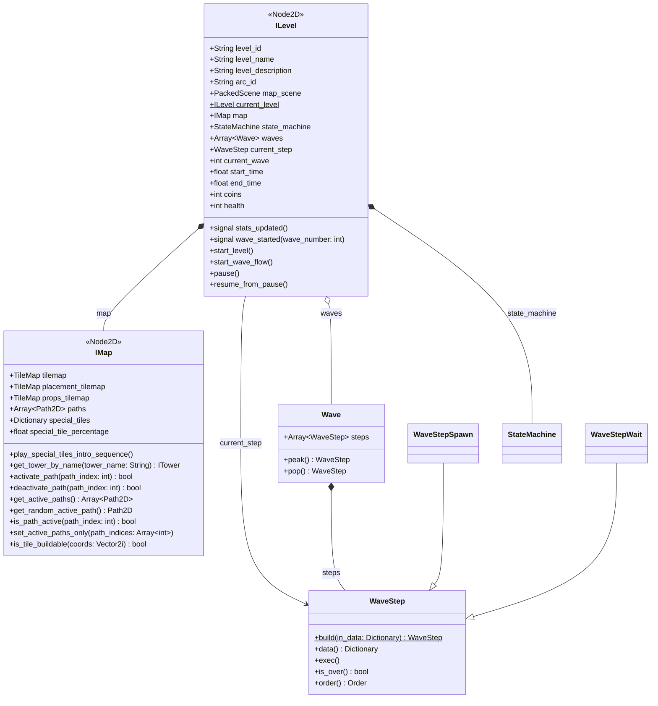

## Description

Le nœud **ILevel** est la base de tous les niveaux.
La référence du niveau en cours est accessible par la variable statique `ILevel.current_level`.

Propriétés exportées:

- `level_id`: identifiant du niveau (`lev.XX`), aussi nom du fichier JSON des vagues
- `level_name`
- `level_description`
- `arc_id`: arc auquel appartient le niveau (`arc.XX`)
- `map_scene`: scène de la map (`IMap`)

Les niveaux sont composés de **vagues**, elles-mêmes composées d'**étapes**.

**ILevel** utilise le nœud **Clock** afin d'exécuter son code métier à intervalle régulier, par défaut tous les **5 ticks** (*10 ticks = 1 seconde*).

Les types d'étapes sont décrits dans [Vagues](/documentation/development/models/wave-model/).

## Diagramme de classes



## Stats joueur

Les stats joueur runtime sont portées directement par `ILevel`:

- `health: int` (20 au départ): points de vie de la base
- `coins: int` (250 au départ): ressources de construction et d'upgrade

Le signal `stats_updated` est émis après chaque changement de `coins` ou de `health`, ce qui rafraîchit l'UI.

- Quand `health` diminue, `ChallengeManager.notify_damage(...)` est appelé.
- Quand `health <= 0`, la machine à états passe à l'état `DEFEAT`.

Ces stats sont des stats de session (niveau en cours), distinctes de la sauvegarde (`ProgressionData`).

## Créer un niveau "from scratch"

Dans l'ordre :

### Map

1. Godot > Scenes > New inherited scene... > `res://scenes/gameplay/world/map/i_map.tscn`
2. Sauvegarder la nouvelle map dans `res://scenes/gameplay/world/map/maps/arc.XX/map.XX.tscn` (exemples: `arc.01/map.01` à `arc.01/map.04`)
3. Dessiner la map depuis la TileMapPlains
4. Ajouter autant de node `Path2D` que nécessaire au node `Paths` puis dessiner les chemins

### Level

1. Godot > Scenes > New inherited scene... > `res://scenes/gameplay/world/level/i_level.tscn`
2. Sauvegarder le niveau dans `res://scenes/gameplay/world/level/levels/`. Le nom du fichier doit être `<level_id>.tscn` (exemple: `lev.01.tscn`)
3. Sélectionner le node `ILevel` nouvellement créé et configurer ses propriétés exportées. `map_scene` pointe vers la map, par exemple `res://scenes/gameplay/world/map/maps/arc.01/map.01.tscn` pour `lev.01`.

### Waves

Créer `res://resources/levels/<level_id>.json` avec les clés `challenges` (ids des [défis](/documentation/development/models/challenge-model/) du niveau), `status` (`done`, `current` ou `locked` dans les niveaux existants) et `waves`. Le format des vagues et des étapes est décrit dans [Vagues](/documentation/development/models/wave-model/).

```json
{
	"challenges": ["cha.000", "cha.001"],
	"status": "done",
	"waves": [
		[
			{"enemy_id": "ene.01", "count": 1, "spawner": 0},
			{"wait_s": 5.25}
		]
	]
}
```

## Arcs

Les niveaux sont regroupés en arcs, décrits dans `res://resources/arcs/`:

- `arc.01.json` (« Chat'lanques de Nyarseille »): `lev.01` à `lev.05`
- `arc.02.json` (« La mer Nyaditerranée »): `lev.06` à `lev.08`

Un fichier d'arc contient `id`, `next` (arc suivant), `name` et `levels` (statut de chaque niveau).
