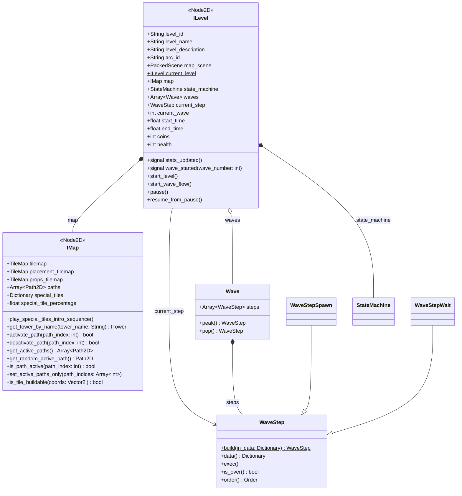

## Description

Le nœud **ILevel** est la base de tous les niveaux.
La référence du niveau en cours est accessible par la variable statique `ILevel.current_level`.

Propriétés exportées:

- `level_id`: identifiant du niveau (`lev.XX`), aussi nom du fichier JSON des vagues
- `level_name`
- `level_description`
- `arc_id`: arc auquel appartient le niveau (`arc.XX`)
- `map_scene`: scène de la map (`IMap`)

Les niveaux sont composés de **vagues**, elles-mêmes composées d'**étapes** ([Vagues](/documentation/development/models/wave-model/)). Les fichiers d'un niveau, les arcs et la création d'un niveau sont dans [Créer un niveau](/documentation/development/guides/levels-and-arcs/). Les états du niveau sont dans [Machine d'états](/documentation/development/models/state-machine/#états-dun-niveau).

## Diagramme de classes



## Stats joueur

Les stats joueur runtime sont portées directement par `ILevel`:

- `health: int` (20 au départ): points de vie de la base
- `coins: int` (250 au départ): ressources de construction et d'upgrade

Le signal `stats_updated` est émis après chaque changement de `coins` ou de `health`, ce qui rafraîchit l'UI.

- Quand `health` diminue, `ChallengeManager.notify_damage(...)` est appelé.
- Quand `health <= 0`, la machine à états passe à l'état `DEFEAT`.

Ces stats sont des stats de session (niveau en cours), distinctes de la sauvegarde (`ProgressionData`).

## Horloge (Clock)

`Clock` (`scenes/gameplay/world/clock/clock.gd`) est un nœud enfant d'`ILevel` qui appelle des callbacks à intervalle régulier. Un tick dure `tick_rate` secondes (0,1 par défaut, donc 10 ticks = 1 seconde).

| Méthode | Rôle |
|---|---|
| `subscribe(callback, tick_count = 1) -> int` | Appelle `callback` tous les `tick_count` ticks, renvoie l'identifiant de l'abonnement |
| `unsubscribe(id) -> bool` | Retire l'abonnement |
| `start()` et `stop()` | Démarrent et arrêtent le `Timer` interne |

`ILevel.start_wave_flow()` abonne `_process_tick` tous les 5 ticks (toutes les 0,5 s) puis démarre l'horloge. À chaque cycle, `_process_tick` exécute le callback de l'état courant de la machine à états. `ILevel` arrête l'horloge à la fin du niveau.

```gdscript
clock.subscribe(_process_tick, 5)
clock.start()
```
