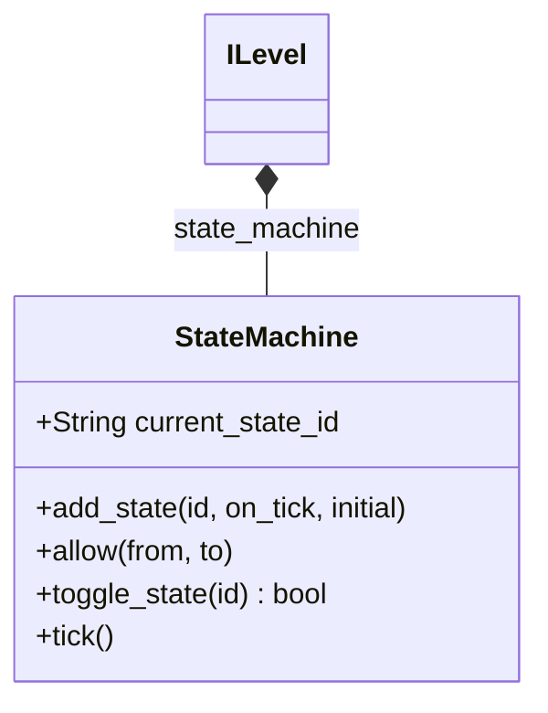
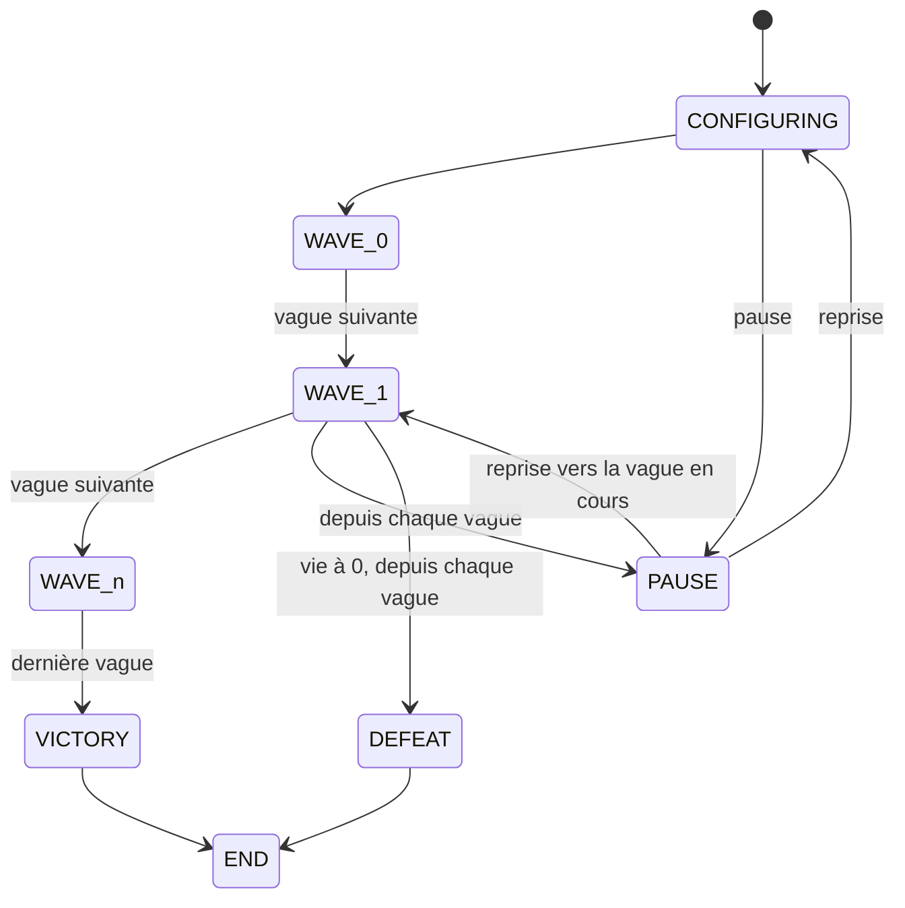

`StateMachine` (`scripts/state_machine/state_machine.gd`) est une machine d'états à transitions explicites: passer d'un état à un autre exige une transition déclarée avec `allow`. C'est une seule classe `RefCounted` qui porte les états et les transitions elle-même: ce n'est pas un nœud, elle est libérée avec sa dernière référence. Seul `ILevel` l'utilise, pour le déroulement des vagues.



| Membre | Rôle |
|---|---|
| `current_state_id: String` | Identifiant de l'état courant, vide tant que l'état initial n'est pas ajouté |
| `add_state(id: String, on_tick: Callable = Callable(), initial: bool = false)` | Enregistre l'état `id`. `on_tick` s'exécute à chaque `tick()` tant que l'état est courant. La machine démarre dans l'état ajouté avec `initial = true` |
| `allow(from: String, to: String)` | Autorise la transition de `from` vers `to` |
| `toggle_state(id: String) -> bool` | Passe à l'état `id` et renvoie `true`. Renvoie `false` avec un log `ERROR` quand l'état est inconnu ou que la transition n'est pas autorisée |
| `tick()` | Exécute le callback de l'état courant, sans rien faire quand l'état n'a pas de callback |

`add_state` refuse un identifiant déjà enregistré et `allow` refuse un état inconnu (`assert`). La machine n'émet aucun signal: l'appelant lit `toggle_state` et `current_state_id`. Un callback ne reçoit aucun argument et ne renvoie rien.

```gdscript
var machine: StateMachine = StateMachine.new()
machine.add_state("IDLE", Callable(), true)
machine.add_state("RUN", _on_run_tick)
machine.allow("IDLE", "RUN")
machine.toggle_state("RUN") # true, une transition non autorisée renvoie false
machine.tick() # appelle _on_run_tick
```

## États d'un niveau

`ILevel._build_state_machine()` appelle `add_state` pour `CONFIGURING` (initial), `VICTORY`, `DEFEAT`, `PAUSE`, `END` et `WAVE_<i>` (un par vague), puis `allow` pour chaque transition. Il n'existe pas d'état d'erreur. Le `WaveTickTimer` du niveau (un `Timer` de 0,5 s dans `i_level.tscn`) appelle `ILevel._process_tick()`, qui exécute `state_machine.tick()`: le callback de l'état courant s'exécute donc toutes les 0,5 s de temps de jeu ([Niveau et carte](/documentation/development/models/level-model/#tick-des-vagues)).



`WAVE_n` est la dernière vague. Seule elle mène à `VICTORY`, et chaque vague mène uniquement à la suivante.

| État | Callback de tick |
|---|---|
| `CONFIGURING` | Passe aussitôt à `WAVE_0` |
| `WAVE_<i>` | Exécute les étapes de la vague. Quand la vague est vide et qu'aucun ennemi n'est en vie, passe à la vague suivante ou à `VICTORY` |
| `PAUSE` | Aucun: le gel du temps est appliqué tout de suite par `ILevel._on_pause_changed()` |
| `VICTORY` | Lance `ChallengeManager.check_victory_conditions()` puis la fin de niveau (écran de victoire) |
| `DEFEAT` | Fin de niveau (écran de défaite) |
| `END` | Aucun |

Autres transitions déclarées, non montrées ci-dessus:

- `CONFIGURING` vers `DEFEAT`.
- Chaque `WAVE_<i>` vers `CONFIGURING`.
- `VICTORY` vers `CONFIGURING`.
- `DEFEAT` vers `PAUSE`.

## Pause

Il n'y a pas de méthodes `ILevel.pause()` ni `resume_from_pause()`. `ILevel` écoute `Global.pause_changed`: quand une source demande une pause pendant `CONFIGURING` ou `WAVE_<i>`, il mémorise l'état courant et bascule vers `PAUSE`. Quand toutes les sources ont libéré leur pause, il revient à l'état mémorisé. Les sources et le gel du temps sont décrits dans [Architecture](/documentation/development/guides/architecture/#pause-par-source) et [Niveau et carte](/documentation/development/models/level-model/#pause).

## Ajouter un état

1. Écrire le callback (`func _on_state_x() -> void`).
2. L'enregistrer avec `state_machine.add_state(id, _on_state_x)`.
3. Déclarer chaque transition avec `allow(from, to)`, après l'enregistrement des deux états: une transition absente est refusée par `toggle_state`.

## Tests

`tests/utilities/test_state_machine.gd` couvre la machine seule et `tests/scenes/gameplay/world/level/test_level_flow.gd` le déroulement d'un niveau ([Tests](/documentation/development/guides/testing/)).
