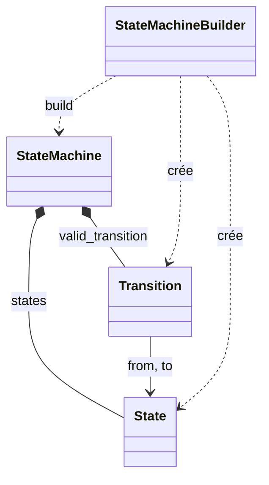
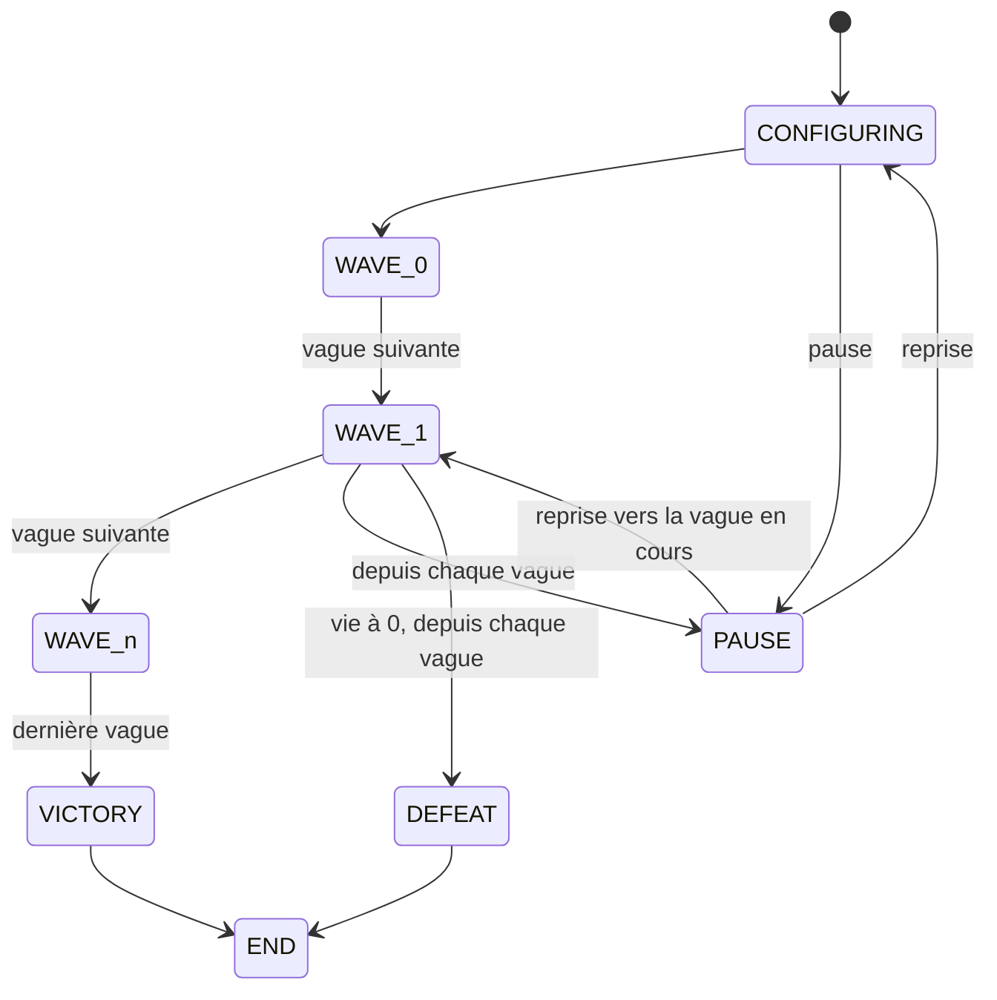

`StateMachine` (`scripts/state_machine/`) est une machine d'états à transitions explicites: passer d'un état à un autre exige une transition déclarée. Seul `ILevel` l'utilise, pour le déroulement des vagues. `StateMachine`, `State`, `Transition` et `StateMachineBuilder` étendent `RefCounted`: ce ne sont pas des nœuds, ils sont libérés avec leur dernière référence. Le builder est présenté dans [Architecture](/documentation/development/guides/architecture/#factory).



| Classe | Membres |
|---|---|
| `StateMachine` | `name`, `states`, `valid_transition`, signal `state_changed(new_state)`, `toggle_state(state_id)`, `toggle_initial_state()`, `handle_current_state(args)`, `get_current_state()`, `add_state`, `add_initial_state`, `add_transition` |
| `State` | `name`, `callback`, `handle(args)` |
| `Transition` | `from`, `to`, `callback`, `handle()` |
| `StateMachineBuilder` | `build()`, `build_state(state_id, callback)`, `build_initial_state(state_id, callback)`, `build_transition(from, to, callback)`, chacun renvoie le builder |

Il n'y a pas de fabriques `StateFactory` ni `TransitionFactory`: le builder crée directement les `State` et les `Transition`. Le callback par défaut d'un état renvoie `true`, celui d'une transition ne fait rien.

## Fonctionnement

- Un `State` porte un nom et un `Callable` qui reçoit un tableau d'arguments et renvoie un `bool`.
- `toggle_state(state_id)` cherche la transition de l'état courant vers l'état demandé. Si elle existe, l'état courant change, le callback de la transition s'exécute et `state_changed` est émis. Sinon la méthode loggue une erreur `ERROR` et renvoie `false`. Un identifiant inconnu donne le même résultat.
- `handle_current_state(args)` exécute le callback de l'état courant.
- `toggle_initial_state()` émet `state_changed` pour l'état initial, sans exécuter son callback.
- `add_state` et `add_transition` refusent les doublons (`assert`).

Le builder enchaîne les appels:

```gdscript
var builder := StateMachineBuilder.new()
builder.build_initial_state(STATE_CONFIGURING, _on_state_configuring)
builder.build_state(STATE_WAVE_0, _on_state_wave)
builder.build_transition(STATE_CONFIGURING, STATE_WAVE_0)
state_machine = builder.build()
```

Les deux états d'une transition doivent exister avant d'appeler `build_transition`.

## États d'un niveau

`ILevel._build_state_machine()` crée les états `CONFIGURING` (initial), `WAVE_<i>` (un par vague), `PAUSE`, `VICTORY`, `DEFEAT`, `ERROR` et `END`. Le `Clock` du niveau appelle `handle_current_state` toutes les 5 ticks, donc le callback de l'état courant s'exécute toutes les 0,5 s de temps de jeu.



`WAVE_n` est la dernière vague. Seule elle mène à `VICTORY`, et chaque vague mène uniquement à la suivante.

| État | Callback |
|---|---|
| `CONFIGURING` | Passe aussitôt à `WAVE_0` |
| `WAVE_<i>` | Exécute les étapes de la vague. Quand la vague est vide et qu'aucun ennemi n'est en vie, passe à la vague suivante ou à `VICTORY` |
| `PAUSE` | Ne fait rien: le gel du temps est appliqué tout de suite par `ILevel._on_pause_changed()` |
| `VICTORY` | Lance `ChallengeManager.check_victory_conditions()` puis la fin de niveau (écran de victoire) |
| `DEFEAT` | Fin de niveau (écran de défaite) |
| `ERROR` | Loggue une erreur |
| `END` | Sans callback |

Autres transitions déclarées, non montrées ci-dessus:

- `CONFIGURING` vers `DEFEAT` et `ERROR`.
- Chaque `WAVE_<i>` vers `CONFIGURING` et `ERROR`.
- `VICTORY` vers `CONFIGURING` et `ERROR`.
- `DEFEAT` vers `PAUSE` et `ERROR`.

## Pause

Il n'y a pas de méthodes `ILevel.pause()` ni `resume_from_pause()`. `ILevel` écoute `Global.pause_changed`: quand une source demande une pause pendant `CONFIGURING` ou `WAVE_<i>`, il mémorise l'état courant et bascule vers `PAUSE`. Quand toutes les sources ont libéré leur pause, il revient à l'état mémorisé. Les sources et le gel du temps sont décrits dans [Architecture](/documentation/development/guides/architecture/#pause-par-source) et [Niveau et carte](/documentation/development/models/level-model/#pause).

## Ajouter un état

1. Écrire le callback (`func _on_state_x(_args: Array = []) -> bool`).
2. L'enregistrer avec `build_state`.
3. Déclarer chaque transition avec `build_transition`: une transition absente est refusée au `toggle_state`.
