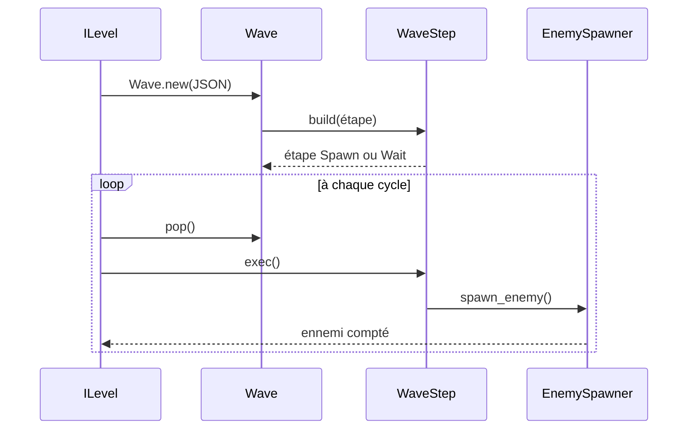
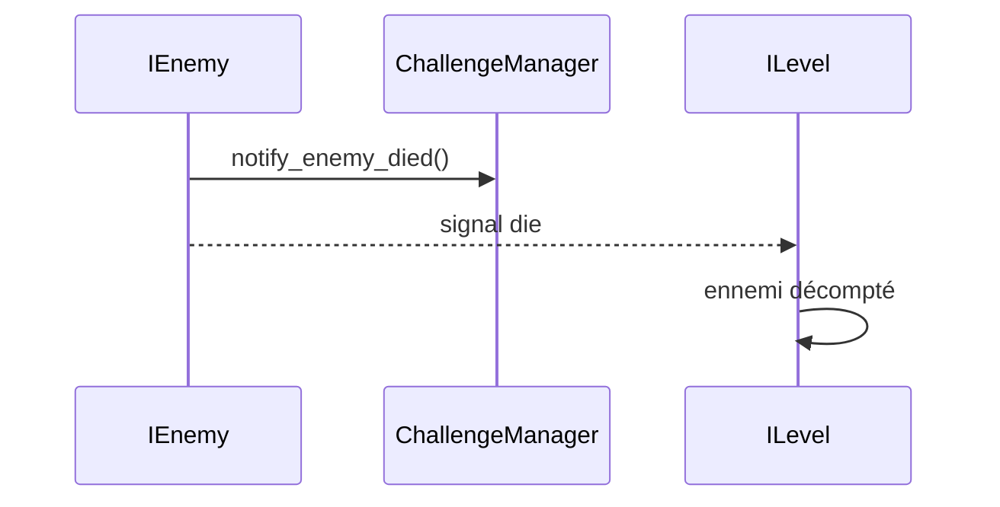

import {Badge} from '@astrojs/starlight/components';

Un niveau est une liste de vagues (`Wave`), chacune étant une liste d'étapes (`WaveStep`). `ILevel` dépile les étapes une par une jusqu'à la fin de la vague, puis passe à la suivante. Le diagramme de classes est dans [Niveau et carte](/documentation/development/models/level-model/#diagramme-de-classes).

## Du JSON à l'ennemi



À la mort d'un ennemi, ou à son arrivée au bout du chemin:



`ILevel` exécute l'étape courante à chaque cycle jusqu'à ce que `is_over()` soit vrai, puis en dépile une autre. Le signal `die` est émis aussi bien à la mort qu'à l'arrivée au bout du chemin: `ChallengeManager.notify_enemy_died` est donc appelé dans les deux cas.

## Contrat public

### Wave

- `steps: Array[WaveStep]`
- `_init(data: Array)`: construit les étapes depuis le JSON.
- `peak() -> WaveStep`: lit la prochaine étape sans la retirer.
- `pop() -> WaveStep`: retire et renvoie la prochaine étape.

### WaveStep

- `enum Order { UNDEFINED, COMMAND, SPAWN, WAIT, DIALOG }`. `COMMAND` et `DIALOG` <Badge text="non implémentés" variant="caution" />: `build()` ne crée que des étapes `SPAWN` et `WAIT`.
- `build(in_data: Dictionary) -> WaveStep`: renvoie un `WaveStepSpawn` si les clés `enemy_id`, `count` et `spawner` sont présentes, un `WaveStepWait` si `wait_s` l'est, sinon `null` avec un log `ERROR`.
- `data() -> Dictionary`: données brutes de l'étape.
- `exec()`: exécute l'étape.
- `is_over() -> bool`: indique si l'étape est terminée.
- `order() -> WaveStep.Order`: type de l'étape.

## Étapes

### Spawn

```json
{"enemy_id": "ene.01", "count": 5, "spawner": 0}
```

`enemy_id` est le nom de la scène dans `scenes/gameplay/entities/enemy/enemies/` (`ene.01` charge `ene.01.tscn`). Chaque `exec()` fait apparaître un ennemi sur le chemin `spawner` de la carte et décrémente `count`. L'étape est terminée quand `count == 0`.

`spawner` désigne un chemin de la carte (index à partir de 0):

- `-1`: chemin actif choisi au hasard
- un index invalide: repli sur un chemin actif au hasard, avec un log `WARN`
- l'index d'un chemin inactif: l'ennemi n'apparaît pas (log `ERROR`)

À la première rencontre d'un ennemi, `ProgressionManager` le marque comme vu et l'interface affiche le popup de nouvel ennemi.

### Wait

```json
{"wait_s": 3}
```

Le premier `exec()` mémorise l'heure de départ, l'étape se termine quand `wait_s` secondes se sont écoulées.

## Exemple

Une vague qui attend 1 seconde, puis fait apparaître 5 ennemis `ene.01` sur le chemin 0:

```json
{
  "waves": [
    [
      {"wait_s": 1},
      {"enemy_id": "ene.01", "count": 5, "spawner": 0}
    ]
  ]
}
```

## Dépendances

- `ILevel` pilote les étapes et les transitions.
- `EnemySpawner` place l'ennemi sur le chemin.
- `ScenesLoader` met en cache les scènes d'ennemis déjà chargées (`enemies_scene`).
- `ProgressionManager` retient les ennemis vus.

## Ajouter un type d'étape

1. Créer une classe dérivée de `WaveStep`.
2. Étendre la détection des clés dans `WaveStep.build()`.
3. Documenter la clé JSON correspondante ici.
