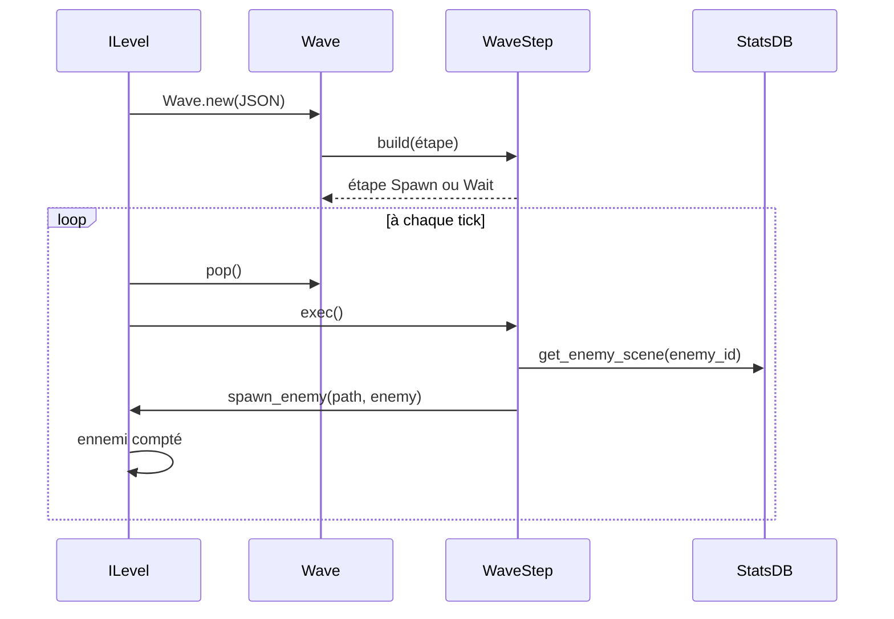
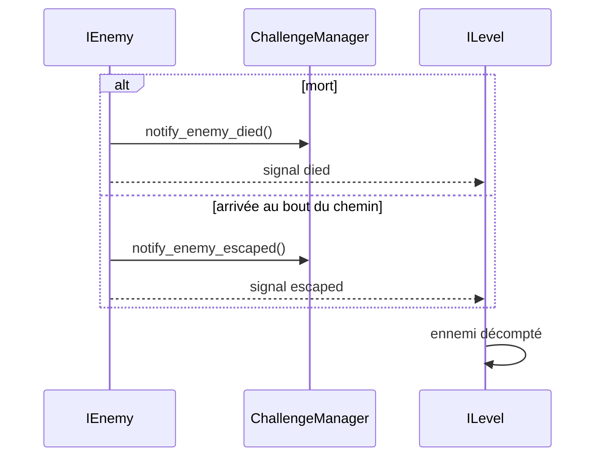

import {Badge} from '@astrojs/starlight/components';

Un niveau est une liste de vagues (`Wave`), chacune étant une liste d'étapes (`WaveStep`). `Wave`, `WaveStep` et leurs sous-classes étendent `RefCounted`. `ILevel` dépile les étapes une par une jusqu'à la fin de la vague, puis passe à la suivante. Le diagramme de classes est dans [Niveau et carte](/documentation/development/models/level-model/#diagramme-de-classes).

## Du JSON à l'ennemi



À la mort d'un ennemi, ou à son arrivée au bout du chemin:



`ILevel` exécute l'étape courante à chaque tick du `WaveTickTimer` (0,5 s, [Niveau et carte](/documentation/development/models/level-model/#tick-des-vagues)) jusqu'à ce que `is_over()` soit vrai, puis en dépile une autre. Les signaux `died` et `escaped` sont distincts: `ChallengeManager.notify_enemy_died` n'est appelé que pour une mort, et une arrivée au bout du chemin appelle `notify_enemy_escaped`. Dans les deux cas, `ILevel` décompte l'ennemi.

## Contrat public

### Wave

- `steps: Array[WaveStep]`
- `_init(data: Array)`: construit les étapes depuis le JSON. Une étape invalide est ignorée avec un log `ERROR`.
- `peak() -> WaveStep`: lit la prochaine étape sans la retirer.
- `pop() -> WaveStep`: retire et renvoie la prochaine étape.

### WaveStep

`WaveStep` est une classe `@abstract`: seules ses sous-classes `WaveStepSpawn` et `WaveStepWait` s'instancient.

- Constantes de clés JSON: `ENEMY_ID`, `COUNT`, `SPAWNER` et `WAIT_S`. `build()` ne crée que des étapes de spawn et d'attente.
- `build(in_data: Dictionary) -> WaveStep`: renvoie un `WaveStepSpawn` si les clés `enemy_id`, `count` et `spawner` sont présentes, un `WaveStepWait` si `wait_s` l'est, sinon `null` avec un log `ERROR`.
- `data() -> Dictionary`: données brutes de l'étape.
- `@abstract func exec() -> void`: exécute l'étape.
- `@abstract func is_over() -> bool`: indique si l'étape est terminée.

## Étapes

### Spawn

```json
{"enemy_id": "default_zombie", "count": 5, "spawner": 0}
```

`enemy_id` est la clé de l'ennemi dans la section `enemies` de `stats.json` (`default_zombie`, `damage_zombie`, `rat`, `small_zombie`, `splitter_zombie`, `minesweeper`, `big_daddy`). `exec()` charge la scène avec `StatsDB.get_enemy_scene(enemy_id)`, qui lit le champ `scene` de l'entrée et met la scène en cache. Chaque `exec()` instancie la scène, la place sur le chemin `spawner` de la carte avec `ILevel.spawn_enemy(path, enemy)` et décrémente `count`. L'étape est terminée quand `count` atteint 0.

`spawner` désigne un chemin de la carte (index à partir de 0):

- `-1`: chemin actif choisi au hasard
- un index invalide: repli sur un chemin actif au hasard, avec un log `WARN`
- l'index d'un chemin inactif: l'ennemi n'apparaît pas (log `ERROR`)

:::caution[Spawn impossible]
Quand la scène de l'ennemi est introuvable, que la carte n'a aucun chemin actif ou que `spawner` désigne un chemin inactif, l'étape met `count` à 0 et se termine, avec un log `ERROR`. Les ennemis restants de l'étape sont perdus, mais la vague ne reste pas bloquée à attendre des ennemis qui ne peuvent pas apparaître.
:::

À la première rencontre d'un ennemi, après un spawn réussi seulement, `ProgressionManager` le marque comme vu (`mark_enemy_seen`) et l'interface affiche le popup de nouvel ennemi ([Interface](/documentation/development/guides/ui/)).

### Wait

```json
{"wait_s": 3}
```

Le premier `exec()` mémorise `ILevel.elapsed_time`, l'étape se termine quand `wait_s` secondes de temps de jeu se sont écoulées. L'attente est donc gelée par une pause ([Niveau et carte](/documentation/development/models/level-model/#temps-de-jeu)).

## Exemple

Une vague qui attend 1 seconde, puis fait apparaître 5 zombies de base sur le chemin 0:

```json
{
  "waves": [
    [
      {"wait_s": 1},
      {"enemy_id": "default_zombie", "count": 5, "spawner": 0}
    ]
  ]
}
```

## Dépendances

- `ILevel` pilote les étapes et les transitions, et place l'ennemi sur le chemin (`spawn_enemy`).
- `StatsDB` fournit la scène de l'ennemi (`get_enemy_scene`).
- `ProgressionManager` retient les ennemis vus.

## Ajouter un type d'étape

1. Créer une classe dérivée de `WaveStep` qui implémente `exec()` et `is_over()` (abstraites).
2. Étendre la détection des clés dans `WaveStep.build()`.
3. Documenter la clé JSON correspondante ici.
