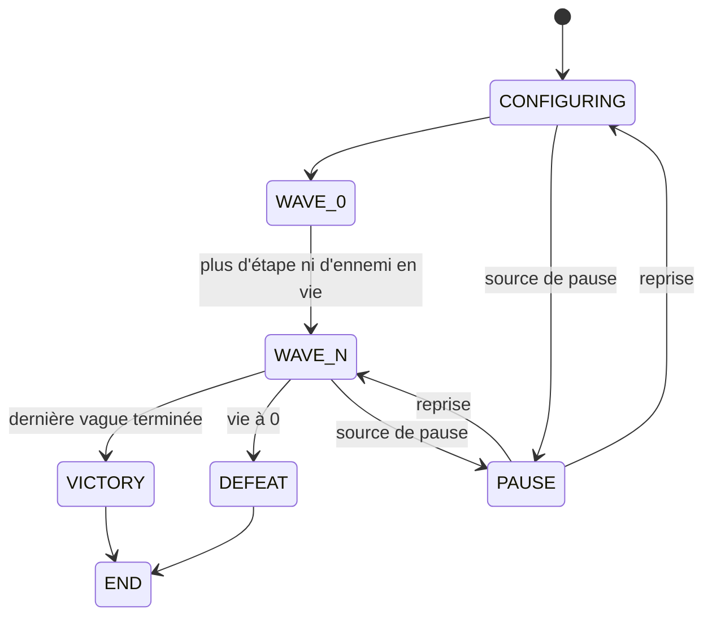
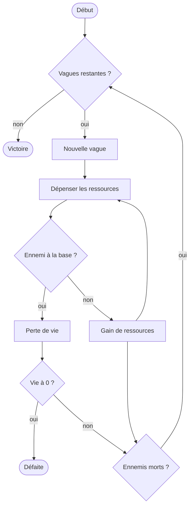
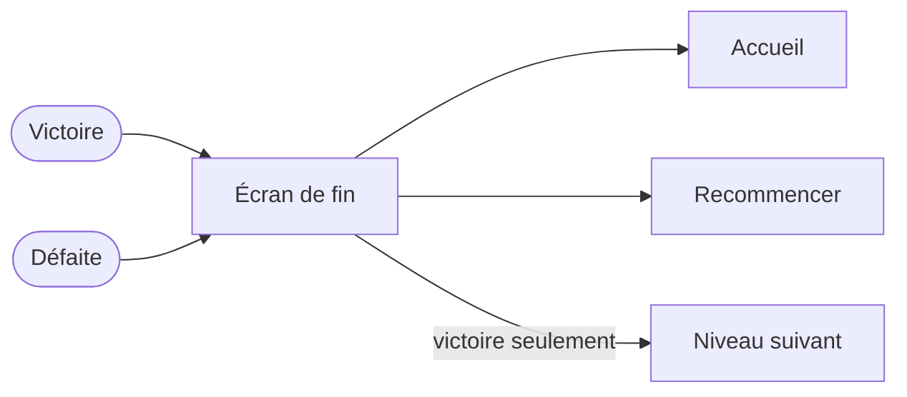

Ce que vit le joueur dans un niveau, du lancement à l'écran de fin. Voir aussi le [parcours hors niveau](/documentation/development/user-flows/off-game/).

## Déroulement

Le niveau démarre via `ScenesLoader.start_level(level_id)`. `ILevel.start_level()` lance la musique, charge la carte et les vagues, joue l'introduction des cases spéciales, puis démarre la boucle de vagues (`start_wave_flow()`). Sur `lev.01`, tant que le tutoriel n'est pas terminé, le démarrage des vagues attend l'objectif de placement du [tutoriel](/documentation/development/guides/tutorial/).

Le détail d'une vague, du côté du joueur:

La victoire et la défaite mènent à l'écran de fin:

## Actions du joueur

Pendant la boucle, le joueur peut à tout moment agir sur l'interface:

| Action | Résultat |
|---|---|
| Bouton de construction | Ouvre le menu des cartes de bâtiments. Une carte verrouillée par l'armurerie ne peut pas être choisie. Valider le placement déduit le coût des pièces |
| Clic sur une tour | Ouvre le menu radial: améliorer, vendre ou consulter les informations. L'amélioration et les informations gèlent le jeu le temps du menu |
| Bouton des défis | Ouvre le panneau latéral des défis |
| Bouton d'accélération | Multiplie la vitesse du jeu par 3. Il est ignoré tant que le temps est gelé |
| Bouton pause | Ferme le menu de construction, met le jeu en pause et ouvre le menu pause: reprendre, recommencer, accueil, encyclopédie |
| Première apparition d'un ennemi | Écran de découverte, jeu en pause le temps de l'animation |

## Pauses

Le jeu se met en pause par sources (`Global.request_pause(&"source")`). Tant qu'une source est active, `ILevel` gèle le niveau (échelle de temps et état `PAUSE`) et le restaure quand la dernière source est relâchée. Les sources du parcours en niveau:

| Source | Origine |
|---|---|
| `&"pause_menu"` | Menu pause |
| `&"tower_info"`, `&"upgrade_menu"` | Menus d'une tour |
| `&"new_enemy"` | Écran de découverte d'un ennemi |
| `&"dialogue"` | Dialogue unique (`Narrative.play_once`) |
| `&"tutorial"` | Répliques du tutoriel jouées sans action du joueur |
| `&"level_end"` | Écran de fin (le temps continue de tourner) |

Le modèle est décrit dans [Niveau et carte](/documentation/development/models/level-model/). Les menus et leurs sources sont décrits dans [Interface](/documentation/development/guides/ui/).

## Boucle de vagues

- Chaque vague enchaîne ses étapes tant que des ennemis restent à faire apparaître. La vague suivante démarre quand il n'y a plus d'étape ni d'ennemi en vie (`ILevel._on_state_wave`).
- Quand il n'y a plus de vague, le niveau passe à l'état victoire. Si la vie tombe à 0, il passe à l'état défaite (`ILevel._set_health`).
- Les états du niveau et le détail d'une vague sont décrits dans [Niveau et carte](/documentation/development/models/level-model/) et [Vagues](/documentation/development/models/wave-model/).

## Tutoriel du premier niveau

Sur `lev.01`, tant que le tutoriel n'est pas terminé, `ILevel.start_level()` ne lance pas les vagues: le `TutorialManager` les démarre après l'objectif de placement d'une tour. Voir [le tutoriel](/documentation/development/guides/tutorial/).

## Écran de fin

À la fin du niveau, `ILevel` arrête la musique et le tutoriel éventuel, puis ajoute l'écran de fin. Il affiche le temps, la vie restante et la liste des défis du niveau avec une étoile pleine ou vide. En cas de victoire, le niveau suivant est débloqué et le bouton « suivant » est visible. En cas de défaite, ce bouton est masqué.

## Dialogues uniques

Whiskas intervient à quelques moments clés, une seule fois par sauvegarde ([Dialogic](/documentation/development/guides/dialogic-guide/#dialogues-du-jeu)):

| Moment | Dialogue |
|---|---|
| Fin de l'écran de découverte d'un ennemi (hors zombie de base) | `first_new_enemy` |
| Fin de l'écran de découverte de Big Daddy | `first_boss` |
| Écran de fin après une victoire | `first_victory` |
| Écran de fin après une défaite | `first_defeat` |

Un dialogue unique est ignoré, sans être marqué comme vu, quand une autre timeline tourne (le tutoriel, par exemple). Il se joue alors à la prochaine occasion.
