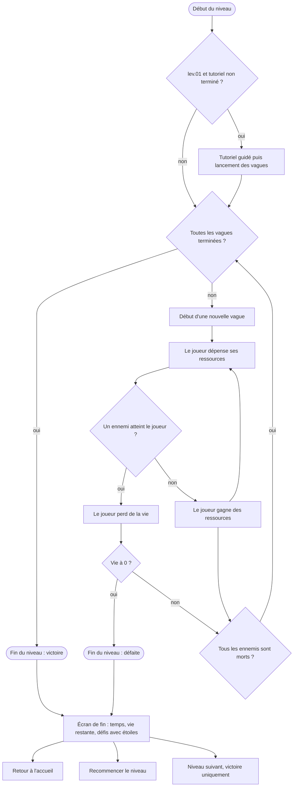
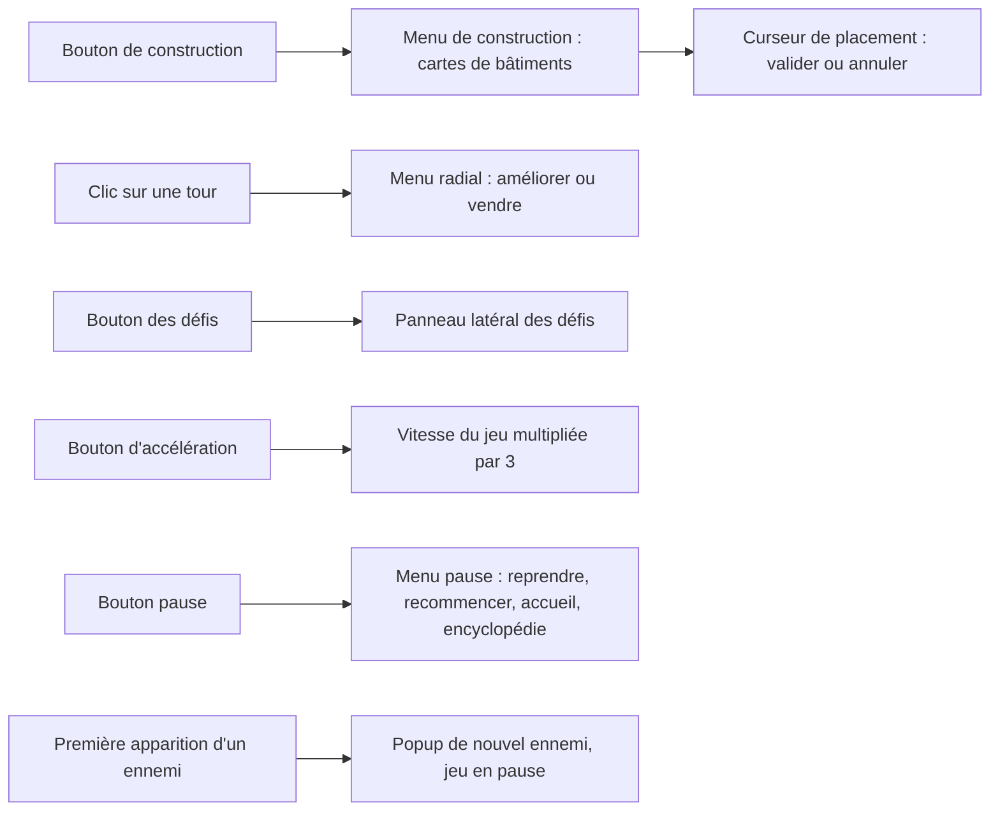

Ce que vit le joueur dans un niveau, du lancement à l'écran de fin. Voir aussi le [parcours hors niveau](/documentation/development/user-flows/off-game/).

Pendant la boucle, le joueur peut à tout moment agir sur l'interface :

## Boucle de vagues

- Chaque vague enchaîne ses étapes tant que des ennemis restent à faire apparaître. La vague suivante démarre quand il n'y a plus d'étape ni d'ennemi en vie (`ILevel._on_state_wave`).
- Quand il n'y a plus de vague, le niveau passe à l'état victoire. Si la vie tombe à 0, il passe à l'état défaite (`ILevel._set_health`).
- Les états du niveau et le détail d'une vague sont décrits dans [Niveau et carte](/documentation/development/models/level-model/) et [Vagues](/documentation/development/models/wave-model/).

## Tutoriel du premier niveau

Sur `lev.01`, tant que le tutoriel n'est pas terminé, `ILevel.start_level()` ne lance pas les vagues : le `TutorialManager` les démarre après l'objectif de placement d'une tour. Voir [le tutoriel](/documentation/development/guides/tutorial/).

## Pendant le niveau

- **Construction** : le bouton de construction ouvre le menu des cartes. Une carte verrouillée par l'armurerie ne peut pas être choisie. Valider le placement déduit le coût du bâtiment des pièces.
- **Amélioration** : un clic sur une tour active ouvre un menu radial avec l'amélioration et la vente.
- **Pause** : le bouton pause ferme le menu de construction, met le jeu en pause et ouvre le menu pause (reprendre, recommencer, retour à l'accueil, encyclopédie, musique et son).
- **Nouvel ennemi** : la première fois qu'un ennemi de ce type apparaît, une popup le présente et met le jeu en pause le temps de l'animation.

## Écran de fin

L'écran affiche le temps, la vie restante et la liste des défis du niveau avec une étoile pleine ou vide. En cas de victoire, le niveau suivant est débloqué et le bouton « suivant » est visible. En cas de défaite, ce bouton est masqué.
