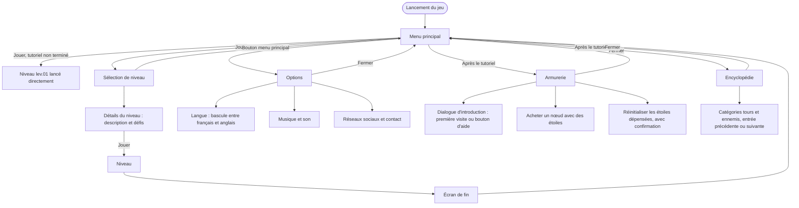

Les menus accessibles hors d'un niveau, depuis le menu principal. Voir aussi le [parcours en niveau](/documentation/development/user-flows/in-game/).

## Menu principal

- **Jouer** : si le tutoriel n'est pas terminé, `lev.01` démarre directement. Sinon, le menu de sélection de niveau s'ouvre.
- **Armurerie et encyclopédie** : les deux boutons restent verrouillés (étiquette `?`) tant que le tutoriel n'est pas terminé.
- **Options** : ouvre le menu des options, fermé par son bouton de fermeture.
- Un bouton de debug des icônes de statistiques s'ajoute dans les builds de debug.

## Sélection de niveau

Le menu affiche un cadre par niveau. Les flèches précédent et suivant changent de niveau, les indicateurs du bas montrent l'état (verrouillé, en cours, terminé). Le titre de l'arc et l'image de fond changent avec le niveau affiché. Chaque cadre présente le nom, la description et les défis du niveau avec leur étoile, ainsi que le bouton jouer. Voir [Niveau et carte](/documentation/development/models/level-model/) pour les données d'un niveau.

## Options

Le bouton de langue bascule entre `fr` et `en`, enregistre le choix dans la progression et applique les paramètres. Les boutons musique et son activent ou coupent chaque canal. Les autres boutons ouvrent les liens Discord, Instagram, X et le contact par e-mail. Les boutons « actualités » et « RGPD » n'ont pas d'action pour l'instant.

## Armurerie

La première ouverture lance le dialogue d'introduction ; le bouton d'aide le relance. Les nœuds de l'armurerie s'achètent avec les étoiles gagnées en réussissant des défis. Le bouton de réinitialisation rend les étoiles dépensées après une confirmation. Voir [Armurerie](/documentation/development/models/armory-model/).

## Encyclopédie

L'encyclopédie présente les tours et les ennemis du jeu, avec une page par entrée. Elle est aussi accessible depuis le menu pause d'un niveau.
