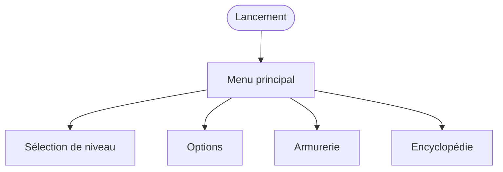
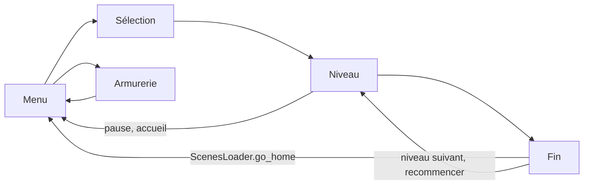

Les menus accessibles hors d'un niveau, depuis le menu principal. Voir aussi le [parcours en niveau](/documentation/development/user-flows/in-game/).

L'armurerie et l'encyclopédie restent verrouillées tant que le tutoriel n'est pas terminé. Les options, l'armurerie et l'encyclopédie se ferment par leur bouton de fermeture et reviennent au menu principal.

Le parcours d'une partie:

Quand le tutoriel n'est pas terminé, « Jouer » lance `lev.01` directement, sans passer par la sélection.

## Menu principal

- **Jouer**: si le tutoriel n'est pas terminé, `lev.01` démarre directement (`ScenesLoader.start_level("lev.01")`). Sinon, le menu de sélection de niveau s'ouvre.
- **Armurerie et encyclopédie**: les deux boutons restent verrouillés (étiquette `?`) tant que le tutoriel n'est pas terminé. L'encyclopédie affiche un point d'exclamation quand des tours ou des ennemis découverts n'ont pas encore été lus.
- **Options**: ouvre le menu des options, fermé par son bouton de fermeture.
- Un bouton de debug des icônes de statistiques s'ajoute dans les builds de debug.

Le retour à l'accueil depuis un niveau passe par `ScenesLoader.go_home()`, qui relâche toutes les pauses et recharge `main.tscn`.

## Sélection de niveau

Le menu affiche un cadre par niveau. Les flèches précédent et suivant changent de niveau (un niveau verrouillé n'est pas atteignable), les indicateurs du bas montrent l'état (verrouillé, en cours, terminé). Le titre de l'arc (`ARC.01.TITLE`, `ARC.02.TITLE`) et l'image de fond changent avec le niveau affiché. Chaque cadre présente le nom (`LEVEL.LEV_0X.NAME`), la description (`LEVEL.LEV_0X.DESC`) et les défis du niveau avec leur étoile, ainsi que le bouton jouer. Un dernier cadre annonce les niveaux à venir (`LEVEL_SELECTION.COMING_SOON`).

Le bouton jouer d'un cadre appelle `ScenesLoader.start_level(level_id)`: en cas d'échec le menu reste affiché, sinon il émet `level_selected` et l'accueil se masque. Voir [Niveau et carte](/documentation/development/models/level-model/) pour les données d'un niveau.

## Options

Le bouton de langue bascule entre `fr` et `en`, enregistre le choix dans la progression et applique les paramètres. Les boutons musique et son activent ou coupent chaque bus audio ([Audio](/documentation/development/guides/audio/)). Les autres boutons ouvrent les liens Discord, Instagram, X et le contact par e-mail. Les boutons « actualités » et « RGPD » n'ont pas d'action pour l'instant.

## Armurerie

La première ouverture lance le dialogue d'introduction (`armory_intro`, une fois par sauvegarde); le bouton d'aide le relance. Les nœuds de l'armurerie s'achètent avec les étoiles gagnées en réussissant des défis. Le premier achat d'une tour ou d'un piège lance le dialogue `armory_first_unlock`. Le bouton de réinitialisation rend les étoiles dépensées après une confirmation. Voir [Armurerie](/documentation/development/models/armory-model/) et [Dialogic](/documentation/development/guides/dialogic-guide/#dialogues-du-jeu).

## Encyclopédie

L'encyclopédie présente les tours et les ennemis du jeu, avec une page par entrée. Une tour est découverte quand elle est débloquée, un ennemi quand il est apparu dans un niveau; les autres pages affichent `?` et « non découvert ». Elle est aussi accessible depuis le menu pause d'un niveau. Voir [Interface](/documentation/development/guides/ui/#encyclopédie).
