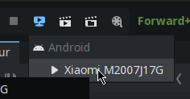

import {Steps} from '@astrojs/starlight/components';

L'éditeur Godot peut installer et lancer le jeu directement sur un téléphone Android.

## Prérequis

- Un téléphone Android et un câble USB
- Le projet ouvert dans Godot
- L'[export Android](/documentation/setup/exporting/#exporter-pour-android) configuré

Le déploiement utilise le preset **Android**: l'APK ne contient que l'architecture `arm64-v8a`, le téléphone doit donc être un appareil arm64.

## Mode développeur

Activer le mode développeur sur le téléphone:

<Steps>

1. Allez dans les paramètres du téléphone
2. Allez dans la section "À propos du téléphone"
3. Cherchez la section "Numéro de build" et appuyez dessus plusieurs fois jusqu'à ce qu'un message vous indique que le mode développeur est activé
4. Retournez dans les paramètres et cherchez la section "Options pour les développeurs"
5. Activez les options `Installer via USB` et `Débogage USB`

</Steps>

## Tester le jeu

<Steps>

1. Connectez le téléphone à l'ordinateur avec le câble USB
2. Ouvrez le projet Godot
3. Cliquez sur le bouton de déploiement à distance (`Remote Deploy` dans l'interface anglaise) en haut à droite de l'interface
4. Sélectionnez votre téléphone

</Steps>



L'application s'installe, puis se lance sur le téléphone. Les logs de l'application s'affichent dans la sortie de l'éditeur Godot.
Le dossier `res://log` n'est pas accessible dans un build Android: sur téléphone, la sortie de Godot est la seule source de logs ([Logs](/documentation/development/guides/logger/#sorties)).

Le téléphone applique les modifications du code ou des ressources sans réinstaller l'application si `Debug` > `Synchronize Script Changes` et `Synchronize Scene Changes` sont activés, ou avec un déploiement par système de fichiers réseau (`Small Deploy with Network Filesystem`).

:::tip
Avec ADB, activer le partage de fichiers via la connexion USB du téléphone n'est en général pas nécessaire. Si le téléphone n'est pas détecté, essayez ce mode.
:::

:::note
Il se peut que l'application ne soit plus lançable une fois déconnectée du câble USB, il faudra alors la réinstaller depuis un export.
:::

## Installer l'APK de la CI

L'artefact `Cataclysm-android` du workflow ([Intégration continue](/documentation/setup/ci/#job-export)) s'installe avec ADB:

```bash
adb install Cataclysm.apk
```

La console de debug est absente d'un APK exporté en release (`Global.debug` vaut `false`).

## Problèmes courants

### Le téléphone n'apparaît pas dans la liste

Si Godot ne propose aucun appareil, il n'a pas trouvé de périphérique Android connecté.
Vérifiez bien d'avoir activé le mode développeur et le débogage USB sur le téléphone, et que le téléphone est bien connecté à l'ordinateur.

### Impossible d'installer l'application

Vérifiez si l'option `Installer via USB` dans les options pour les développeurs du téléphone est bien activée.
