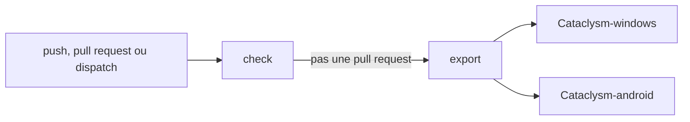

import {Steps} from '@astrojs/starlight/components';

Le workflow `Build` (`.github/workflows/build.yml` du projet Godot) vérifie le projet puis exporte le jeu. Il tourne sur `ubuntu-24.04` avec Godot 4.7.2 en headless (variable `GODOT_VERSION`), à chaque push sur `main` et `develop`, à chaque pull request vers ces branches, et à la demande (`workflow_dispatch`). Un nouveau run annule le run en cours de la même branche (`concurrency`), et le token n'a que la permission `contents: read`.

Les actions sont épinglées par leur SHA de commit (`actions/checkout`, `actions/setup-java`, `actions/cache`, `actions/upload-artifact`, `chickensoft-games/setup-godot`), avec la version en commentaire.

## Job `check`

Il tourne à chaque déclenchement, pull request comprise (15 minutes maximum).

<Steps>

1. **Godot**: `chickensoft-games/setup-godot` installe Godot 4.7.2 sans .NET (`use-dotnet: false`).
2. **Cache d'import**: `actions/cache` restaure et sauvegarde seulement `.godot/imported`, avec la clé `godot-import-<OS>-<version>-<hash des *.import et de project.godot>` et une clé de repli sur la version. `.godot/uid_cache.bin` n'est pas mis en cache: restauré depuis une clé de repli, il associerait des uids à des chemins renommés.
3. **Import**: `godot --headless --path . --import` deux fois, puis `git diff --exit-code -- project.godot`. Sur un `.godot` vide, le premier import vide `dialogic/directories/dch_directory` et `dtl_directory` dans `project.godot`: le plugin Dialogic reconstruit ces répertoires avant que les chargeurs `.dch` et `.dtl` soient enregistrés, et retire toutes les entrées. Le second import les restaure. Sans lui, les exports de la CI partiraient sans le personnage Whiskas ni ses portraits. Le `git diff` fait échouer le job si `project.godot` reste modifié.
4. **Scripts**: `godot --headless --path . --quit-after 3000 res://tools/check_scripts.tscn` compile tous les scripts, le job échoue si un script ne compile pas.
5. **Smoke test**: `godot --headless --path . --quit-after 6000 res://tools/smoke_test.tscn` charge le menu principal puis les 8 niveaux, le job échoue sur toute erreur moteur.
6. **Tests unitaires** (étape « Unit tests »): `godot --headless --path . -s res://addons/gdUnit4/bin/GdUnitCmdTool.gd -a res://tests -c --ignoreHeadlessMode -rd res://reports` lance toutes les suites gdUnit4 de `tests/`. Un échec (code de sortie `100`), des nœuds orphelins (`101`) ou une erreur de script (`105`) font échouer le job.
7. **Rapport de test**: si le job échoue, `actions/upload-artifact` publie `reports/` dans l'artefact `test-report` (14 jours, sans erreur si le dossier est absent).

</Steps>

Le fonctionnement des deux scènes est décrit dans [Vérifications headless](/documentation/development/guides/debugging/#vérifications-headless), celui des tests et de leurs codes de sortie dans [Tests](/documentation/development/guides/testing/). Les mêmes commandes se lancent en local.

## Job `export`

Il dépend de `check` et ne tourne pas sur les pull requests (30 minutes maximum).

<Steps>

1. **Outils**: Java 17 (Temurin) et Godot 4.7.2 avec les templates d'export (`include-templates: true`).
2. **Import**: même cache `.godot/imported` et même commande d'import que `check`.
3. **Windows**: `godot --headless --path . --export-release "Windows Desktop" exports/windows/Cataclysm.exe`.
4. **Keystore**: le secret `KEYSTORE_BASE64` est décodé en `$RUNNER_TEMP/Cataclysm.keystore` (droits `600`). S'il est vide, l'étape publie une annotation `notice` et l'APK n'est pas signé avec le keystore de release.
5. **Android signé**: avec le keystore, `godot --headless --path . --export-release "Android" exports/android/Cataclysm.apk`. Godot lit sa signature dans trois variables d'environnement: `GODOT_ANDROID_KEYSTORE_RELEASE_PATH` (le keystore décodé), `GODOT_ANDROID_KEYSTORE_RELEASE_USER` (`Cataclysm`) et `GODOT_ANDROID_KEYSTORE_RELEASE_PASSWORD` (le secret `KEYSTORE_PASSWORD`). Le preset n'est pas modifié.
6. **Android sans secret**: sans keystore, `godot --headless --path . --export-debug "Android" exports/android/Cataclysm.apk` exporte avec le keystore debug.
7. **Vérification**: avec les derniers `build-tools` du SDK Android du runner, `apksigner verify` contrôle la signature et `zipalign -c -P 16 4` contrôle l'alignement des pages sur 16 Ko. Le job échoue si l'un des deux échoue.
8. **Artefacts**: `Cataclysm-windows` (`exports/windows/Cataclysm.exe`) et `Cataclysm-android` (`exports/android/Cataclysm.apk`), conservés 14 jours. Le job échoue si un fichier manque (`if-no-files-found: error`).

</Steps>

## Secrets

| Secret | Contenu |
|---|---|
| `KEYSTORE_BASE64` | Keystore de signature encodé en base64 (alias `Cataclysm`) |
| `KEYSTORE_PASSWORD` | Mot de passe du keystore, transmis à Godot par `GODOT_ANDROID_KEYSTORE_RELEASE_PASSWORD` |

Le workflow ne produit que des APK: l'AAB du Play Store n'est pas possible avec un export sans Gradle ([Exporter le jeu](/documentation/setup/exporting/#format-apk-et-aab)).
